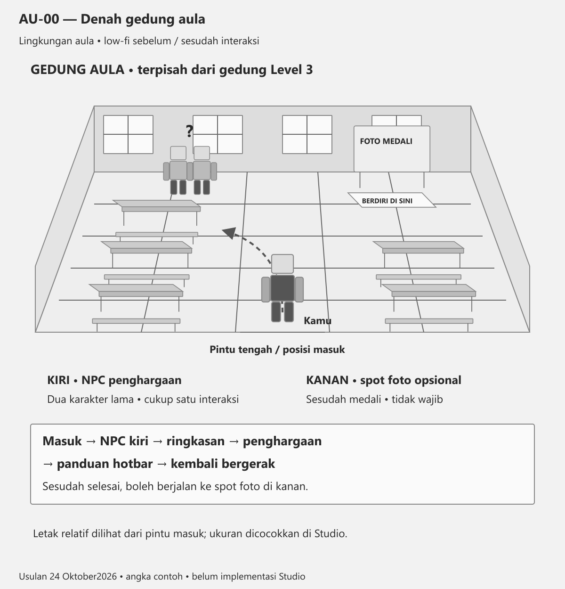
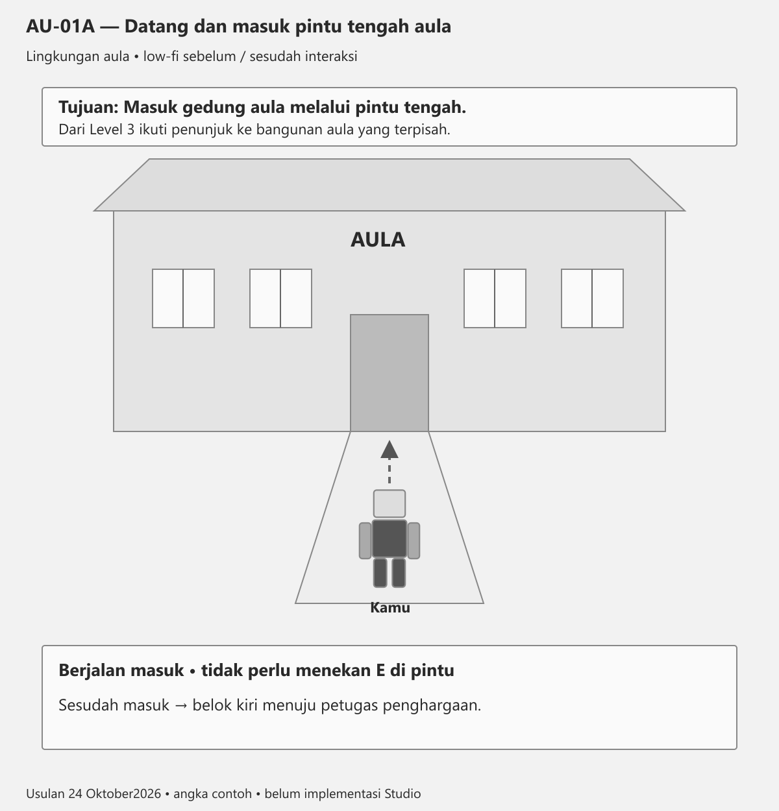
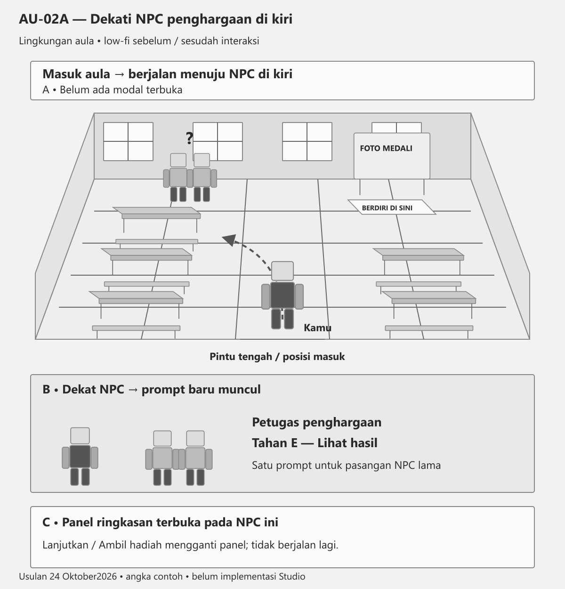
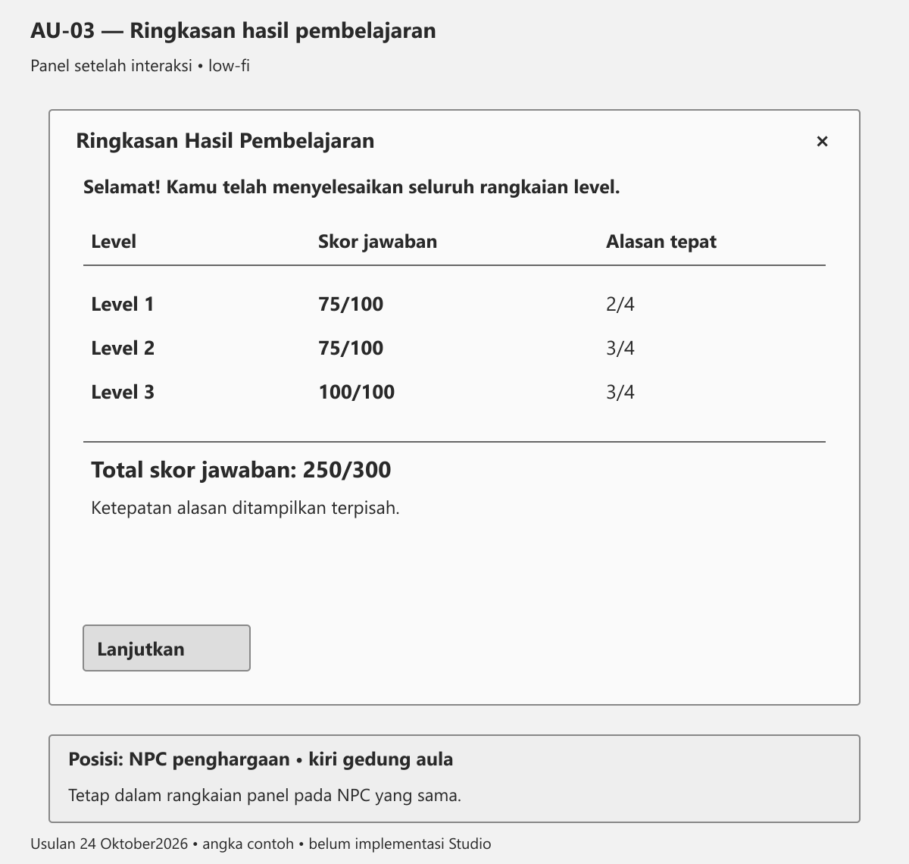
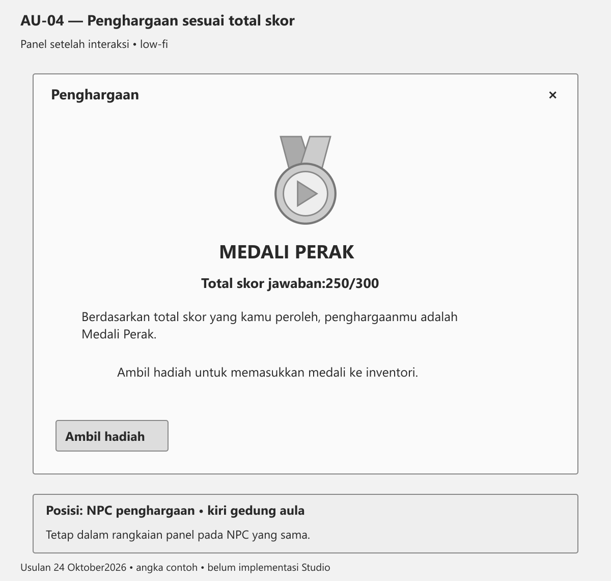
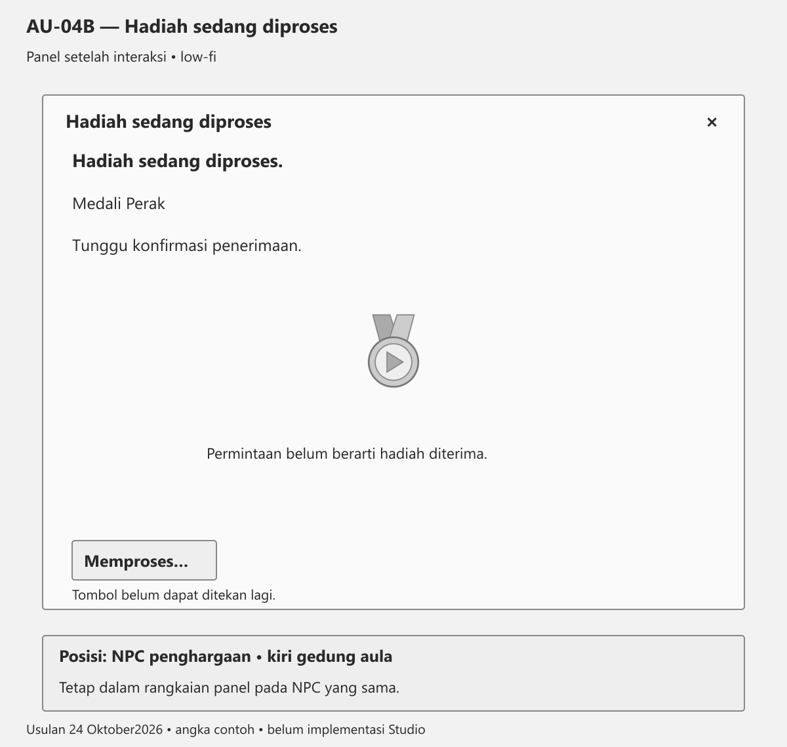
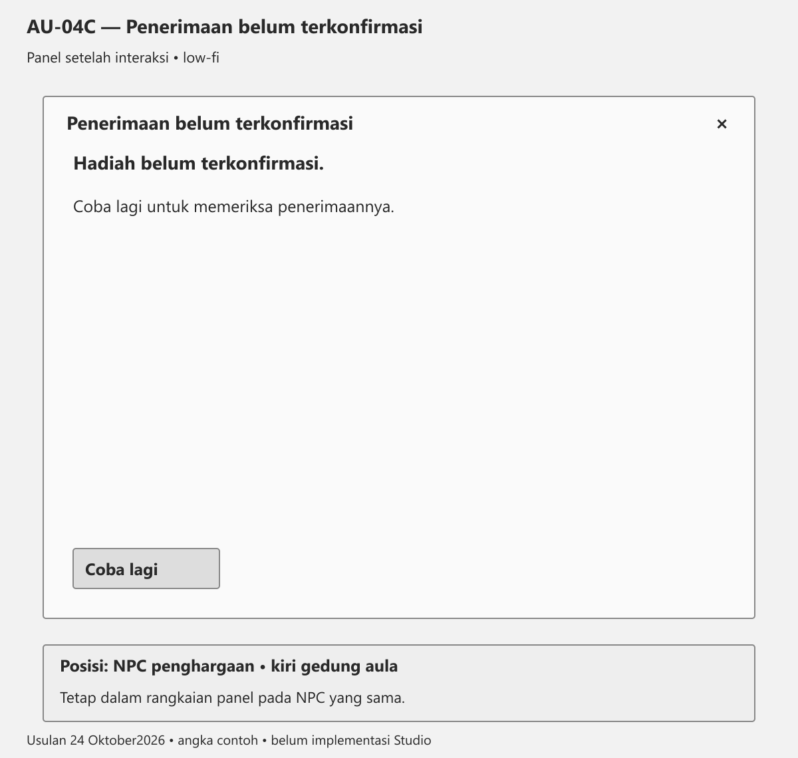
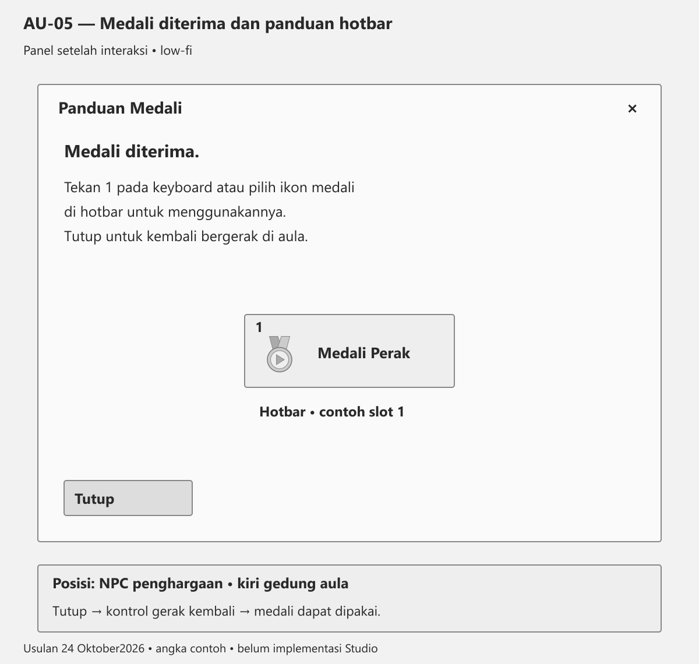
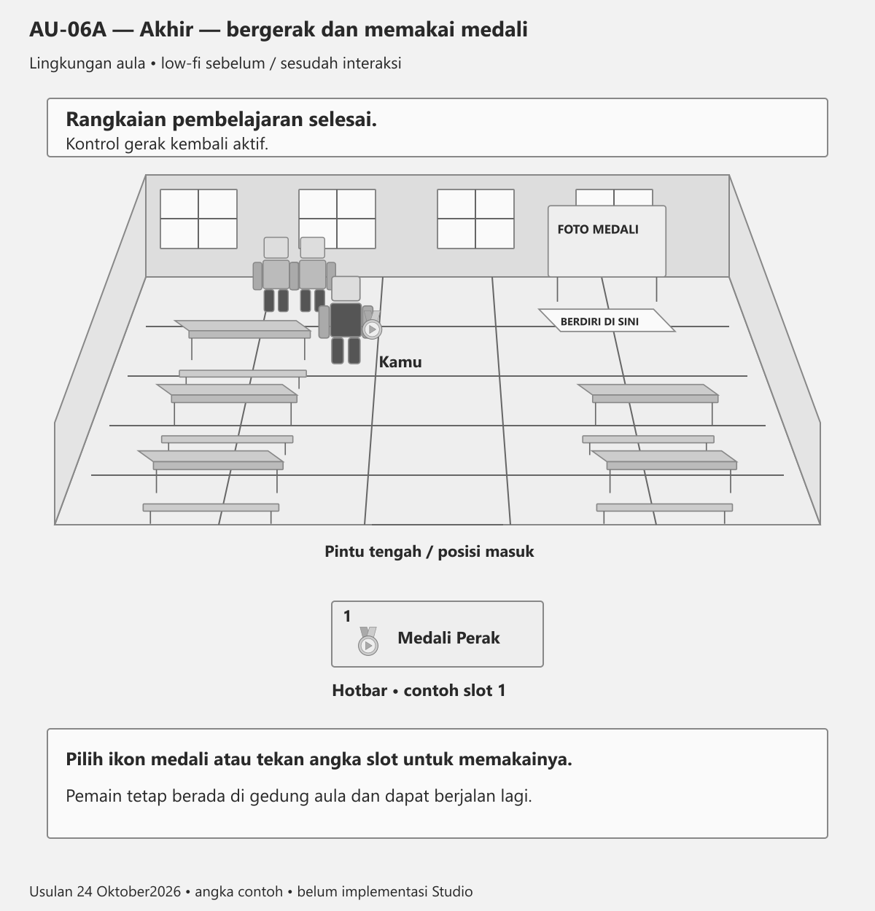
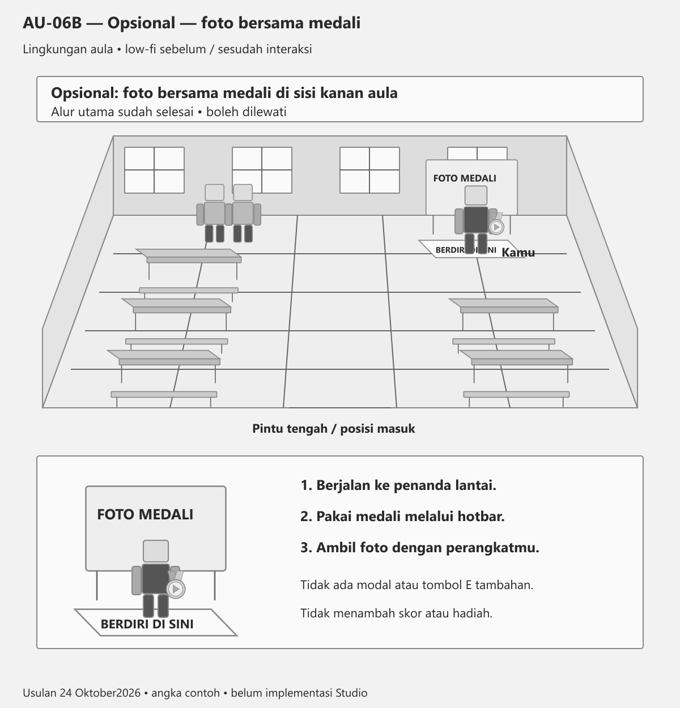

# Storyboard Aula — rancangan24Oktober2026

Aula bangunan tersendiri, pintu tengah danNPC kiri. Sumber bentuk/wording foto 58–63 DocsAll dan pembacaan read-only SummaryHandler/GiveMedalHandler; pemeriksaan prasyarat/konfirmasi penerimaan adalah rancangan pengembangan.

## AU-00 — Denah gedung aula

Perilaku: Aula adalah GEDUNG TERPISAH dari Level 3. Denah hanya aula: pintu tengah depan; NPC penghargaan di kiri dilihat saat masuk sesuai arahan pengguna. Dua NPC lama memakai satu titik SummaryProximity, bukan dua tugas bicara. Meja/bangku lama kiri-kanan dan jalur tengah bebas, tanpa latihan/ruangan baru. Sisi kanan belakang diusulkan spot foto opsional sesudah menerima medali; satu area bangku dilonggarkan agar akses jelas. Bentuk acuan foto 58–63; posisi kiri mengikuti pengguna, bukan tafsiran arah kamera foto. Ukuran/koordinat masih relatif dan perlu dicocokkan di Studio. Rute: masuk→NPC kiri→ringkasan→penghargaan→panduan hotbar→bergerak lagi.

## AU-01A — Datang dan masuk pintu tengah aula

Tujuan: Masuk ke gedung aula.

Perilaku: Pintu aula hanya dapat dilewati setelah Level 3 lulus minimal 75. Sebelum itu, pemain tetap di luar dengan tulisan “Selesaikan Level 3 terlebih dahulu”; tidak membuka modal dan tidak memakai tombol E di pintu. Sesudah terbuka, dari gedung Level 3 yang terpisah ikuti penunjuk, masuk pintu tengah aula, lalu menuju NPC kiri pada AU-02A. Tidak menambah tugas perjalanan atau teleport. Bentuk fasad dan arah antargedung masih relatif; cocokkan di Studio. Materi, latihan dan evaluasi Level 1–3 tetap.

## AU-02A — Dekati NPC penghargaan di kiri

Tujuan: Temui petugas penghargaan.

Petugas penghargaan

Tahan E — Lihat hasil

Perilaku: Dari pintu tengah, berjalan menuju NPC kiri melalui jalur bangku yang lapang. Setelah dekat, tahan E pada satu SummaryProximity untuk pasangan NPC lama. Pemain yang masuk aula melalui alur normal sudah lulus ketiga level karena akses gedung berurutan. NPC langsung membuka ringkasan, tanpa panel penolakan “belum semua level selesai”. Jika data hasil sedang dimuat, tampil status menunggu pada panel yang sama, bukan angka nol atau medali tebakan. Pergantian panel tetap pada NPC yang sama.

## AU-03 — Ringkasan hasil pembelajaran

Selamat! Kamu telah menyelesaikan seluruh rangkaian level.

Level 1:75/100 • Alasan tepat:2/4

Level 2:75/100 • Alasan tepat:3/4

Level 3:100/100 • Alasan tepat:3/4

Total skor jawaban:250/300

Perilaku: Wording mengikuti foto 60, penyesuaian untuk memisahkan alasan dari skorjawaban. Semua angka contoh tampilan, bukan data penelitian; ambil nilai aktual ketiga Level . Total hanya penjumlahan tier1:75+75+100=250, tidak menambah latihan/alasan. Masing-masingLevel haruslulus75. Lanjutkan mengganti ke04 pada interaksi yang sama; karakter tetap di NPC kiri, kontrol gerak berhenti selama modal terbuka. ×menutup dan mengembalikan kontrol; buka lagi melanjutkan hasil tanpa reset.

## AU-04 — Penghargaan sesuai total skor

Berdasarkan total skor yang kamu peroleh,

penghargaanmu adalah:

MEDALI PERAK

Total skor jawaban:250/300

Ambil hadiah untuk memasukkan medali ke inventori.

Perilaku: Contoh total250→SilverMedal. Pemetaan baselineSummaryHandler:225BronzeMedal/perunggu,250SilverMedal/perak,275GoldMedal/emas,300PlatinumMedal/platinum. Empat totaldiskret berasal dari tiga skor kelipatan25 yang masing-masingminimal75. Gambar/teks medali mengikuti total aktual; tidak mengartikan medali sebagai sertifikat kemampuan bahasa. Ambil hadiah memulai satu permintaan, lalu04B; jangan langsung menyatakan diterima. Server memeriksa progres/total/jenis medali dan hadiah yang sudahada di Backpack ATAU Character. Rancangan pemeriksaan ini belumterujiStudio.

## AU-04B — Hadiah sedang diproses

Hadiah sedang diproses.

Medali Perak

Tunggu konfirmasi penerimaan.

Perilaku: Keadaan panel yang sama setelah Ambilhadiah. Tombol dinonaktifkan agar klik cepat tidak mengirim permintaan ganda. Kesuksesan hanya setelah status/keberadaan tool terkonfirmasi, bukan sesudah FireServer. Konfirmasi→05. Gagal atau belumada kepastian setelah menunggu→04C; jangan mengganti teks menjadi sukses. ×boleh menutup dan mengembalikan gerak tanpa membatalkan permintaan; saat dibuka lagi, lanjutkan status aktual tanpa permintaan ganda atau hadiah baru. Ini kebutuhan pengembangan, bukan perilaku baseline yang sudah diuji.

## AU-04C — Penerimaan belum terkonfirmasi

Hadiah belum terkonfirmasi.

Coba lagi untuk memeriksa penerimaannya.

Perilaku: Cabang bila pengiriman gagal atau belum terkonfirmasi; bukan langkah wajib alur normal. Tidak berarti pasti belumada tool karena respons dapat terlambat. Coba lagi meminta pemeriksaan status/permintaan yang idempoten: cek Backpack/Character atau catatan penerimaan sesi dahulu; bila sudahada→05, jangan clone lagi. Jika memang belumada dan prasyarat sah, proses pemberian. ×menutup dan mengembalikan gerak; progres dan status klaim tetap. Tidak menampilkan Medali diterima sebelum kondisi sukses aktual.

## AU-05 — Medali diterima dan panduan hotbar

Medali diterima.

Tekan 1 pada keyboard atau pilih ikon medali

di hotbar untuk menggunakannya.

Tutup untuk kembali bergerak di aula.

Perilaku: Mengikuti foto 62. Hanya tampil setelah tool medali aktual terkonfirmasi di Backpack/Character. Contoh slot1; bila indeks slot berbeda, tampilkan angka/penanda sesuai slot aktual, bukan selalu1. Nama/ikon mengikuti medali aktual. Tutup menutup seluruh rangkaian hasil, melepas kunci kontrol, dan menyelesaikan penunjuk/prompt pemberian. Jika panel sempat ditutup sebelum panduan, interaksiNPC melanjutkan panduan penerimaan tanpa memberi tool baru. Tidak menambah cutscene, konfeti, sertifikat atau lencana baru.

## AU-06A — Akhir — bergerak dan memakai medali

Rangkaian pembelajaran selesai.

Medali dapat dipakai dari hotbar.

Perilaku: Karakter berada di depanNPC kiri dalam gedung aula yang sama, kontrol gerak kembali aktif dan medali dapat dipakai. Kamera/prop relatif terhadap pintu, belumCFrame terukur. Penunjuk serta prompt tugas hadiah selesai tidak terus menyuruh pemain berinteraksi. Mengacu foto 63. Hasil sesi tetap; kebijakan lintassesi belumdikunci. Selesainya gameplay tidak menyatakan pascates/kuesioner penelitian selesai; keduanya mengikutiSOP terpisah. Tidak menambah latihan atau tugas wajib sesudah medali; spotfoto06B boleh dilewati.

## AU-06B — Opsional — foto bersama medali

Berdiri di spot foto sisi kanan aula.

Pakai medali dari hotbar, lalu ambil foto sendiri.

Perilaku: Pilihan tambahan setelah alur utama selesai, bukan syarat kelulusan atau tugas baru. Sisi kanan mendapat latar foto sederhana dan penanda lantai; gunakan area kosong agar tidak menghalangi pintu atau jalur bangku. Denah mengusulkan sudut kanan belakang; penempatan perlu dicocokkan di Studio. Pemain berjalan sendiri dariNPC kiri ke kanan, memilih tool medali melalui hotbar, lalu memakai fitur tangkapan layar perangkat. Tidak membuka modal, tidak ada prompt E, upload, kamera khusus, skor atau hadiah tambahan. CukupPart latar/penanda dan medali yang sudahada. Tidak perlu sistem pose baru.

