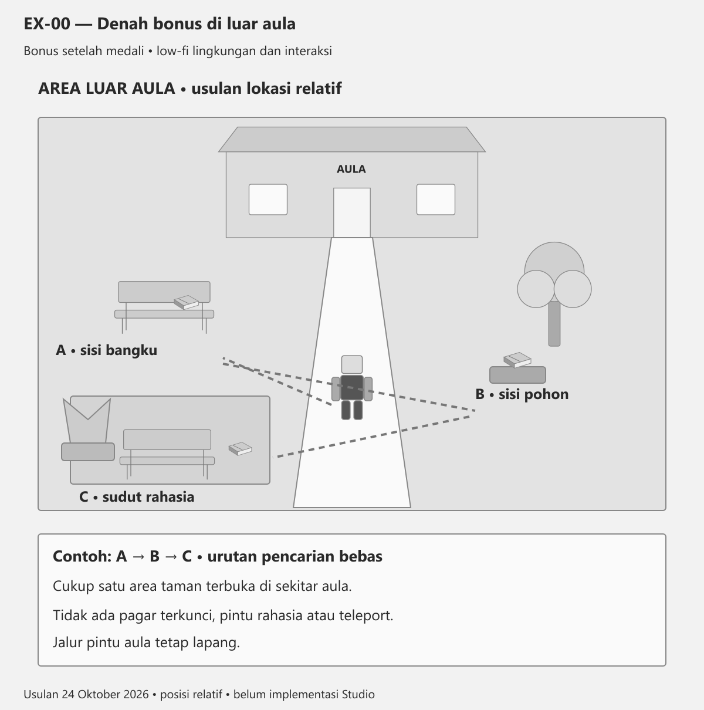
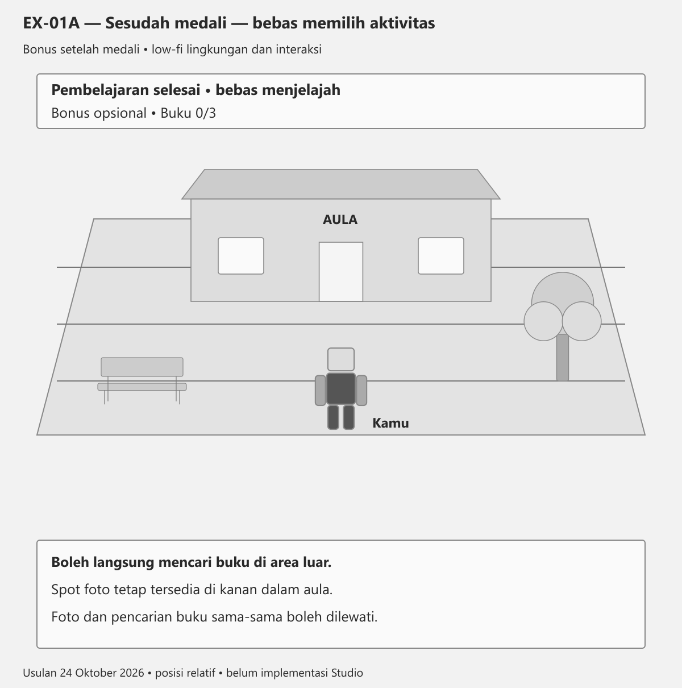
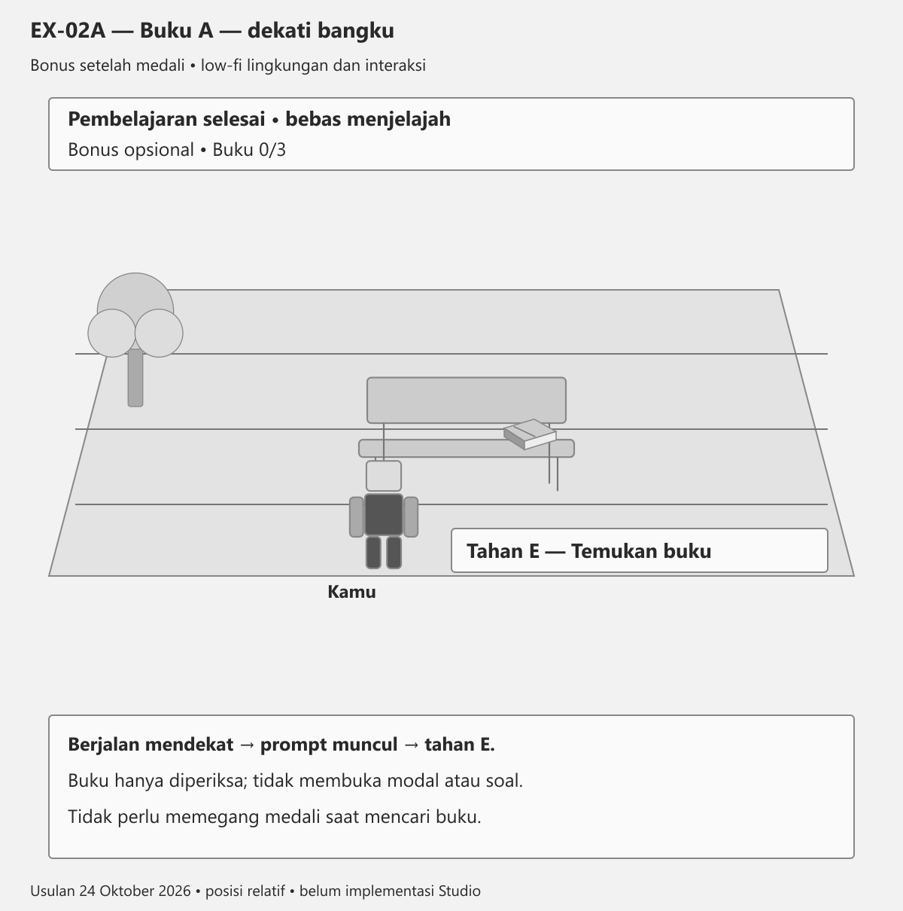
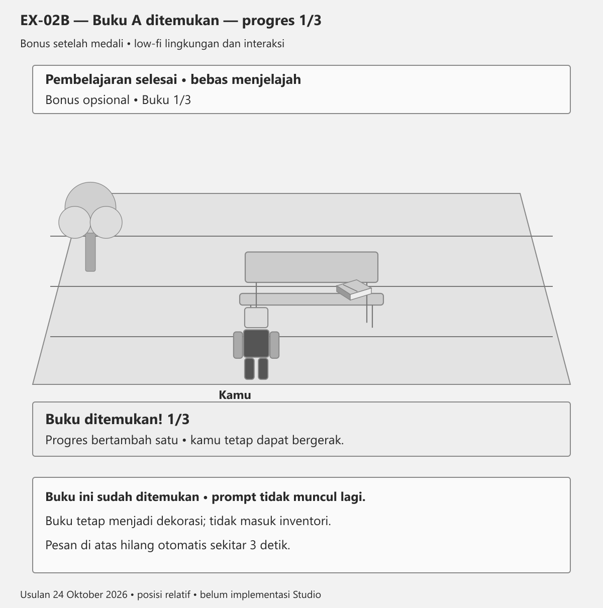
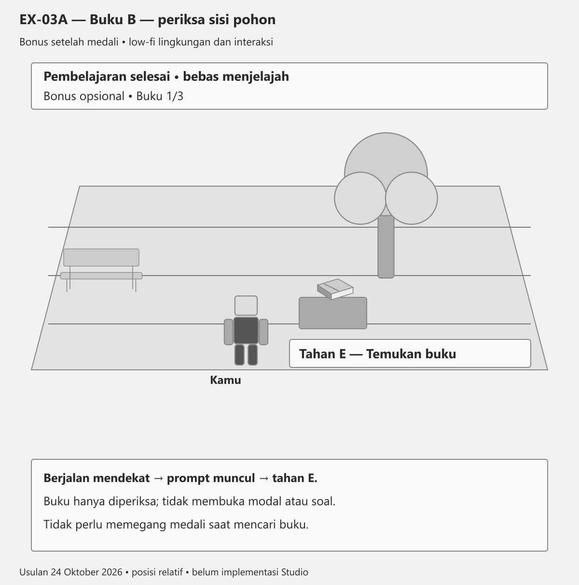
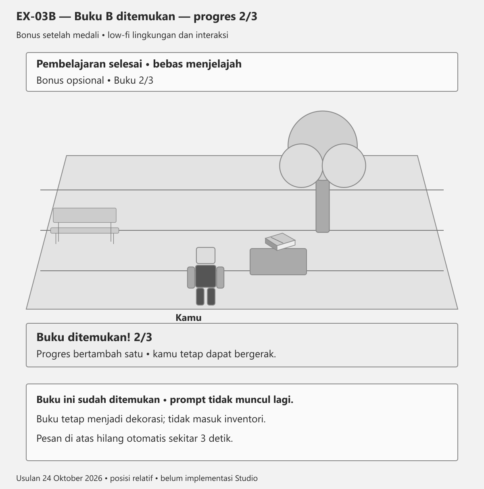
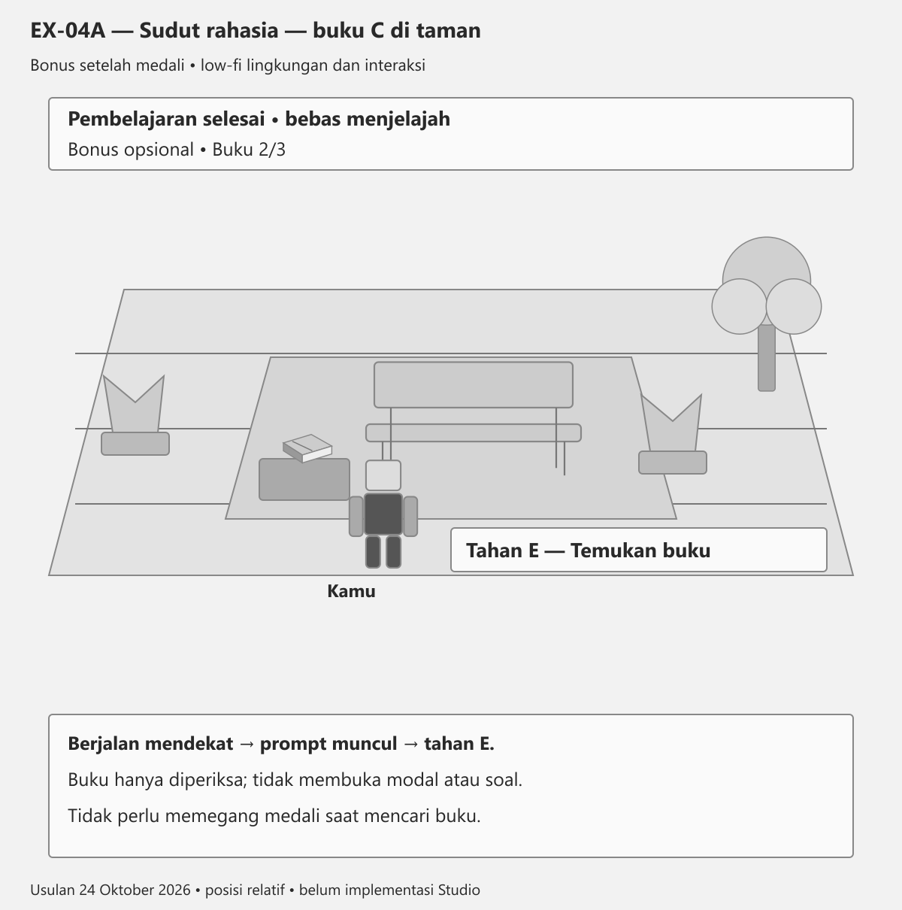
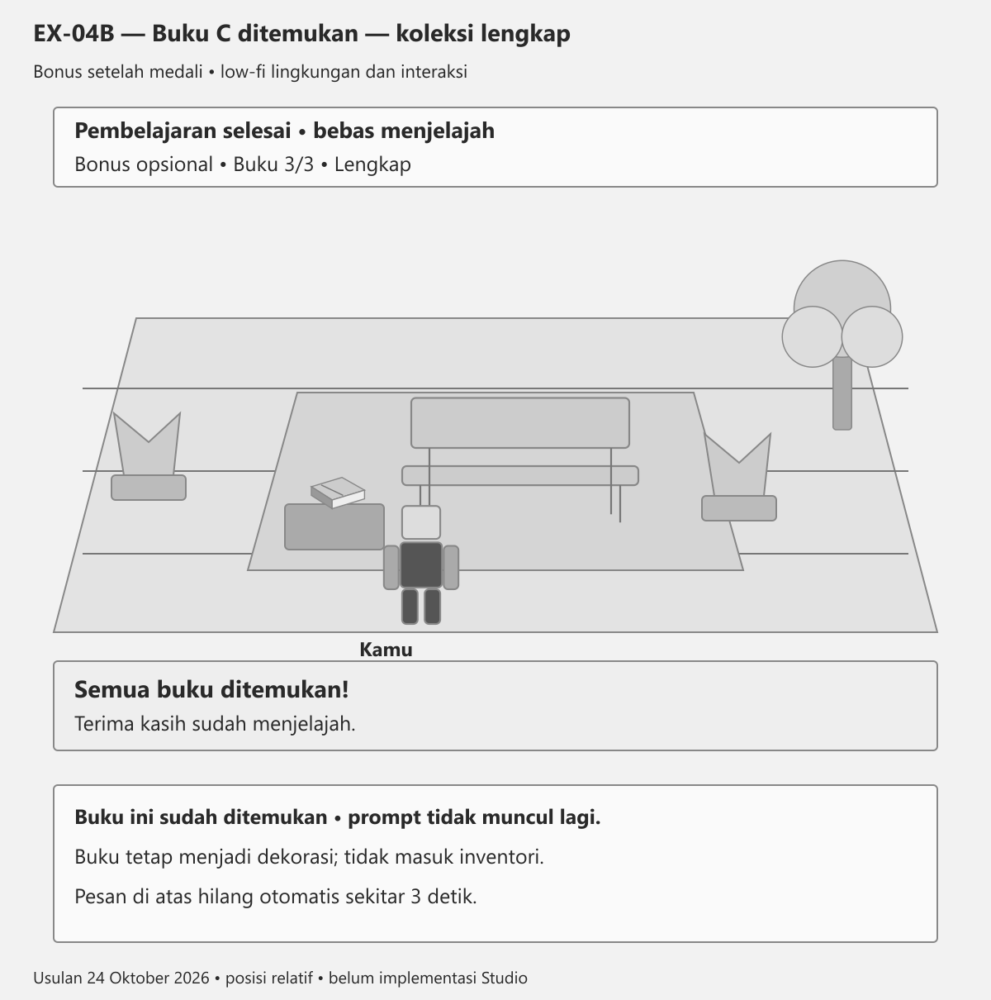
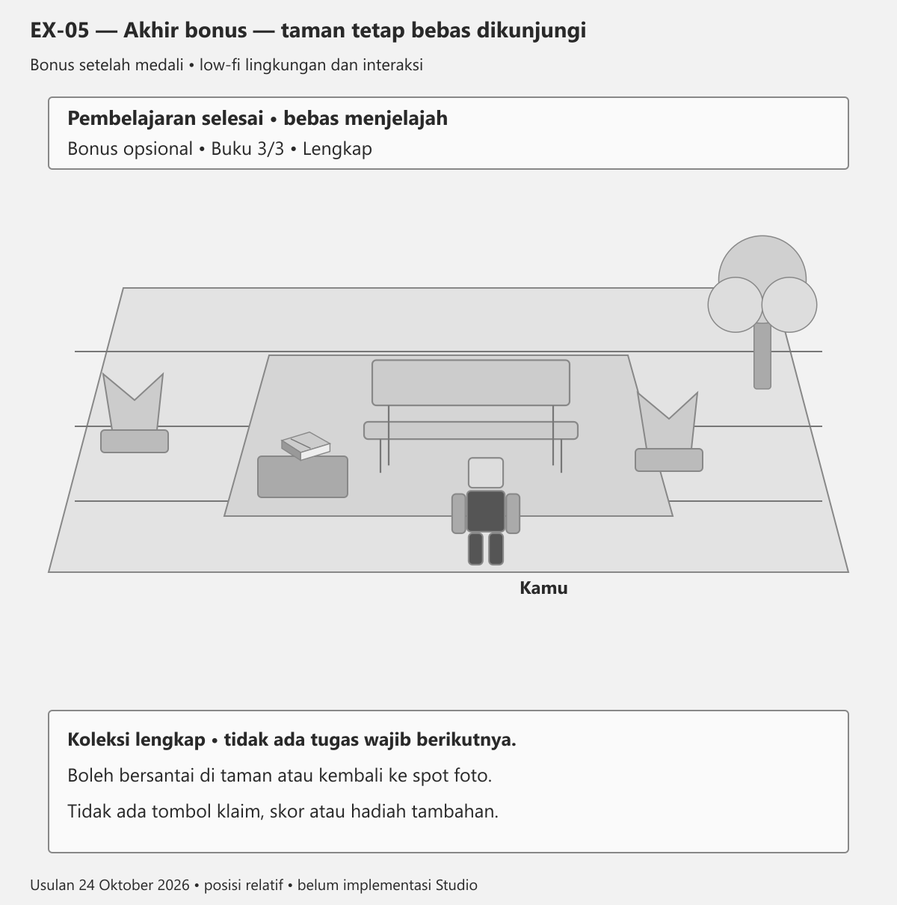

# Bonus luar aula — tiga buku dan sudut rahasia

Rancangan 24 Oktober 2026. Foto medali telah diterima pengguna; bonus ini mengikuti izin pengguna untuk pencarian buku dan sudut rahasia yang mudah dikembangkan. Urutan contoh A–B–C, bukan kewajiban.

## EX-00 — Denah bonus di luar aula

Usulan satu kantong area luar dekat aula, bukan denah seluruh map atau koordinat Studio. Gedung aula tetap terpisah dari Level 2/3. A: buku di sisi bangku; B: buku di dekat pohon; C: buku di sudut taman rahasia. Ketiganya dapat ditemukan dalam urutan bebas. A/B/C adalah kode desain, bukan label wajib di game. Sudut rahasia hanya ruang terbuka dengan bangku dan tanaman, tanpa pintu, kunci, teleport atau bangunan baru. Cocokkan area kosong dan aset taman aktual di Studio; jalur pintu aula harus tetap lapang.

## EX-01A — Sesudah medali — bebas memilih aktivitas

Setelah medali diterima dan panduan ditutup, bonus koleksi aktif untuk pemain tersebut. HUD kecil menampilkan Bonus opsional • Buku 0/3. Pemain boleh foto di kanan dalam aula, langsung berjalan keluar dan mencari buku, atau melewati keduanya. Tidak harus foto dahulu dan tidak ada tombol Mulai atau modal baru. Contoh gambar sudah di luar pintu aula; HUD mulai aktif dari penutupan panduan, tanpa menambah trigger keluar gedung. Tujuan utama pembelajaran sudah selesai.

## EX-02A — Buku A — dekati bangku

Contoh urutan dimulai dari A. Berjalan ke bangku di area luar; buku tetap terlihat di sisi bangku dan tidak menutup jalur. Saat dekat, muncul prompt bawaan Tahan E — Temukan buku. Tidak membuka bacaan, pertanyaan atau inventori. Prompt hanya aktif jika bonus tersedia dan buku A belum ditemukan pemain ini. Medali tidak harus sedang dipegang.

## EX-02B — Buku A ditemukan — progres 1/3

Sesudah interaksi sah, ID A ditandai ditemukan untuk pemain ini; HUD menjadi 1/3 dan pesan Buku ditemukan! 1/3 muncul singkat, sekitar tiga detik. Tidak ada modal dan gerak tetap aktif. Buku fisik tetap sebagai dekorasi; prompt hilang untuk pemain yang sudah menemukannya, sementara pemain lain masih dapat berinteraksi. Mengulang interaksi tidak menambah hitungan.

## EX-03A — Buku B — periksa sisi pohon

Contoh melanjutkan dari A ke B, tetapi urutan bebas. Buku B diletakkan di atas batu rendah di dekat pohon agar terlihat, tanpa memanjat, melompat atau obby. Saat dekat, Tahan E — Temukan buku muncul dengan pola yang sama. HUD tetap 1/3 sebelum interaksi; berjalan ke lokasi tidak otomatis menghitung penemuan.

## EX-03B — Buku B ditemukan — progres 2/3

Interaksi buku B menambahkan ID baru, memperbarui HUD menjadi 2/3 dan menampilkan Buku ditemukan! 2/3 selama sekitar tiga detik. Prompt buku B hilang hanya untuk pemain ini; buku dan pohon tidak perlu animasi atau menghilang. Tidak memberi poin atau hadiah. Apabila buku B ditemukan pertama, angka menjadi 1/3; angka pada gambar hanyalah contoh urutan A–B–C.

## EX-04A — Sudut rahasia — buku C di taman

Sudut rahasia berupa ceruk taman terbuka di sisi area luar aula: bangku, tanaman yang sudah ada, dan jalur masuk pendek. Boleh dikunjungi tanpa mencari buku lain dahulu; tidak ada pagar terbuka, ruangan tersembunyi atau teka-teki kunci. Buku C ada di atas alas rendah dekat bangku, bukan tertutup tanaman. Saat dekat, gunakan prompt yang sama. Contoh HUD 2/3 mengikuti A–B lebih dahulu.

## EX-04B — Buku C ditemukan — koleksi lengkap

Contoh C adalah buku ketiga. HUD menjadi Buku 3/3 • Lengkap; satu pesan Semua buku ditemukan! Terima kasih sudah menjelajah. tampil singkat, sekitar tiga detik, lalu hilang. Tidak ada tombol klaim, panel hasil, skor, medali atau hadiah tambahan. Apabila buku terakhir sebenarnya A atau B, pesan selesai muncul di lokasi itu, tanpa teleport ke sudut rahasia. Prompt semua buku yang sudah ditemukan tetap nonaktif untuk pemain ini.

## EX-05 — Akhir bonus — taman tetap bebas dikunjungi

Sesudah pesan selesai hilang, dunia tetap aktif dan pemain boleh berjalan di taman, kembali ke spot foto medali, atau mengakhiri sesi. Tidak perlu tombol Duduk atau mekanik pose baru; bangku cukup dekorasi, fungsi Seat yang sudah ada boleh dipakai jika tersedia. Progres bonus sederhana hanya tiga ID per pemain selama sesi; keluar dan masuk kembali boleh mengulang bonus tanpa mengubah skor, medali atau akses gedung utama. Bonus bukan syarat kelulusan atau penanda pascates/kuesioner penelitian selesai.

