# Storyboard usulan Level 2 — 24 Oktober 2026

Acauan: foto25–39 tab [23 April] REVIEW ROBLOX dan tab Peta tujuan pembelajaran tiga level pada rancangan aktif. Materi/soal/kunci dipertahankan; latihan/penempatan baru belum diterima sebagai final.

## L2-00 — Peta kegiatan di dalam gedung

Perilaku: Denah relatif dikoreksi mengikuti penjelasan pengguna 24 Oktober: pintu di tengah sisi depan. Kiri/kanan dilihat saat pemain masuk. M1 NPC+meja, M2 istilah dan M3 papan berita tetap di sayap kiri; susunan rinci objek lama dicocokkan di Studio. Sayap kanan yang semula kosong menampung M4 meja bukti, M5 panel pasangan dan M6 kios evaluasi dekat akses keluar. Jalur tengah bebas tanpa sekat baru. Rute: pintu → M1 → M3 → M4 → M5 → M6 → pintu yang sama. M2 opsional. Ini usulan penempatan, bukan koordinat terukur atau perubahan map Studio. M1–M6 bukan enam ruangan atau enam NPC. Satu gedung kotak tanpa sekat: kelompok objek lama di kiri; dua meja latihan dan satu kios di kanan. Bentuk fisik memakai Parts sederhana; interaksi E dan panel klik. Avatar/NPC, papan berkaki, meja, jendela, rak dan pintu digambarkan agar ruang dapat dibayangkan. Lampu, jarak rapi dan satu penanda tujuan aktif menjadi prioritas tampilan; animasi khusus tidak diperlukan.

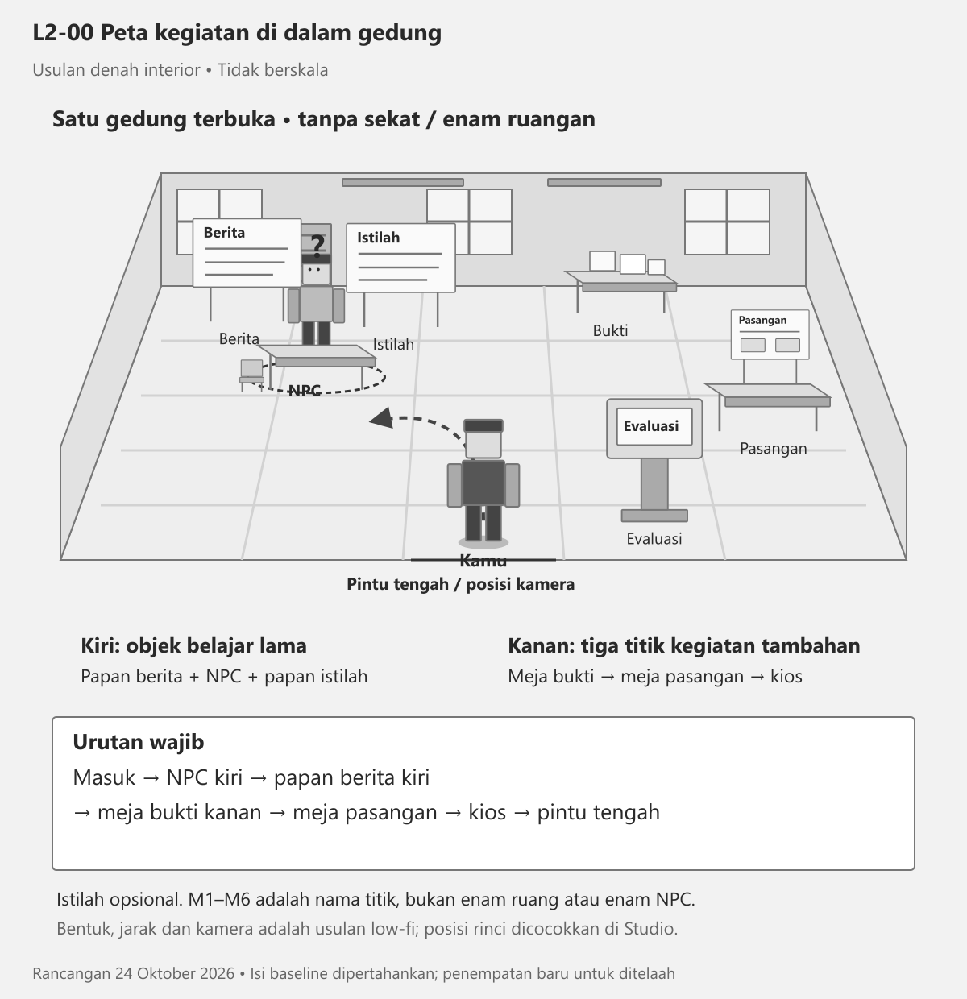

## L2-01A — Masuk gedung dan menuju NPC

Tujuan: Temui pemandu Level 2.

Pemandu Level 2

Tahan E — Bicara

Perilaku: Pintu berada di tengah sisi depan. Akses gedung Level 2 hanya terbuka setelah Level 1 lulus minimal 75. Jika belum, pemain tetap di luar dan melihat tulisan singkat “Selesaikan Level 1 terlebih dahulu”; tidak ada modal atau tombol E di pintu. Setelah terbuka, langsung masuk dan ikuti penanda ke NPC kiri. NPC langsung membuka pembuka, tanpa cabang penolakan akses. Perjalanan dari Level 1 pendek tanpa kegiatan tambahan. Alur visual: pintu tengah → NPC kiri → tahan E → pembuka → Mulai → berjalan ke papan berita. Gedung sebelumnya tetap dapat dikunjungi. Posisi relatif, belum uji Studio.

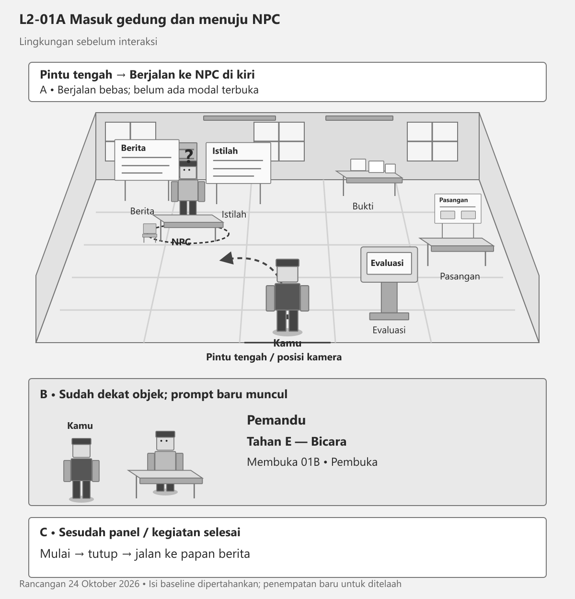

## L2-01B — NPC — pembuka Level 2

Selamat datang di Level 2 — Keterampilan Membaca.

Pada level ini, Anda akan membaca sebuah teks eksposisi berita yang membahas inovasi teknologi terbaru dalam bidang sistem operasi dan komputasi awan.

Bacalah teks dengan saksama dan pahami informasi yang disampaikan. Papan istilah tersedia bila diperlukan.

Setelah membaca, kerjakan latihan, kemudian jawab empat soal untuk menguji pemahaman terhadap isi, bukti, dan simpulan berdasarkan berita.

Gunakan kemampuan literasi dan analisis Anda untuk menentukan jawaban yang paling tepat.

Tekan Mulai untuk menuju papan berita.

Perilaku: Wording mengikuti pembuka baseline foto30, disesuaikan seperlunya untuk latihan dan pembacaan pada objek berbeda. Mulai menutup panel dan mengarahkan pemain berjalan ke M3, tidak langsung membuka seluruh materi/latihan/kuis. NPC dapat diakses lagi untuk petunjuk lokasi berikutnya sesuai progres. Lokasi/status: NPC • sisi kiri. Panel pembuka NPC terbuka; karakter berhenti dekat meja. Mulai → panel ditutup → berjalan ke 03A papan berita.

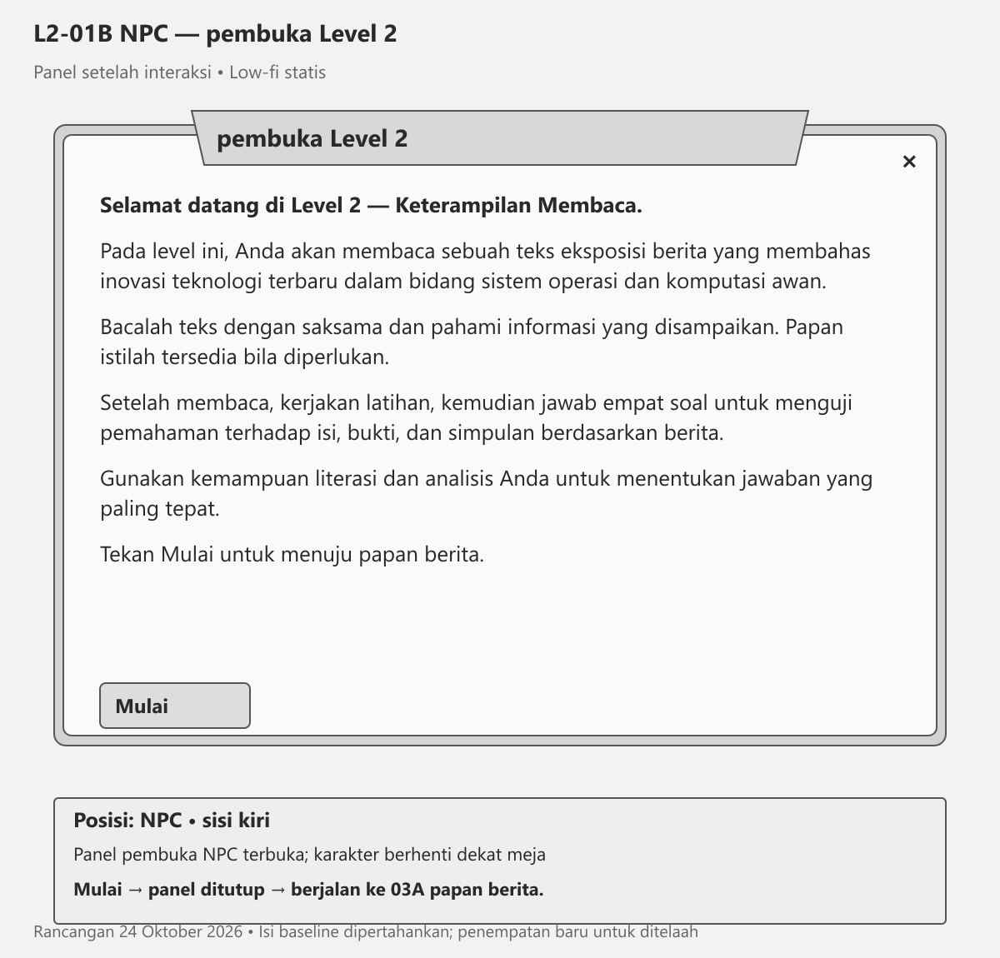

## L2-02A — Papan istilah — bantuan opsional

Bantuan: Papan istilah tersedia di samping NPC.

Istilah dalam bacaan

Tahan E — Lihat istilah

Perilaku: Papan istilah lama tetap di sayap kiri dekat NPC. Bantuan opsional sebelum/selama belajar, tanpa skor atau syarat kunjungan. Tutup kembali ke map tanpa menghapus tujuan utama. Alur visual: Area belajar kiri → Opsional: dekati papan istilah. Setelah interaksi: 02B1–02B2 • Istilah. × → kembali ke lokasi dan tujuan sebelumnya. Pemain dan NPC ditampilkan sebagai avatar blok; gambar adalah usulan gameplay, bukan screenshot Studio.

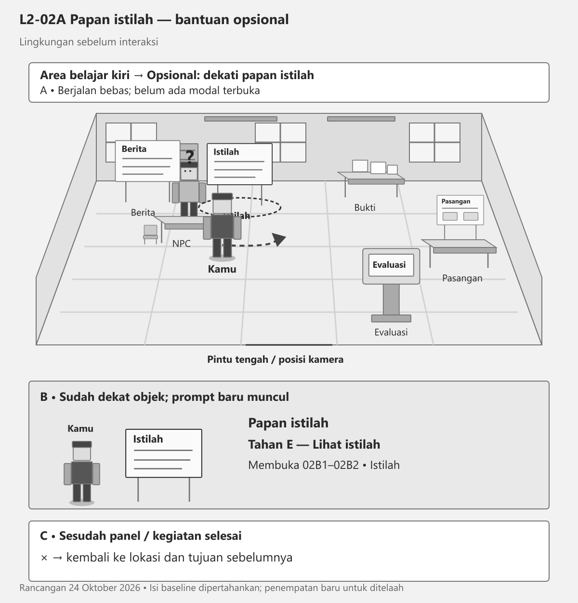

## L2-02B1 — Istilah — halaman 1/2

Istilah dalam bacaan

1. Sistem operasi

Perangkat lunak yang mengatur dan mengelola kerja perangkat, seperti menjalankan aplikasi, mengatur memori, serta menghubungkan perangkat keras dan perangkat lunak. Contohnya Android dan Windows.

2. Sistem operasi ganda

Penggunaan dua sistem operasi dalam satu perangkat. Pengguna dapat memanfaatkan keunggulan masing-masing sistem sesuai kebutuhan.

3. Lokal / native

Sistem atau aplikasi dijalankan langsung pada perangkat. Pada bacaan ini, Android dijalankan lokal.

Perilaku: Mengacu papan baseline foto27. Judul diselaraskan dengan materi sistem operasi; redaksi lokal dipersempit agar tidak menjanjikan semua aplikasi pasti offline/lebih cepat. Makna lain dipertahankan, tetap bahan telaah ahli. Panah berikut membuka halaman2, tutup kembali ke map. Lokasi/status: Papan istilah • sisi kiri. Satu panel bantuan, dua halaman; tetap di depan papan. Panah = ganti halaman. × = tutup dan kembali ke gedung.

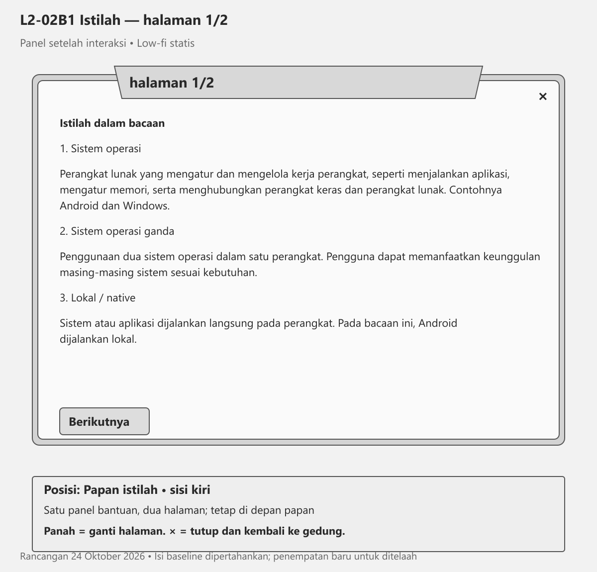

## L2-02B2 — Istilah — halaman 2/2

Komputasi awan / cloud

Teknologi yang memungkinkan pengguna mengakses sistem atau layanan melalui internet tanpa harus menginstalnya secara langsung di perangkat. Proses komputasi dilakukan di server jarak jauh.

Perilaku: Isi mengikuti papan baseline foto28. Halaman terakhir menyediakan kembali dan tutup; tidak memaksa pindah ke materi dari panel bantuan. Istilah membantu memahami teks, bukan jawaban yang otomatis menyelesaikan latihan. Lokasi/status: Papan istilah • sisi kiri. Satu panel bantuan, dua halaman; tetap di depan papan. Panah = ganti halaman. × = tutup dan kembali ke gedung.

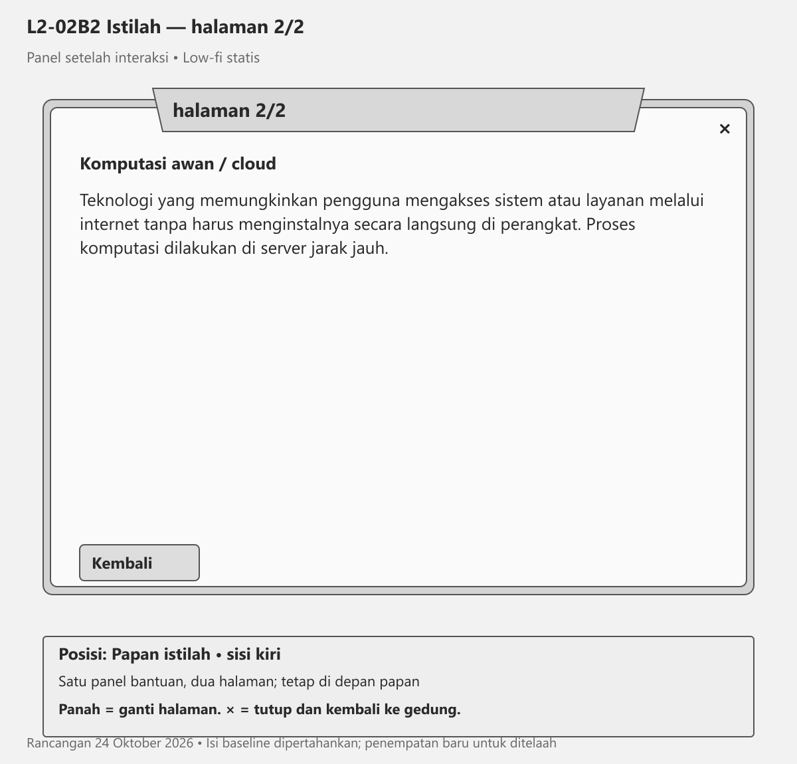

## L2-03A — Papan berita — titik akses materi

Tujuan: Baca berita pada papan besar.

Berita Cloud AI Pad

Tahan E — Baca berita

Perilaku: Papan besar lama di sayap kiri menjadi titik akses berita. Materi panjang tetap dibaca pada panel layar. Pertahankan objek lama; susunan rinci dicocokkan di Studio, bukan dipindah ke kanan. Alur visual: NPC kiri • sesudah Mulai → Jalan pendek ke papan berita. Setelah interaksi: 03B1–03B3b • Berita. Ke meja bukti → tutup → seberang ke kanan. Pemain dan NPC ditampilkan sebagai avatar blok; gambar adalah usulan gameplay, bukan screenshot Studio.

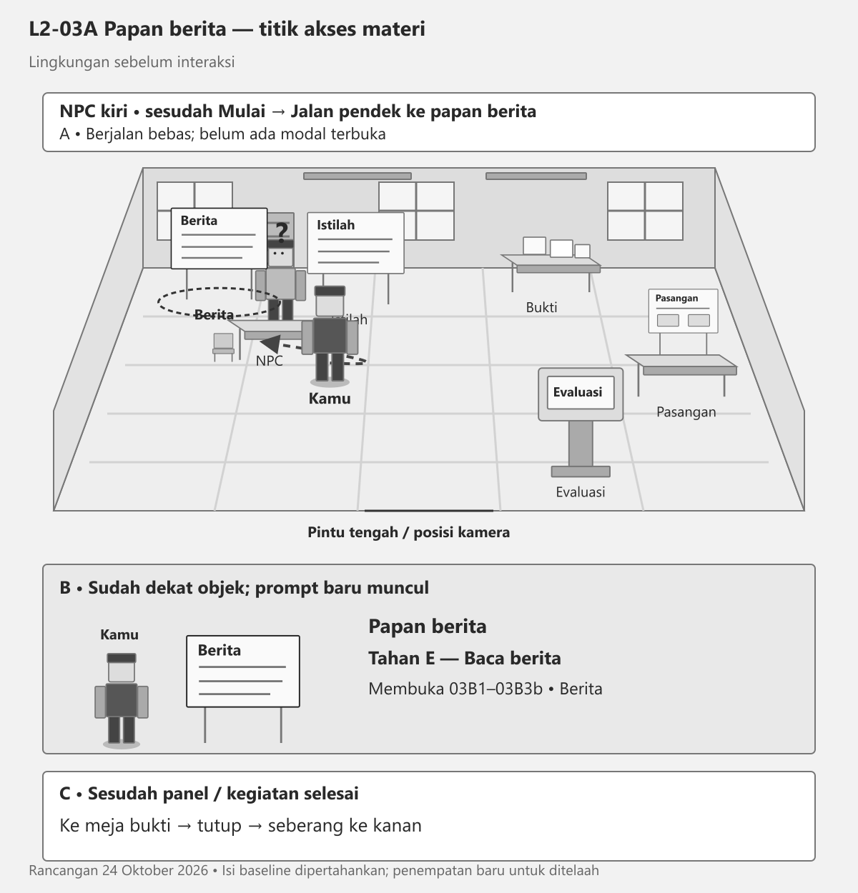

## L2-03B1 — Berita — bagian 1/3

Perangkat dan gagasan utama

Perkembangan teknologi perangkat pintar terus menghadirkan inovasi yang semakin mengaburkan batas antara tablet dan komputer. Salah satu inovasi terbaru yang menarik perhatian dunia teknologi datang dari operator telekomunikasi asal China, China Unicom, yang meluncurkan tablet terbaru bernama Cloud AI Pad. Perangkat ini menghadirkan terobosan berupa penggunaan dua sistem operasi dalam satu perangkat sekaligus. Tablet ini menjalankan sistem operasi Android dan Windows secara bersamaan dengan pendekatan yang berbeda dan saling melengkapi. Peluncuran Cloud AI Pad menunjukkan perkembangan teknologi sistem operasi yang semakin adaptif terhadap kebutuhan produktivitas dan fleksibilitas pengguna di era modern.

Perilaku: Isi paragraf1 disalin utuh dari tab peta. Lanjut membuka bagian2 pada panel yang sama. Tutup menyimpan bagian terakhir selama sesi. Penanda1/3 adalah bagian materi, bukan pecahan durasi atau skor. Klik Lanjut hanya menandai kunjungan, bukan bukti membaca/paham. Istilah dapat dibuka sebagai bantuan dan kembali ke bagian yang sama. Lokasi/status: Papan berita • sisi kiri. Satu panel berita, tiga bagian; karakter tetap dekat papan. Lanjut / Kembali = ganti bagian dalam panel yang sama.

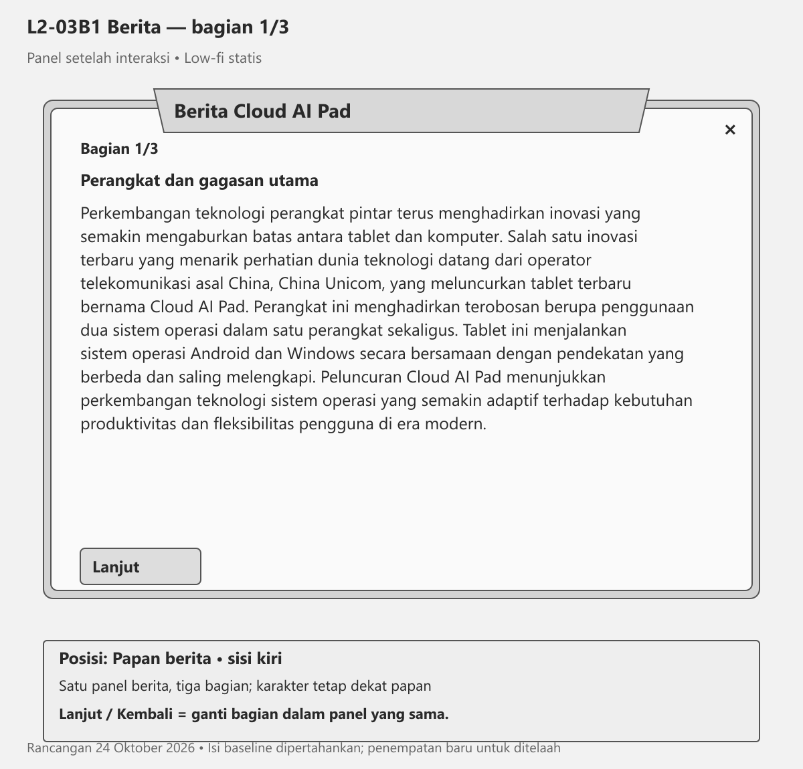

## L2-03B2 — Berita — bagian 2/3

Cara kerja kedua sistem

Secara teknis, kedua sistem operasi pada Cloud AI Pad dijalankan dengan cara yang berbeda. Sistem operasi Android dijalankan secara lokal langsung di perangkat tablet. Pendekatan ini memungkinkan pengguna mengakses berbagai aplikasi Android dengan respons yang cepat dan efisien, tanpa memerlukan koneksi internet yang stabil sebagai syarat utama. Di sisi lain, sistem operasi Windows dijalankan melalui teknologi komputasi awan atau cloud, sehingga pengguna dapat menikmati pengalaman kerja layaknya menggunakan komputer berbasis Windows tanpa harus menginstalnya secara langsung di perangkat. Perbedaan pendekatan ini mencerminkan strategi desain yang cermat dalam memaksimalkan kemampuan perangkat keras tablet sekaligus memanfaatkan infrastruktur cloud yang terus berkembang.

Perilaku: Isi paragraf2 disalin utuh. Kembali mengulang bagian1; Lanjut ke bagian3. Tidak memisahkan kalimat Android dan Windows ke objek berbeda. Bahan tetap satu berita dalam tiga bagian, dengan akses baca ulang sebelum evaluasi. Lokasi/status: Papan berita • sisi kiri. Satu panel berita, tiga bagian; karakter tetap dekat papan. Lanjut / Kembali = ganti bagian dalam panel yang sama.

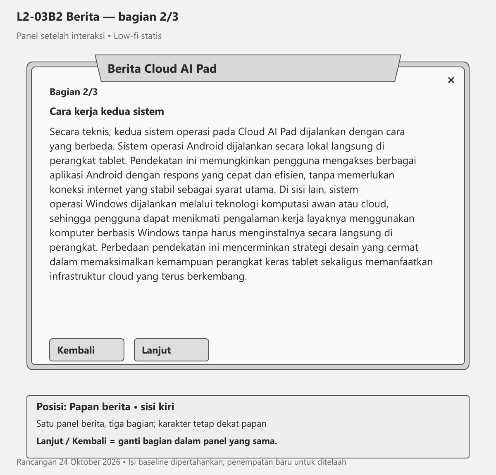

## L2-03B3a — Berita — bagian 3/3, posisi awal

Manfaat dan fitur pendukung

Dari sudut pandang pasar, pendekatan dual sistem operasi seperti yang diterapkan pada Cloud AI Pad masih tergolong jarang ditemui di pasar global. Umumnya, tablet hanya menggunakan satu sistem operasi utama, baik Android maupun Windows, secara native. Kehadiran dua sistem operasi dalam satu perangkat selama ini dianggap kompleks secara teknis dan berisiko menimbulkan konflik antarsistem. Namun, dengan konsep yang diterapkan oleh China Unicom ini, pengguna Cloud AI Pad dapat beralih antara platform Android yang fleksibel untuk kebutuhan sehari-hari dan Windows yang mendukung produktivitas kerja profesional, semuanya dalam satu perangkat yang sama. Hal ini menjadikan Cloud AI Pad sebagai perangkat yang berpotensi menjawab kebutuhan pengguna yang menginginkan fleksibilitas sekaligus produktivitas tinggi tanpa harus membawa dua perangkat berbeda.

Perilaku: Bagian3 mencakup paragraf3–4, bukan menambah bagian4. Gambar ini menunjukkan posisi awal gulir (paragraf3); gambar03B3b posisi bawah pada panel yang sama. Paragraf4 tetap utuh pada sumber dan UI. Kembali menuju bagian2. Tombol Ke meja bukti berada di bagian bawah konten. Lokasi/status: Papan berita • sisi kiri. Satu panel berita, tiga bagian; karakter tetap dekat papan. 03B3a/b = gulir panel yang sama; bukan pindah objek.

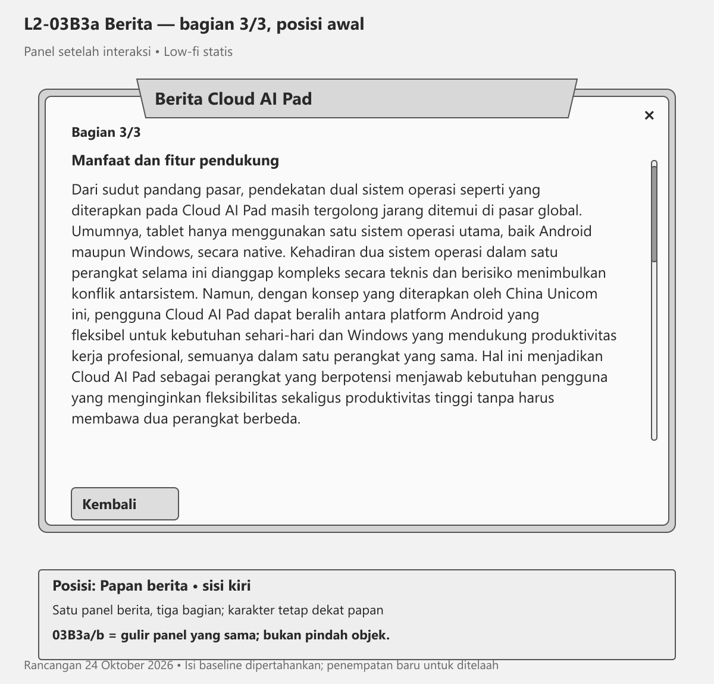

## L2-03B3b — Berita — bagian 3/3, posisi bawah

Manfaat dan fitur pendukung

Selain keunggulan sistem operasi ganda, Cloud AI Pad juga dilengkapi dengan fitur kecerdasan buatan (artificial intelligence) yang terintegrasi langsung ke dalam perangkat melalui tombol khusus AI pada keyboard. Fitur ini terhubung dengan asisten cerdas berbasis model bahasa besar Yuanjing yang dikembangkan secara mandiri oleh China Unicom. Dengan adanya integrasi ini, pengguna dapat mengakses kemampuan kecerdasan buatan secara langsung dalam berbagai aktivitas kerja maupun belajar. Kehadiran Cloud AI Pad menegaskan bahwa inovasi sistem operasi tidak lagi hanya berfokus pada pengembangan perangkat lunak semata, tetapi telah berkembang ke arah integrasi menyeluruh antara teknologi cloud, kecerdasan buatan, dan perangkat keras untuk mendukung kebutuhan pengguna modern yang semakin beragam dan dinamis.

Perilaku: Posisi bawah gulir bagian3, paragraf4 utuh. Ke meja bukti menutup panel dan mengganti tujuan ke M4; pemain berjalan di dalam ruang. Tidak otomatis membuka latihan. Progres materi menyatakan ketiga bagian telah dikunjungi, bukan kelulusan pemahaman. Lokasi/status: Papan berita • sisi kiri. Satu panel berita, tiga bagian; karakter tetap dekat papan. Ke meja bukti → tutup panel → berjalan ke 04A di kanan.

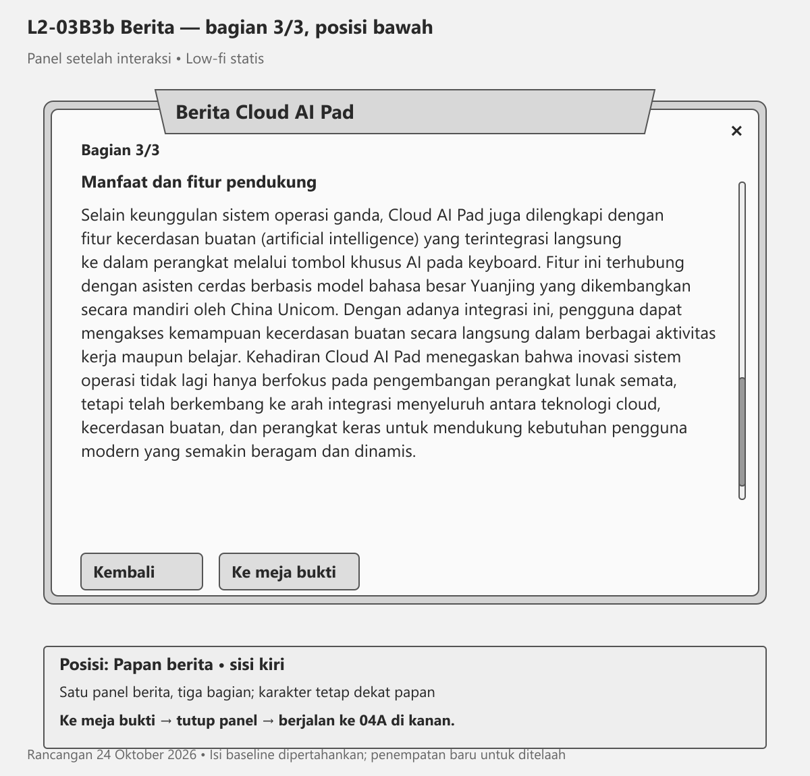

## L2-04A — Mendekati meja bukti

Tujuan: Temukan bukti dari berita.

Latihan 1 — Bukti teks

Tahan E — Buka latihan

Perilaku: Meja bukti tambahan berada di sayap kanan bagian dalam. Setelah membaca, pemain melintasi jalur tengah menuju meja ini; penanda hanya menunjukkan tujuan aktif. Jangan menutup jalur pintu. Jika materi belum lengkap, arahkan ke bagian belum dikunjungi pada papan berita kiri. Alur visual: Papan berita kiri → Seberang ke meja bukti kanan. Setelah interaksi: 04B–04E • Latihan 1. Selesai → Ke panel pasangan → berjalan. Pemain dan NPC ditampilkan sebagai avatar blok; gambar adalah usulan gameplay, bukan screenshot Studio.

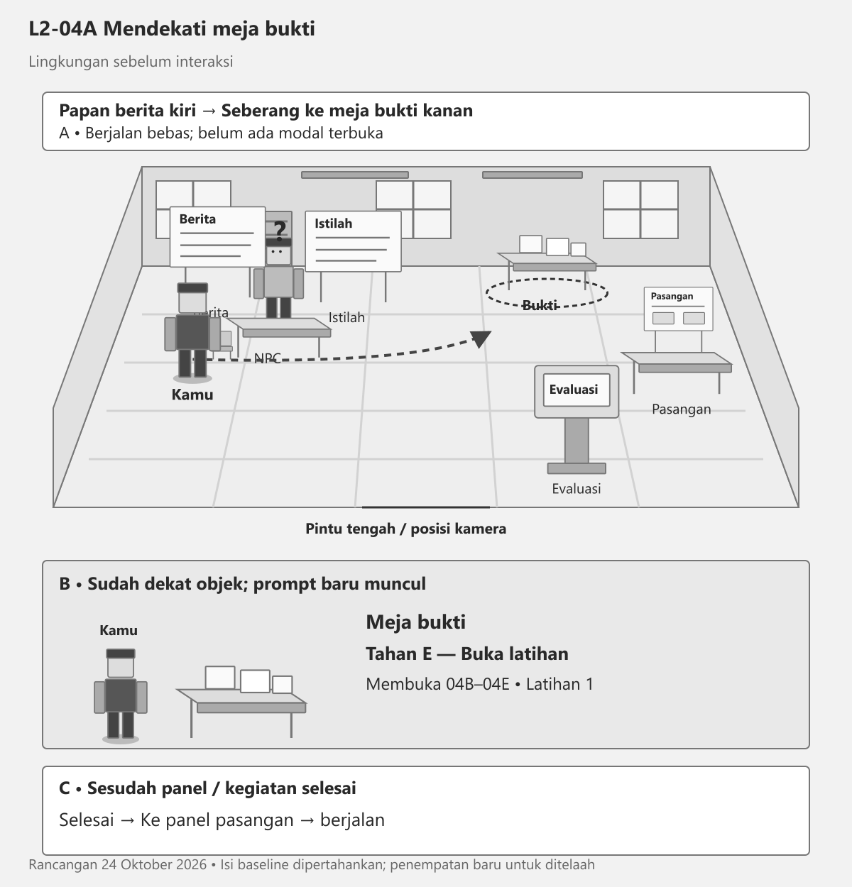

## L2-04B — Latihan 1 — tandai bukti pada berita

Baca cuplikan berita. Tandai dua kalimat yang mendukung pernyataan: kedua sistem tidak dijalankan dengan cara yang sama.

Perilaku: Tujuan: menemukan bukti tertulis, lalu menghubungkan bukti dengan simpulan; bukan menghafal teori OS. Cuplikan tersedia selama latihan, tanpa batas waktu baca dan tanpa skor kelulusan. Klik kalimat berarsir pada cuplikan; empat sasaran maker/android/windows/ai tampil seragam tanpa label jawaban A–D. Kunci internal android+windows. Tepat dua pilihan mengaktifkan Periksa; klik ulang melepas. Pilihan ketiga ditolak dengan pesan Pilih dua kalimat saja. Baca berita lengkap membuka pembaca di panel yang sama; posisi/pilihan tersimpan dan Kembali ke latihan mengembalikannya. Lokasi/status: Meja bukti • kanan bagian dalam. Satu panel latihan 1; salah / bantuan / selesai = status panel. Pilihan, periksa dan bantuan tetap di meja yang sama.

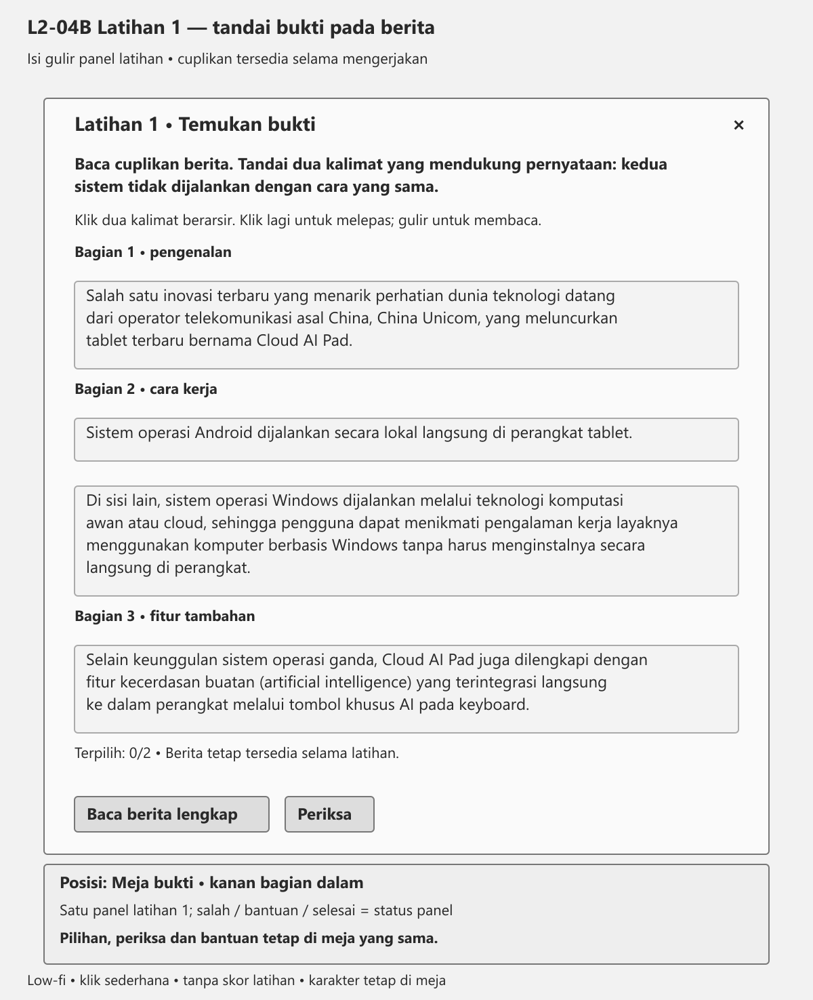

## L2-04C — Latihan 1 — tinjau relevansi bukti

Tinjau bukti pilihanmu.

Kalimat nama pembuat tidak mendukung perbedaan cara menjalankan kedua sistem. Cari bukti yang menjelaskan sistem lainnya.

Perilaku: Tujuan: menemukan bukti tertulis, lalu menghubungkan bukti dengan simpulan; bukan menghafal teori OS. Cuplikan tersedia selama latihan, tanpa batas waktu baca dan tanpa skor kelulusan. Contoh setelah Periksa: android dipertahankan sebagai bukti relevan, maker perlu ditinjau; tidak mewarnai semua salah. Jika ai dipilih: Kalimat tombol AI menjelaskan fitur tambahan, bukan perbedaan cara kedua sistem dijalankan. Kutipan sumber tetap terlihat. Coba lagi mengizinkan perubahan pada cuplikan yang sama; tidak membuka objek baru. Lokasi/status: Meja bukti • kanan bagian dalam. Satu panel latihan 1; salah / bantuan / selesai = status panel. Pilihan, periksa dan bantuan tetap di meja yang sama.

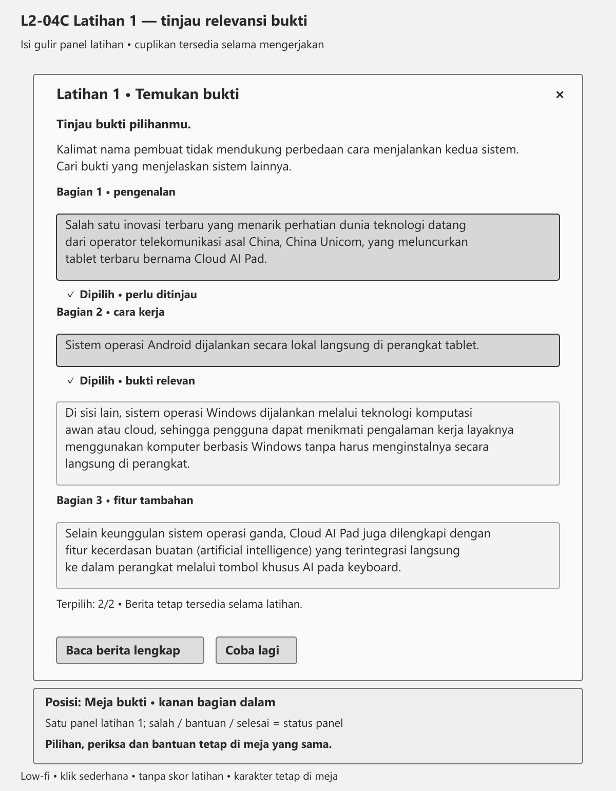

## L2-04D — Latihan 1 — bukti sudah sesuai

Bukti sudah sesuai.

Kalimat tentang Android menyatakan sistem dijalankan langsung di tablet. Kalimat tentang Windows menyatakan sistem dijalankan melalui cloud.

Keduanya mendukung pernyataan bahwa cara menjalankannya berbeda. Kalimat nama pembuat dan tombol AI tidak menjelaskan perbedaan itu.

Berikutnya, hubungkan simpulan dengan bukti yang mendukungnya.

Perilaku: Tujuan: menemukan bukti tertulis, lalu menghubungkan bukti dengan simpulan; bukan menghafal teori OS. Cuplikan tersedia selama latihan, tanpa batas waktu baca dan tanpa skor kelulusan. Selesai setelah dua kalimat sumber yang tepat dipilih dan diperiksa. Ke panel pasangan menutup latihan dan menunjuk meja berikutnya; pemain berjalan seperti alur sebelumnya. Status mandiri/berbantuan dibedakan; tidak ada tambahan skor. Lokasi/status: Meja bukti • kanan bagian dalam. Satu panel latihan 1; salah / bantuan / selesai = status panel. Ke panel pasangan → tutup → berjalan ke 05A, tekan E.

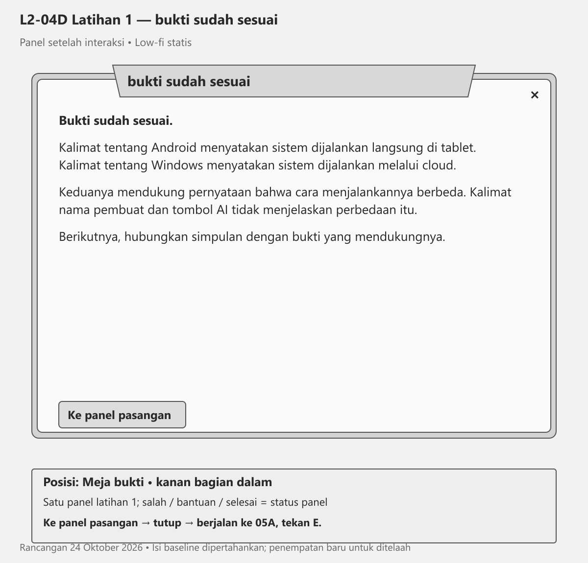

## L2-04E — Latihan 1 — petunjuk mencari bukti

Cari kalimat tentang cara setiap sistem dijalankan.

Pada cuplikan bagian 2, perhatikan keterangan dijalankan secara lokal dan dijalankan melalui komputasi awan.

Tandai dua kalimat tersebut, lalu Periksa kembali.

Perilaku: Tujuan: menemukan bukti tertulis, lalu menghubungkan bukti dengan simpulan; bukan menghafal teori OS. Cuplikan tersedia selama latihan, tanpa batas waktu baca dan tanpa skor kelulusan. Setelah salah pertama gunakan koreksi sesuai pilihan pada04C; setelah masih salah pada pemeriksaan berikutnya, petunjuk ini menunjukkan ciri kalimat relevan. Ini usulan aturan bantuan untuk telaah, bukan SOP eksperimen final. Kembali memilih bukti mengembalikan cuplikan dan pilihan. Membuka bantuan tidak otomatis menyelesaikan latihan; pengguna tetap menandai dua kalimat tepat dan Periksa. Lokasi/status: Meja bukti • kanan bagian dalam. Satu panel latihan 1; salah / bantuan / selesai = status panel. Pilihan, periksa dan bantuan tetap di meja yang sama.

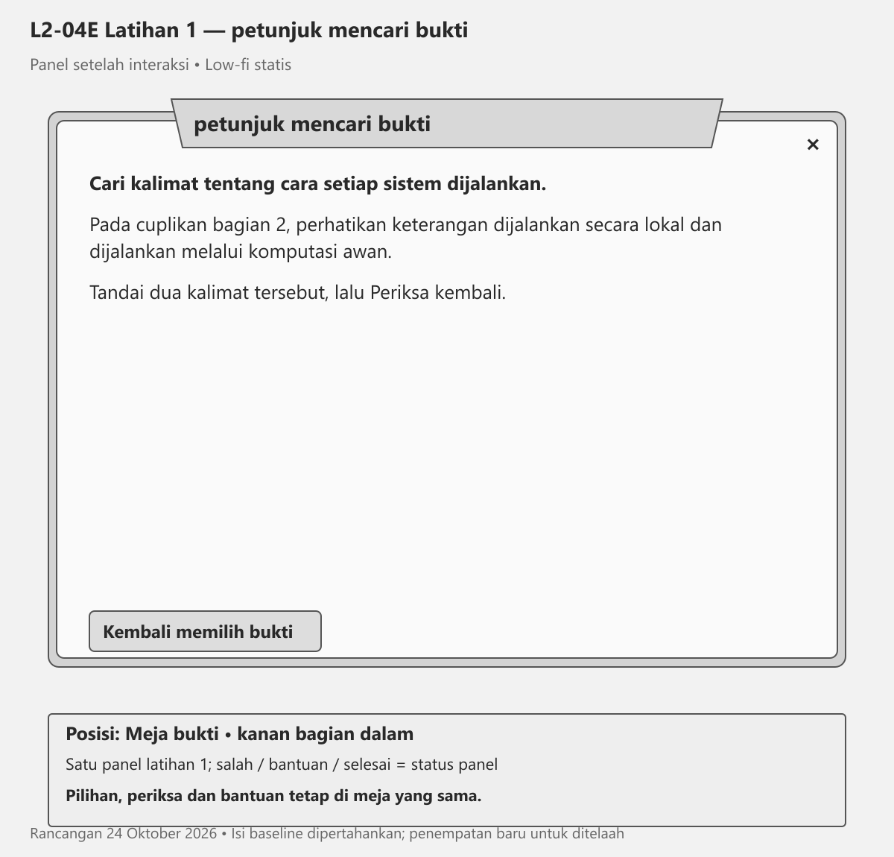

## L2-05A — Mendekati panel pasangan

Tujuan: Hubungkan simpulan dengan bukti berita.

Latihan 2 — Simpulan dan bukti

Tahan E — Buka pasangan

Perilaku: Meja pasangan tetap di kanan, setelah meja bukti. Pemain berjalan pendek lalu tahanE seperti sebelumnya. Tugas berikutnya menghubungkan bukti dengan simpulan; tidak lagi memasangkan nama OS ke lokal/cloud. Jika terlalu awal, arahkan ke tugas yang belum selesai. Alur visual: Meja bukti kanan → Jalan pendek ke meja pasangan. Setelah interaksi: 05B–05D • Latihan 2. Selesai → Ke kios evaluasi → berjalan. Pemain dan NPC ditampilkan sebagai avatar blok; gambar adalah usulan gameplay, bukan screenshot Studio.

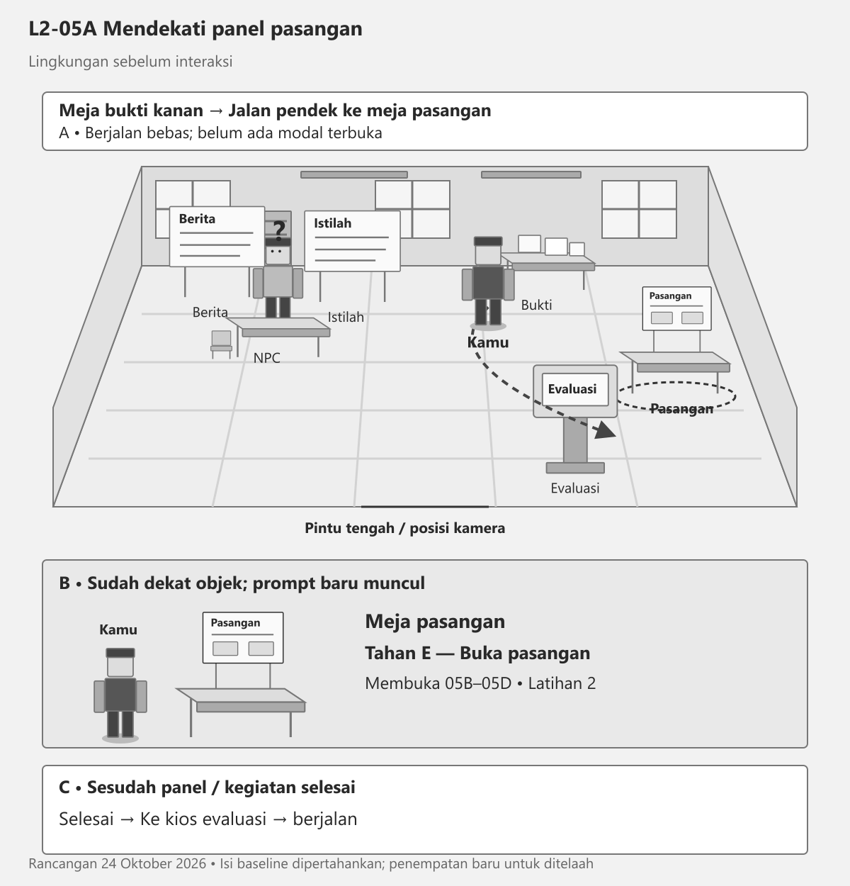

## L2-05B — Latihan 2 — pasangkan simpulan dan bukti

Baca bukti. Seret setiap kartu simpulan ke kotak bukti yang mendukungnya.

Pada tablet dalam berita, dua OS tidak berarti keduanya dipasang langsung di perangkat.

Keunggulan yang ditawarkan adalah dua lingkungan yang saling melengkapi kebutuhan pengguna.

Perilaku: Tujuan: menemukan bukti tertulis, lalu menghubungkan bukti dengan simpulan; bukan menghafal teori OS. Cuplikan tersedia selama latihan, tanpa batas waktu baca dan tanpa skor kelulusan. Dua kartu simpulan dipasangkan dengan drag-and-drop ke kotak di bawah bukti teks. Bukti1 menggabungkan dua kalimat utuh bagian2 (Android lokal dan Windows cloud tanpa instalasi langsung); bukti2 satu kalimat utuh bagian3 (kebutuhan sehari-hari dan produktivitas). Kunci simpulan pertama→bukti1, simpulan kedua→bukti2. Label1/2 adalah identitas lokasi, bukan penanda kunci. Kartu awal diurut terbalik dari kotak bukti; tidak ada garis/kode jawaban sebelum Periksa. Satu simpulan per tempat; seret dan lepaskan, tanpa duplikasi. Periksa aktif setelah dua pasangan terbentuk. Bukti selalu terlihat; berita lengkap dapat dibaca lalu kembali tanpa kehilangan pasangan. Drag-and-drop 2D pada ScreenGui: tahan kartu simpulan, seret, lalu lepaskan di kotak bukti. Kedua kartu dan kedua kotak terlihat bersamaan; jangan menyeret dalam ScrollingFrame. Lepas di luar kotak atau di kotak terisi: kembali ke posisi sah sebelumnya, tanpa menimpa/menukar otomatis. Satu kartu per kotak. Untuk mengganti, seret kartu yang sudah ditempatkan kembali ke area kartu dahulu. Pasangan semantik yang salah tetap diterima secara posisi; penilaian hanya setelah Periksa. Periksa aktif setelah dua kotak terisi. Tidak ada timer, poin latihan atau penilaian ketepatan gerak mouse. Baca berita lengkap hanya saat tidak menyeret; kembali mempertahankan pasangan. Lokasi/status: Meja pasangan • sisi kanan. Satu panel latihan 2; karakter tetap di depan meja. Tahan kartu → seret → lepas → Periksa.

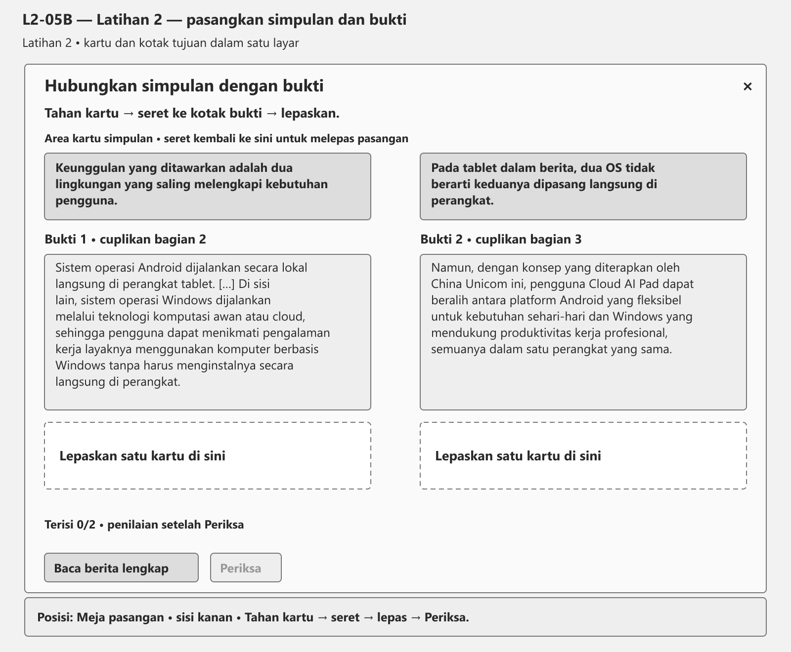

## L2-05C — Latihan 2 — tinjau hubungan bukti

Bukti dan simpulan belum sesuai.

Bukti tentang cara menjalankan sistem mendukung simpulan tentang instalasi. Bukti tentang kebutuhan pengguna mendukung simpulan tentang manfaat.

Perilaku: Tujuan: menemukan bukti tertulis, lalu menghubungkan bukti dengan simpulan; bukan menghafal teori OS. Cuplikan tersedia selama latihan, tanpa batas waktu baca dan tanpa skor kelulusan. Contoh dua simpulan tertukar setelah Periksa. Koreksi menunjukkan hubungan isi, bukan memberi definisi teori OS. Jika hanya sebagian perlu ditinjau, pertahankan pasangan tepat. Coba lagi membuka kembali penyusunan pada panel ini; pemain menyeret kartu ke area kartu atau kotak kosong. Jika masih salah pada pemeriksaan berikutnya, tampilkan petunjuk dengan menyorot frasa relevan pada bukti: lokal/tanpa menginstalnya; kebutuhan sehari-hari/produktivitas. Sorotan baru muncul sesudah bantuan, bukan pada keadaan awal. Pengguna tetap menyusun pasangan tepat dan Periksa; status bantuan dicatat terpisah. Drag-and-drop 2D pada ScreenGui: tahan kartu simpulan, seret, lalu lepaskan di kotak bukti. Kedua kartu dan kedua kotak terlihat bersamaan; jangan menyeret dalam ScrollingFrame. Lepas di luar kotak atau di kotak terisi: kembali ke posisi sah sebelumnya, tanpa menimpa/menukar otomatis. Satu kartu per kotak. Untuk mengganti, seret kartu yang sudah ditempatkan kembali ke area kartu dahulu. Pasangan semantik yang salah tetap diterima secara posisi; penilaian hanya setelah Periksa. Periksa aktif setelah dua kotak terisi. Tidak ada timer, poin latihan atau penilaian ketepatan gerak mouse. Baca berita lengkap hanya saat tidak menyeret; kembali mempertahankan pasangan. Lokasi/status: Meja pasangan • sisi kanan. Satu panel latihan 2; karakter tetap di depan meja. Tahan kartu → seret → lepas → Periksa.

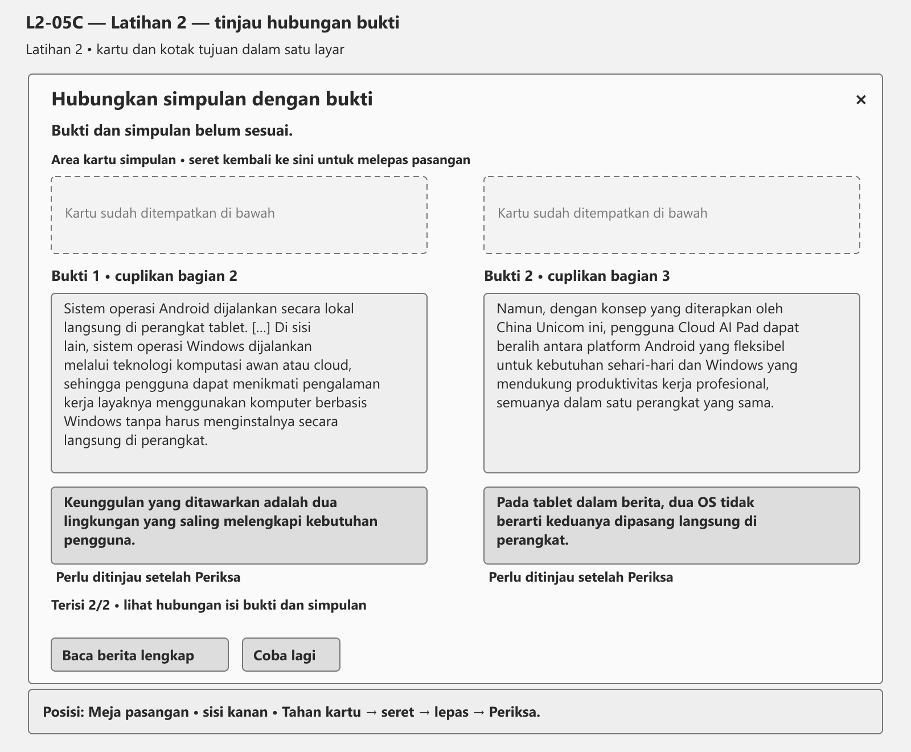

## L2-05D — Latihan 2 — hubungan sudah sesuai

Simpulan sesuai dengan buktinya.

Cara eksekusi mendukung simpulan tentang instalasi; perbedaan kebutuhan mendukung simpulan tentang manfaat.

Perilaku: Tujuan: menemukan bukti tertulis, lalu menghubungkan bukti dengan simpulan; bukan menghafal teori OS. Cuplikan tersedia selama latihan, tanpa batas waktu baca dan tanpa skor kelulusan. Kedua simpulan dipasangkan dengan bukti yang sesuai lalu Periksa. Ini latihan menghubungkan/mengintegrasikan informasi, bukan klaim inferensi mendalam atau pengukuran kemampuan yang sudah tervalidasi. Simpulan pertama dibatasi pada perangkat dalam berita, bukan aturan universal semua OS. Simpulan kedua merangkum manfaat yang disebut penulis tanpa menambah klaim semua aplikasi offline/lebih cepat. Ke kios evaluasi menutup panel dan menunjuk kios; alur/skor berikutnya tetap. Drag-and-drop 2D pada ScreenGui: tahan kartu simpulan, seret, lalu lepaskan di kotak bukti. Kedua kartu dan kedua kotak terlihat bersamaan; jangan menyeret dalam ScrollingFrame. Lepas di luar kotak atau di kotak terisi: kembali ke posisi sah sebelumnya, tanpa menimpa/menukar otomatis. Satu kartu per kotak. Untuk mengganti, seret kartu yang sudah ditempatkan kembali ke area kartu dahulu. Pasangan semantik yang salah tetap diterima secara posisi; penilaian hanya setelah Periksa. Periksa aktif setelah dua kotak terisi. Tidak ada timer, poin latihan atau penilaian ketepatan gerak mouse. Baca berita lengkap hanya saat tidak menyeret; kembali mempertahankan pasangan. Lokasi/status: Meja pasangan • sisi kanan. Satu panel latihan 2; karakter tetap di depan meja. Ke kios evaluasi → tutup → berjalan ke 06A, tekan E.

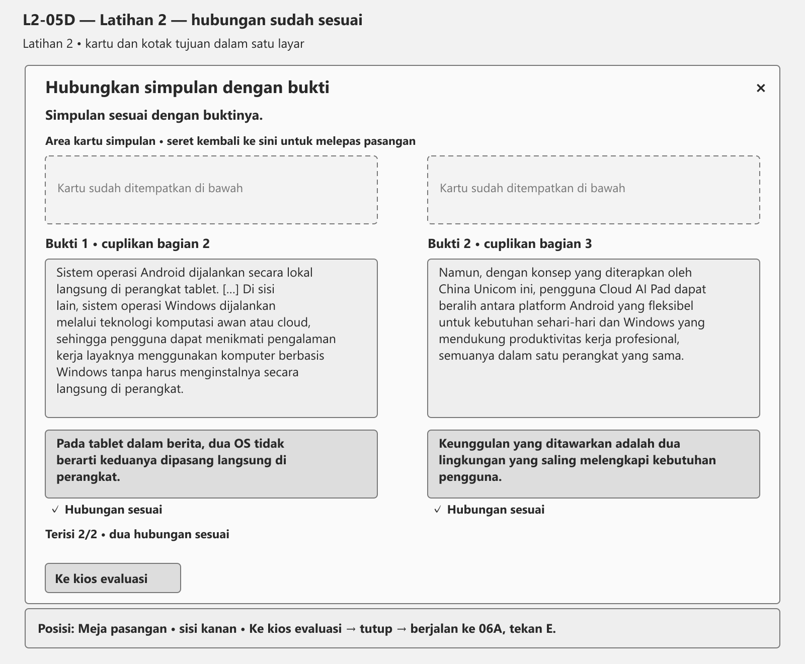

## L2-06A — Mendekati kios evaluasi

Tujuan: Kerjakan evaluasi Level 2.

Evaluasi Level 2

Tahan E — Buka evaluasi

Perilaku: Kios evaluasi tambahan berada di sayap kanan bagian depan, di samping akses keluar tetapi tidak menutup pintu/jalur tengah. Pemain berjalan setelah dua latihan selesai. Prasyarat mengikuti progres aktual; jarak dan prompt dicek di Studio. Alur visual: Meja pasangan kanan → Jalan ke kios kanan depan. Setelah interaksi: 06B → 07 → 08 → 09. Soal, alasan, feedback dan hasil: tetap di kios. Pemain dan NPC ditampilkan sebagai avatar blok; gambar adalah usulan gameplay, bukan screenshot Studio.

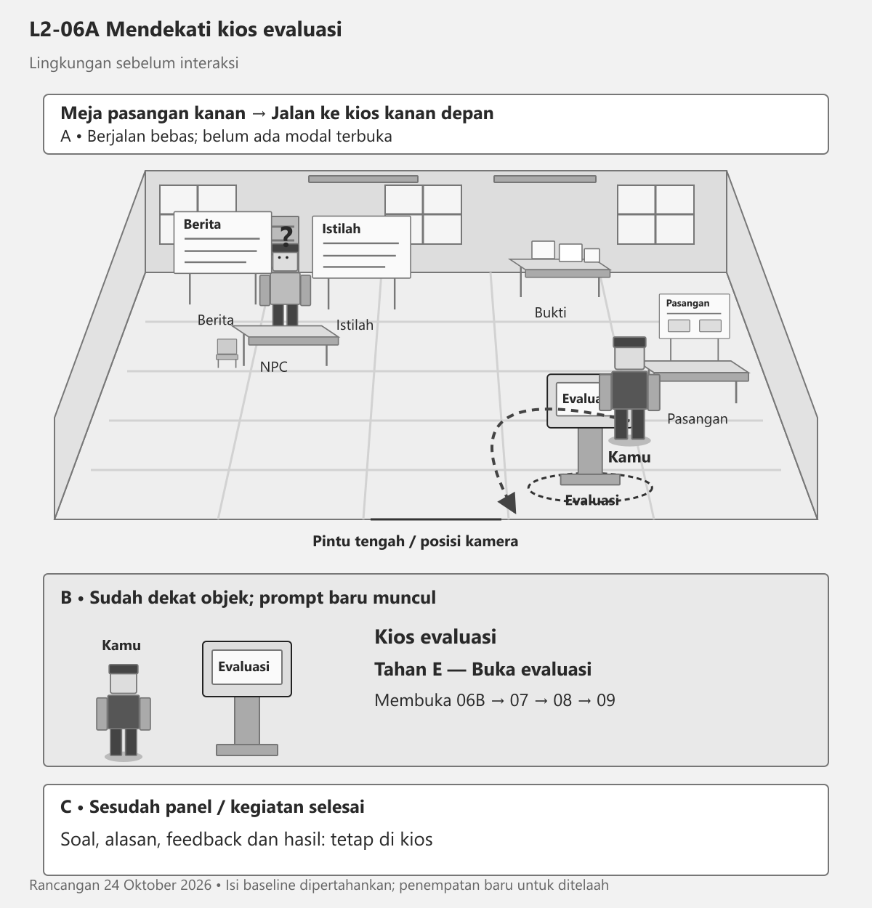

## L2-06B1 — Kios — contoh akses belum siap

Evaluasi belum dapat dimulai.

Materi: 3 dari 3 bagian dikunjungi.

Latihan bukti: selesai.

Latihan pasangan: belum selesai.

Perilaku: Contoh cabang belum siap; isi status harus mencerminkan progres nyata. Kembali belajar menunjuk bagian materi/latihan pertama yang belum selesai. Akses evaluasi aktif setelah ketiga bagian dikunjungi dan kedua tugas selesai. Papan istilah tidak menjadi syarat. Lokasi/status: Kios evaluasi • kanan depan. Tetap di panel evaluasi; karakter berada di kios. Kembali belajar → tutup → berjalan ke tugas belum selesai.

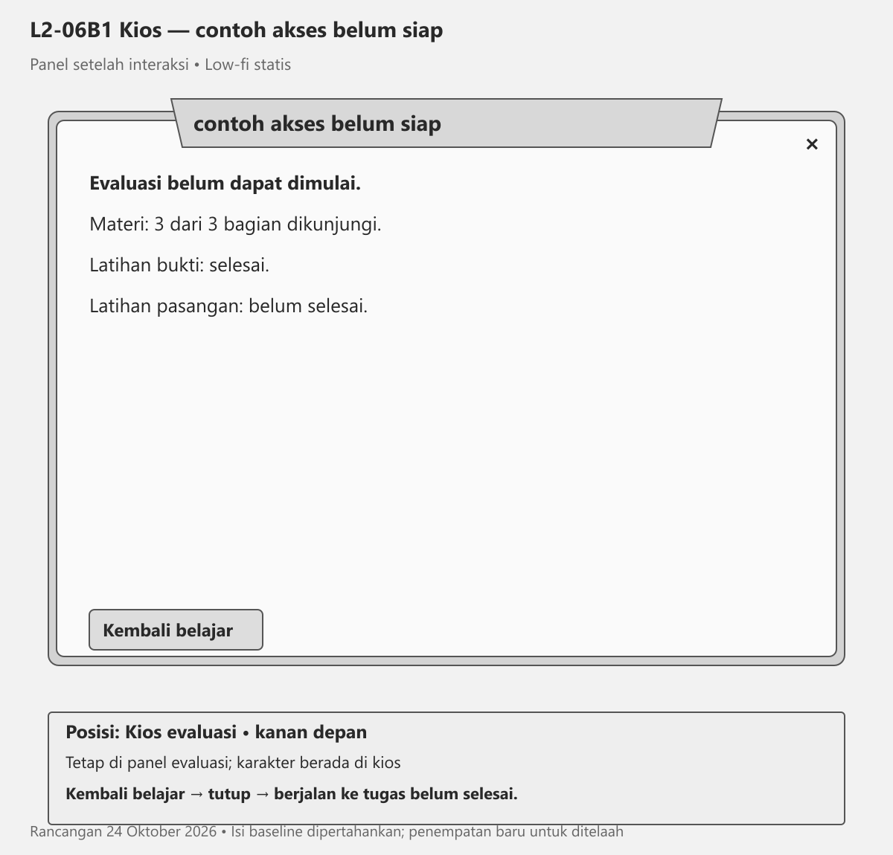

## L2-06B2 — Kios — petunjuk sebelum mulai

Siap mengikuti evaluasi Level 2?

Ada empat soal. Pilih jawaban, kunci, lalu pilih alasan. Penjelasan muncul setelah keduanya dikirim.

Jawaban tepat bernilai 25; nilai minimal 75 untuk melanjutkan. Ketepatan alasan ditampilkan terpisah.

Jika ingin membaca kembali sebelum mulai, pilih Nanti dulu.

Perilaku: Pola mengikuti Level1: Nanti dulu menutup panel; Mulai membuka soal1. Selama evaluasi, materi/bantuan latihan tidak dibuka. Keluar memerlukan konfirmasi dan membatalkan percobaan belum selesai tanpa nilai akhir. Aturan waktu/retry/skor percobaan penelitian belum dikunci dan harus selaras SOP A/B. Lokasi/status: Kios evaluasi • kanan depan. Tetap di panel evaluasi; karakter berada di kios. Mulai evaluasi → soal 1 di panel ini. Nanti dulu → tutup.

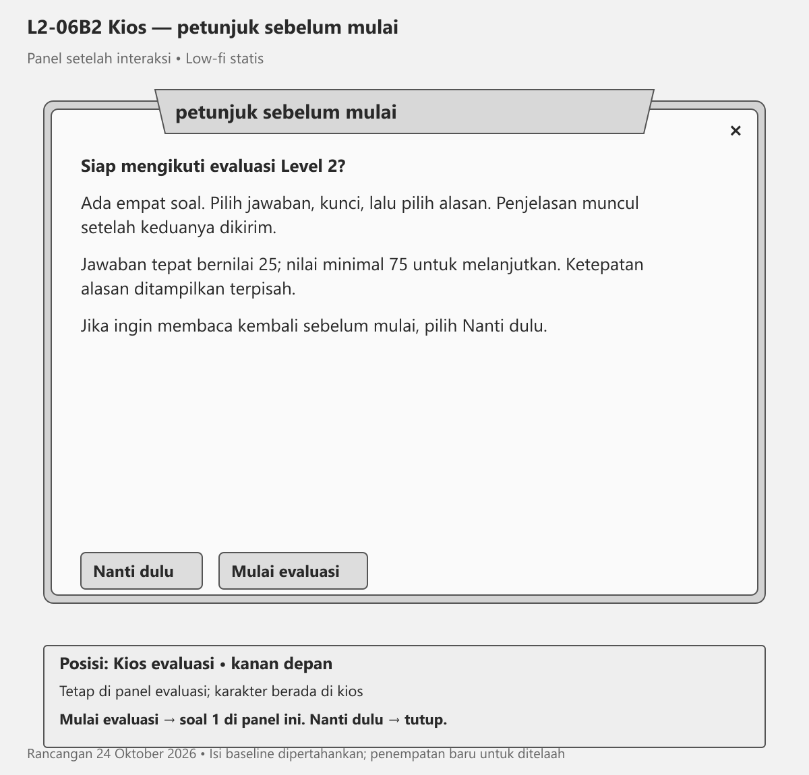

## L2-07Q1A — Evaluasi 1/4 — jawaban

Berdasarkan teks, bagaimana perbedaan cara kerja sistem operasi Android dan Windows pada Cloud AI Pad?

A. Android dijalankan secara lokal, sedangkan Windows dijalankan melalui cloud

B. Android dan Windows sama-sama dijalankan melalui cloud

C. Windows dijalankan secara lokal, sedangkan Android melalui cloud

D. Keduanya dijalankan secara native di perangkat tablet

E. Android dan Windows hanya dapat digunakan secara bergantian melalui restart

Perilaku: Isi persis dari tab peta aktif. Kunci tier 1: A. Batang, opsi, dan kunci mengikuti baseline Sanubari. Kunci hanya untuk penelaah. Pilihan dapat diganti sampai Kunci jawaban dipilih; tombol nonaktif sebelum ada pilihan. Setelah dikunci, tampilkan tier2 tanpa warna benar/salah. Lokasi/status: Kios evaluasi • kanan depan. Tetap di panel evaluasi; karakter berada di kios. Pindah halaman panel. Tidak perlu E atau berjalan lagi.

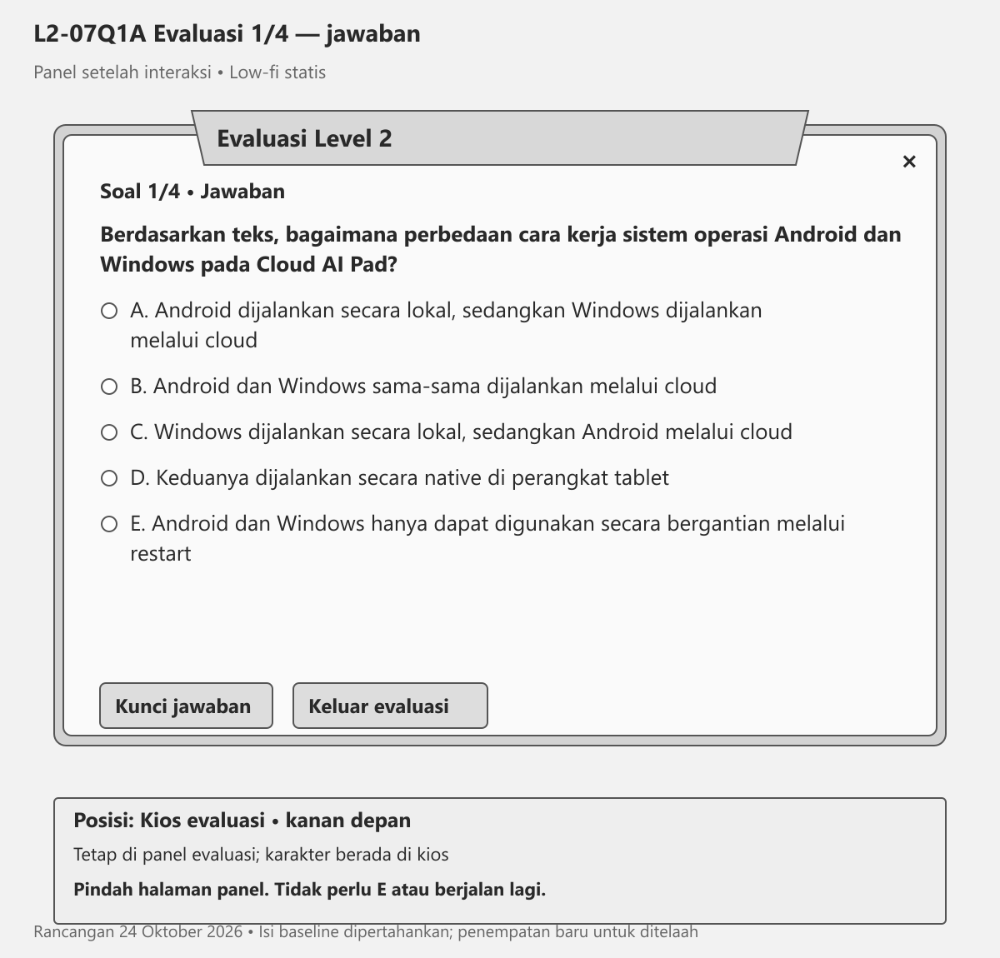

## L2-07Q1B — Evaluasi 1/4 — alasan

Alasan atau bukti manakah yang paling tepat mendukung jawaban pada tingkat pertama?

A. Teks menghubungkan tombol AI dengan lokasi eksekusi kedua sistem operasi.

B. Teks menyebut Windows dijalankan lokal dan Android diakses melalui cloud.

C. Teks menyebut Android dijalankan lokal dan Windows diakses melalui cloud.

D. Teks menyebut Android dan Windows dijalankan langsung pada perangkat tablet.

Perilaku: Ringkasan jawaban di atas menggunakan contoh UI, bukan kunci yang dibocorkan. Isi opsi alasan persis dari tab peta. Kunci tier 2: C. Bukti penjelas: Teks menyebut Android lokal dan Windows melalui cloud. Kunci hanya untuk penelaah. Kirim aktif setelah alasan dipilih; setelah dikirim tidak dapat diubah pada percobaan ini. Lokasi/status: Kios evaluasi • kanan depan. Tetap di panel evaluasi; karakter berada di kios. Pindah halaman panel. Tidak perlu E atau berjalan lagi.

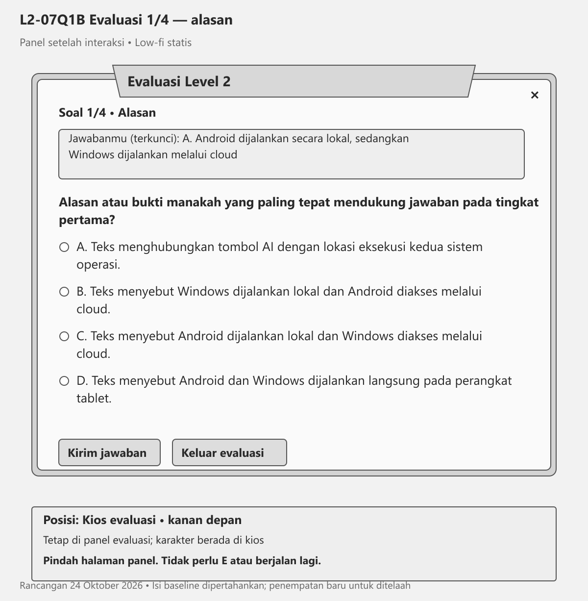

## L2-07Q2A — Evaluasi 2/4 — jawaban

Berdasarkan teks, mengapa pendekatan dual sistem operasi yang diterapkan pada Cloud AI Pad dianggap sebagai inovasi yang signifikan dalam industri tablet saat ini?

A. Karena tablet Cloud AI Pad merupakan satu-satunya perangkat yang pernah menggunakan sistem operasi Android

B. Karena penggunaan dua sistem operasi dalam satu perangkat masih jarang ditemui dan mampu menjawab kebutuhan fleksibilitas sekaligus produktivitas pengguna

C. Karena Cloud AI Pad menggantikan sistem operasi Windows dengan sistem operasi buatan China secara penuh

D. Karena tablet ini menggunakan satu sistem operasi dengan dua antarmuka yang berbeda secara tampilan

E. Karena Cloud AI Pad menjalankan Linux dan Windows secara bersamaan untuk pertama kalinya

Perilaku: Isi persis dari tab peta aktif. Kunci tier 1: B. Batang, opsi, dan kunci mengikuti baseline Sanubari. Kunci hanya untuk penelaah. Pilihan dapat diganti sampai Kunci jawaban dipilih; tombol nonaktif sebelum ada pilihan. Setelah dikunci, tampilkan tier2 tanpa warna benar/salah. Lokasi/status: Kios evaluasi • kanan depan. Tetap di panel evaluasi; karakter berada di kios. Pindah halaman panel. Tidak perlu E atau berjalan lagi.

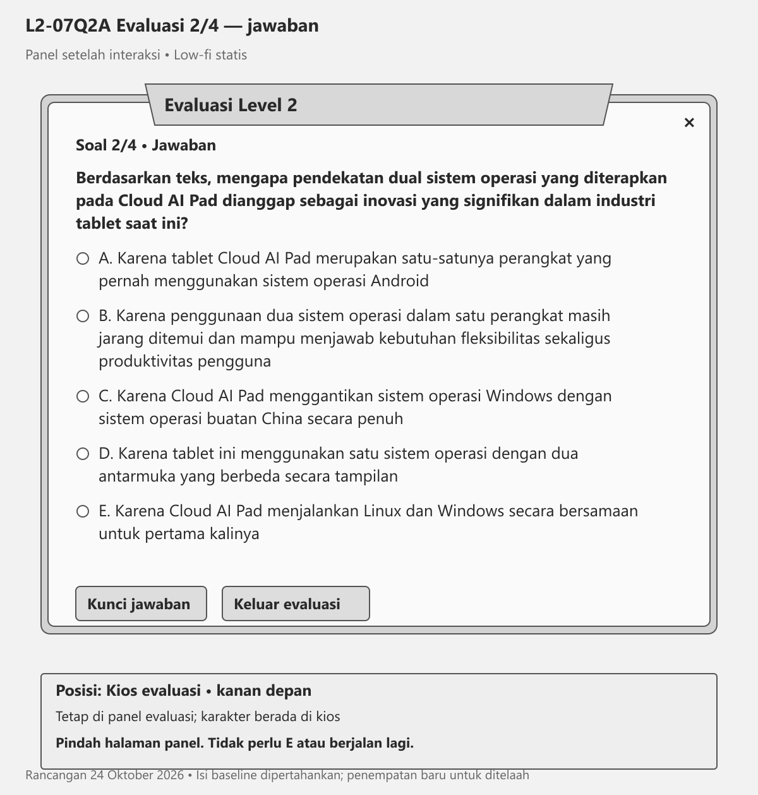

## L2-07Q2B — Evaluasi 2/4 — alasan

Alasan atau bukti manakah yang paling tepat mendukung jawaban pada tingkat pertama?

A. Teks menekankan fleksibilitas Android dan produktivitas Windows dalam pendekatan ganda.

B. Teks menekankan penggunaan Android pada tablet untuk pertama kalinya dalam industri.

C. Teks menekankan dua antarmuka sebagai bukti adanya dua sistem operasi berbeda.

D. Teks menekankan penggantian Windows dengan Linux sebagai pembaruan utama perangkat tablet.

Perilaku: Ringkasan jawaban di atas menggunakan contoh UI, bukan kunci yang dibocorkan. Isi opsi alasan persis dari tab peta. Kunci tier 2: A. Bukti penjelas: Teks menyebut satu perangkat memberi fleksibilitas Android dan produktivitas Windows dengan pendekatan ganda yang jarang ditemui. Kunci hanya untuk penelaah. Kirim aktif setelah alasan dipilih; setelah dikirim tidak dapat diubah pada percobaan ini. Lokasi/status: Kios evaluasi • kanan depan. Tetap di panel evaluasi; karakter berada di kios. Pindah halaman panel. Tidak perlu E atau berjalan lagi.

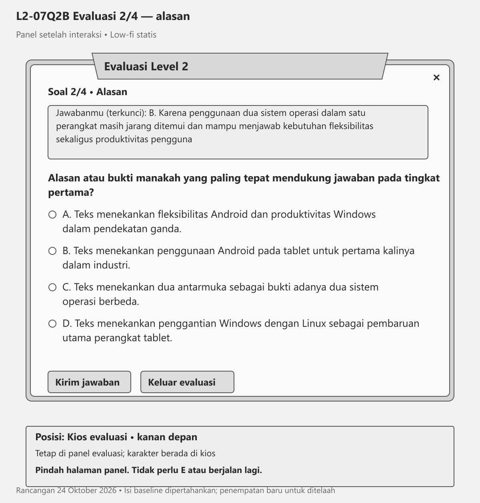

## L2-07Q3A — Evaluasi 3/4 — jawaban

Apa keunggulan penggunaan konsep dual sistem operasi pada Cloud AI Pad dibandingkan tablet pada umumnya?

A. Tablet dapat menjalankan semua sistem operasi

B. Pengguna dapat memanfaatkan fleksibilitas Android dan produktivitas Windows dalam satu perangkat

C. Tablet dapat berfungsi tanpa perangkat keras tambahan

D. Sistem operasi tidak lagi memerlukan pembaruan perangkat lunak

E. Semua aplikasi dapat berjalan tanpa koneksi internet

Perilaku: Isi persis dari tab peta aktif. Kunci tier 1: B. Batang, opsi, dan kunci mengikuti baseline Sanubari. Kunci hanya untuk penelaah. Pilihan dapat diganti sampai Kunci jawaban dipilih; tombol nonaktif sebelum ada pilihan. Setelah dikunci, tampilkan tier2 tanpa warna benar/salah. Lokasi/status: Kios evaluasi • kanan depan. Tetap di panel evaluasi; karakter berada di kios. Pindah halaman panel. Tidak perlu E atau berjalan lagi.

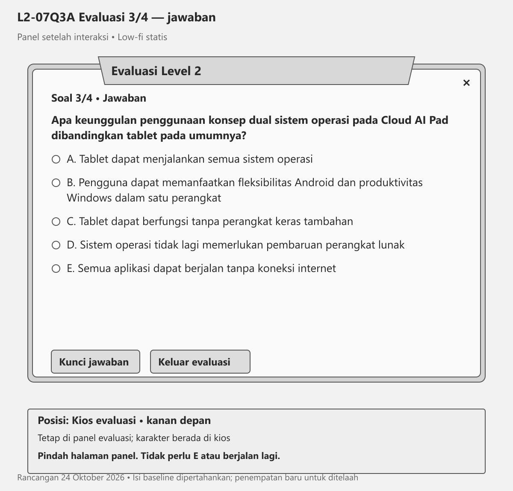

## L2-07Q3B — Evaluasi 3/4 — alasan

Alasan atau bukti manakah yang paling tepat mendukung jawaban pada tingkat pertama?

A. Teks menjelaskan seluruh aplikasi kedua sistem dapat digunakan tanpa koneksi internet.

B. Teks mengaitkan dua sistem dalam satu perangkat dengan kebutuhan harian dan produktivitas.

C. Teks menjelaskan kedua sistem dapat berfungsi tanpa komponen fisik pada perangkat tablet.

D. Teks menjelaskan pembaruan kedua sistem tidak lagi diperlukan untuk mendukung produktivitas pengguna.

Perilaku: Ringkasan jawaban di atas menggunakan contoh UI, bukan kunci yang dibocorkan. Isi opsi alasan persis dari tab peta. Kunci tier 2: B. Bukti penjelas: Teks mengaitkan Android dan Windows dalam satu perangkat dengan kebutuhan sehari-hari dan produktivitas. Kunci hanya untuk penelaah. Kirim aktif setelah alasan dipilih; setelah dikirim tidak dapat diubah pada percobaan ini. Lokasi/status: Kios evaluasi • kanan depan. Tetap di panel evaluasi; karakter berada di kios. Pindah halaman panel. Tidak perlu E atau berjalan lagi.

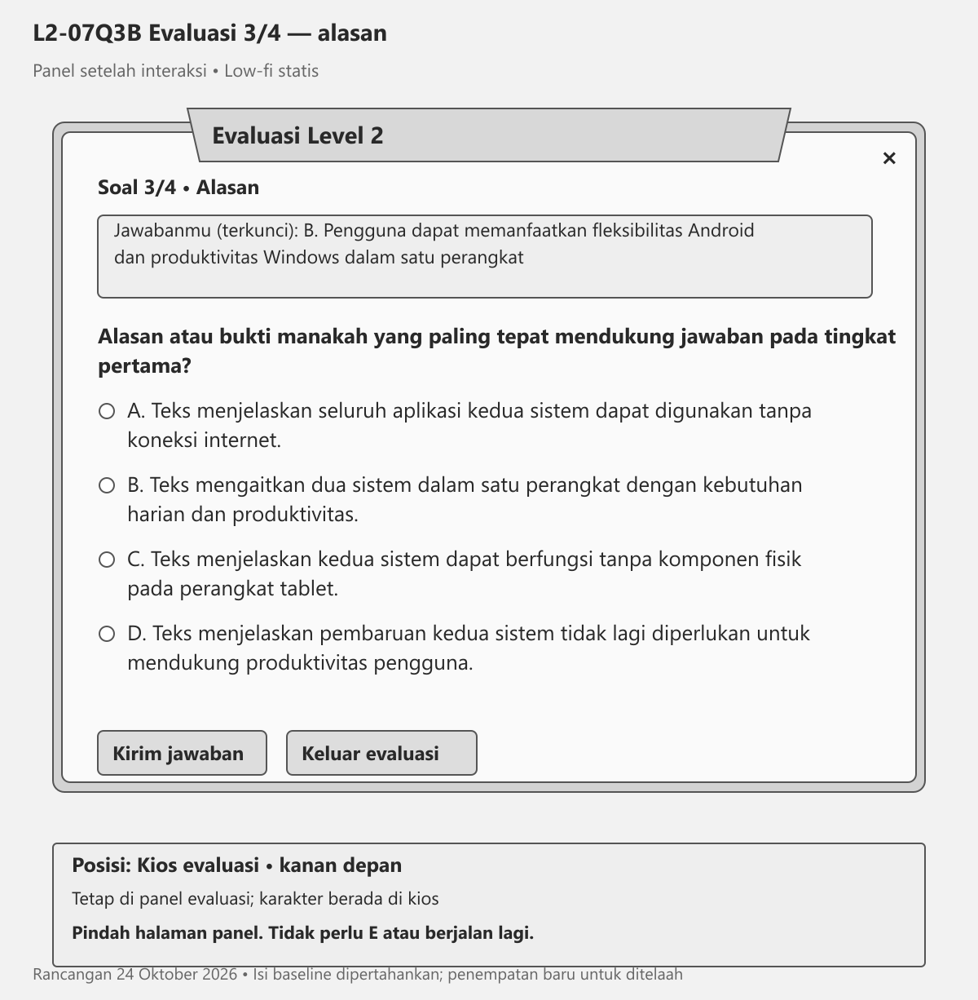

## L2-07Q4A — Evaluasi 4/4 — jawaban

Berdasarkan teks, Cloud AI Pad menjalankan Android secara lokal dan Windows melalui cloud. Analisislah implikasi dari pendekatan ini terhadap ketergantungan pengguna pada koneksi internet dalam penggunaan perangkat!

A. Pengguna tidak membutuhkan koneksi internet sama sekali karena kedua sistem berjalan secara lokal

B. Pengguna sepenuhnya bergantung pada internet karena kedua sistem berjalan melalui cloud

C. Android berjalan lokal tanpa bergantung cloud untuk menjalankan OS, sedangkan akses Windows cloud bergantung koneksi; aplikasi Android tertentu tetap dapat memerlukan internet

D. Koneksi internet hanya diperlukan saat memperbarui sistem operasi Android

E. Ketergantungan pada internet tidak relevan karena fitur AI menggantikan fungsi koneksi

Perilaku: Isi persis dari tab peta aktif. Kunci tier 1: C. Opsi C merupakan usulan koreksi baseline untuk ditelaah ahli. Kunci hanya untuk penelaah. Opsi C adalah usulan koreksi baseline yang sudah tercatat; belum ACC ahli. Pilihan dapat diganti sampai Kunci jawaban dipilih; tombol nonaktif sebelum ada pilihan. Setelah dikunci, tampilkan tier2 tanpa warna benar/salah. Lokasi/status: Kios evaluasi • kanan depan. Tetap di panel evaluasi; karakter berada di kios. Pindah halaman panel. Tidak perlu E atau berjalan lagi.

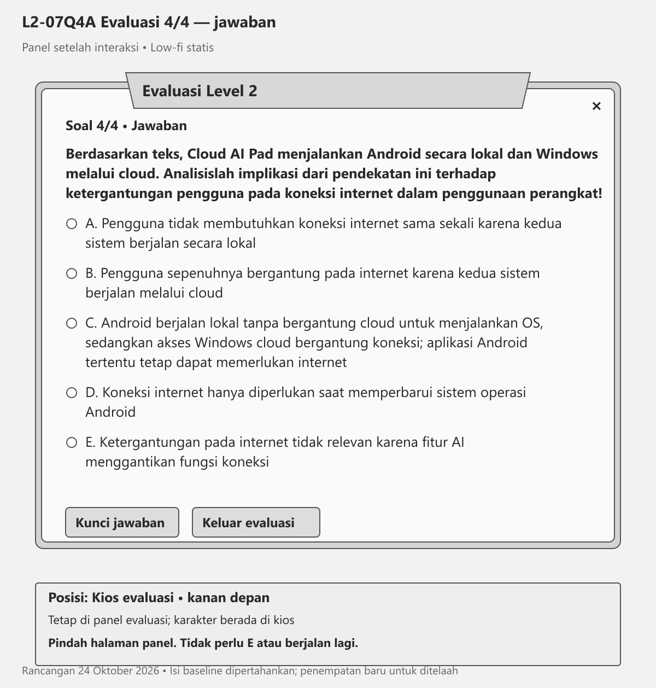

## L2-07Q4B — Evaluasi 4/4 — alasan

Alasan atau bukti manakah yang paling tepat mendukung jawaban pada tingkat pertama?

A. Teks menyebut eksekusi Android lokal menjamin semua aplikasinya selalu dapat berjalan offline.

B. Teks menyebut tombol AI menggantikan kebutuhan koneksi saat pengguna mengakses layanan Windows cloud.

C. Teks menyebut Android dan Windows sama-sama berjalan lokal tanpa bergantung pada layanan cloud.

D. Teks membedakan Android lokal dari Windows cloud, tanpa menjamin semua aplikasi Android offline.

Perilaku: Ringkasan jawaban di atas menggunakan contoh UI, bukan kunci yang dibocorkan. Isi opsi alasan persis dari tab peta. Kunci tier 2: D. Bukti penjelas: Eksekusi Android lokal dibedakan dari akses Windows cloud yang bergantung koneksi, tanpa menjamin semua aplikasi Android offline. Kunci hanya untuk penelaah. Kirim aktif setelah alasan dipilih; setelah dikirim tidak dapat diubah pada percobaan ini. Lokasi/status: Kios evaluasi • kanan depan. Tetap di panel evaluasi; karakter berada di kios. Pindah halaman panel. Tidak perlu E atau berjalan lagi.

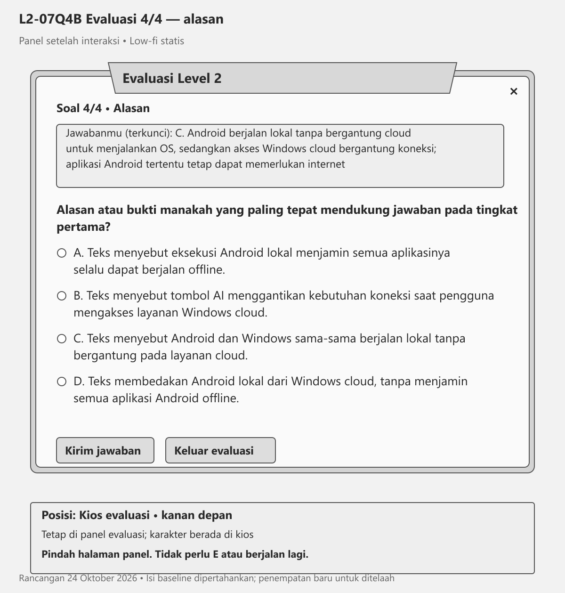

## L2-08F1 — Umpan balik — jawaban tepat • alasan tepat

Jawaban tepat • Alasan tepat

Contoh soal 1 • Jawaban A • Alasan C

Benar. Android lokal dan Windows melalui cloud sesuai informasi teks.

Alasan C tepat: teks membedakan Android lokal dan Windows cloud.

Bukti: teks menyebut Android lokal dan Windows melalui cloud.

Nilai jawaban soal ini: 25/25. Alasan dicatat terpisah.

Perilaku: Contoh tampilan, bukan data penelitian. Pesan sesuai pilihan yang dikirim; gunakan 36 pesan koreksi Level2 pada tab peta. Penjelasan setelah dua tier dikirim, bukan setelah tier1 saja. Soal berikutnya untuk nomor1–3; pada soal4 tombol menjadi Lihat hasil. Lokasi/status: Kios evaluasi • kanan depan. Tetap di panel evaluasi; karakter berada di kios. Pindah halaman panel. Tidak perlu E atau berjalan lagi.

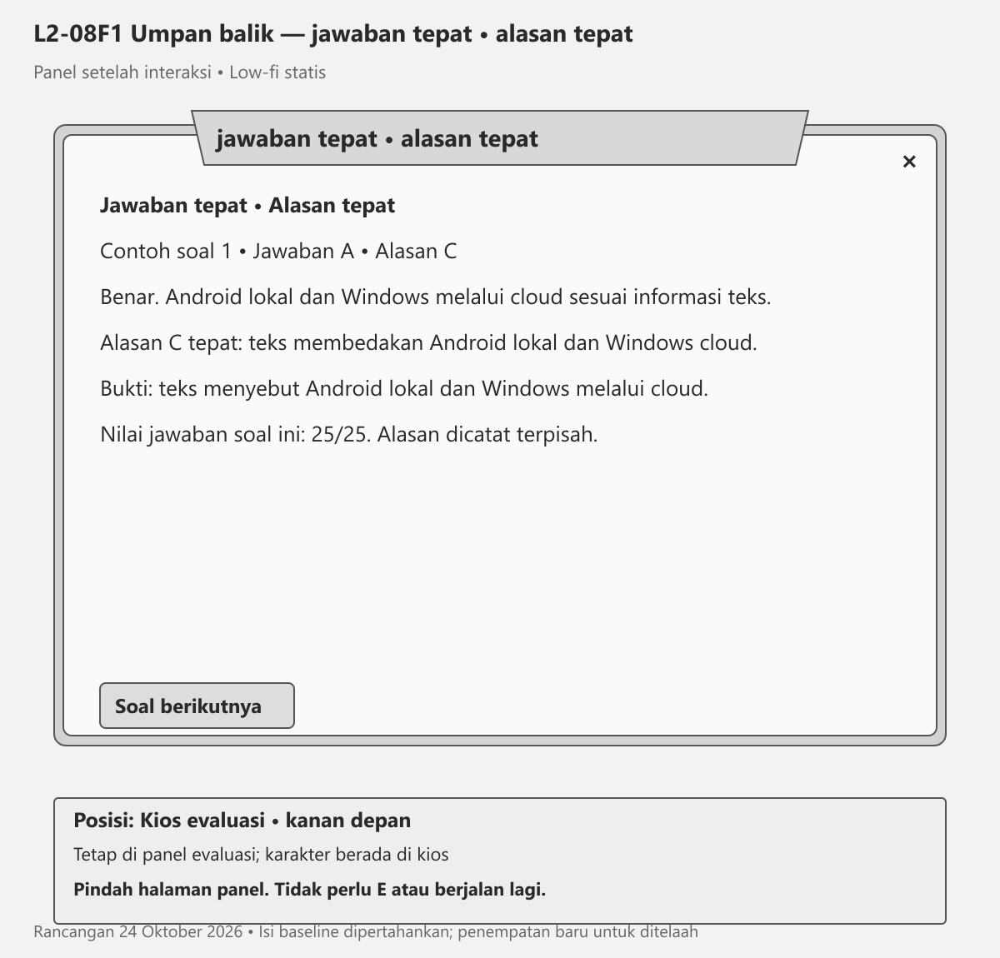

## L2-08F2 — Umpan balik — jawaban belum tepat • alasan tepat

Jawaban belum tepat • Alasan tepat

Contoh soal 1 • Jawaban B • Alasan C

Hanya Windows yang dinyatakan melalui cloud; Android dinyatakan lokal.

Alasan C tepat: teks membedakan Android lokal dan Windows cloud.

Bukti: teks menyebut Android lokal dan Windows melalui cloud.

Nilai jawaban soal ini: 0/25. Alasan dicatat terpisah.

Perilaku: Contoh tampilan, bukan data penelitian. Pesan sesuai pilihan yang dikirim; gunakan 36 pesan koreksi Level2 pada tab peta. Penjelasan setelah dua tier dikirim, bukan setelah tier1 saja. Soal berikutnya untuk nomor1–3; pada soal4 tombol menjadi Lihat hasil. Lokasi/status: Kios evaluasi • kanan depan. Tetap di panel evaluasi; karakter berada di kios. Pindah halaman panel. Tidak perlu E atau berjalan lagi.

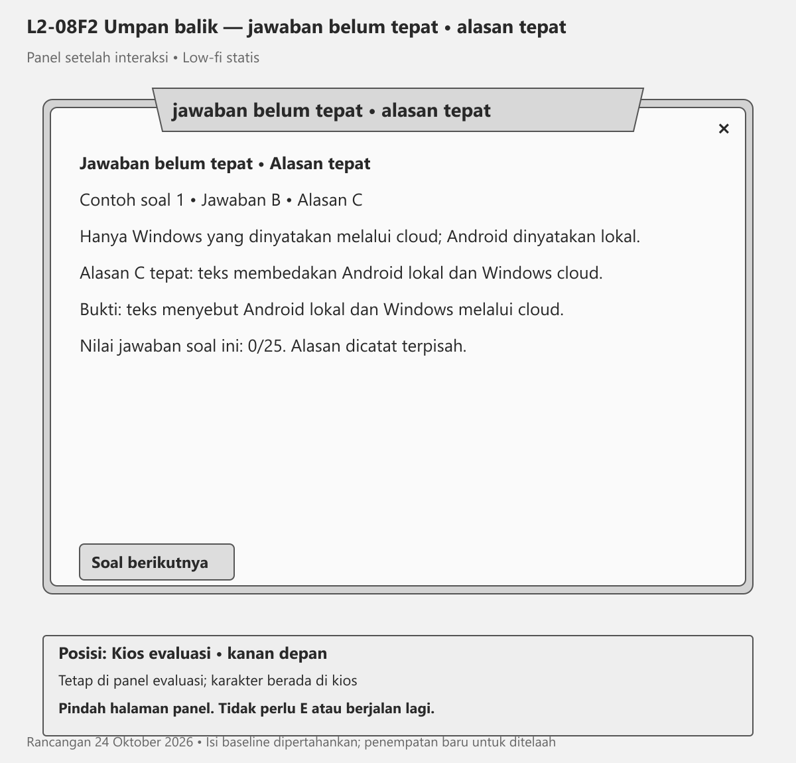

## L2-08F3 — Umpan balik — jawaban tepat • alasan belum tepat

Jawaban tepat • Alasan belum tepat

Contoh soal 1 • Jawaban A • Alasan A

Benar. Android lokal dan Windows melalui cloud sesuai informasi teks.

Alasan A memakai tombol AI, padahal soal menanyakan lokasi eksekusi OS.

Bukti: teks menyebut Android lokal dan Windows melalui cloud.

Nilai jawaban soal ini: 25/25. Alasan dicatat terpisah.

Perilaku: Contoh tampilan, bukan data penelitian. Pesan sesuai pilihan yang dikirim; gunakan 36 pesan koreksi Level2 pada tab peta. Penjelasan setelah dua tier dikirim, bukan setelah tier1 saja. Soal berikutnya untuk nomor1–3; pada soal4 tombol menjadi Lihat hasil. Lokasi/status: Kios evaluasi • kanan depan. Tetap di panel evaluasi; karakter berada di kios. Pindah halaman panel. Tidak perlu E atau berjalan lagi.

## L2-08F4 — Umpan balik — jawaban belum tepat • alasan belum tepat

Jawaban belum tepat • Alasan belum tepat

Contoh soal 1 • Jawaban B • Alasan A

Hanya Windows yang dinyatakan melalui cloud; Android dinyatakan lokal.

Alasan A memakai tombol AI, padahal soal menanyakan lokasi eksekusi OS.

Bukti: teks menyebut Android lokal dan Windows melalui cloud.

Nilai jawaban soal ini: 0/25. Alasan dicatat terpisah.

Perilaku: Contoh tampilan, bukan data penelitian. Pesan sesuai pilihan yang dikirim; gunakan 36 pesan koreksi Level2 pada tab peta. Penjelasan setelah dua tier dikirim, bukan setelah tier1 saja. Soal berikutnya untuk nomor1–3; pada soal4 tombol menjadi Lihat hasil. Lokasi/status: Kios evaluasi • kanan depan. Tetap di panel evaluasi; karakter berada di kios. Pindah halaman panel. Tidak perlu E atau berjalan lagi.

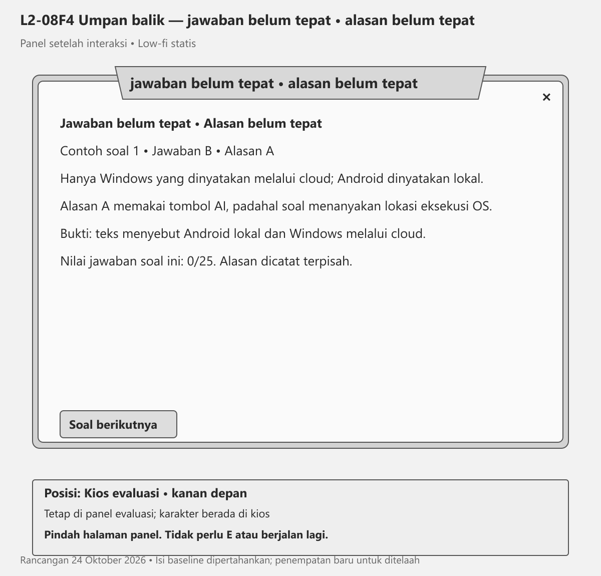

## L2-08X — Konfirmasi keluar evaluasi

Keluar dari evaluasi?

Percobaan ini belum selesai. Jika keluar, jawaban percobaan ini dibatalkan dan belum ada nilai akhir.

Progres materi dan latihan tetap tersimpan selama sesi.

Perilaku: Tetap mengerjakan kembali ke soal dan pilihan yang sama. Ya keluar menutup evaluasi dan mengarahkan kembali belajar; bukan hasil gagal bernilai0. Mengikuti pola Level1 yang sudah ditelaah, bukan aturan baru tentang jumlah retry. Lokasi/status: Kios evaluasi • kanan depan. Tetap di panel evaluasi; karakter berada di kios. Tetap = kembali soal. Ya keluar = tutup dan kembali ke gedung.

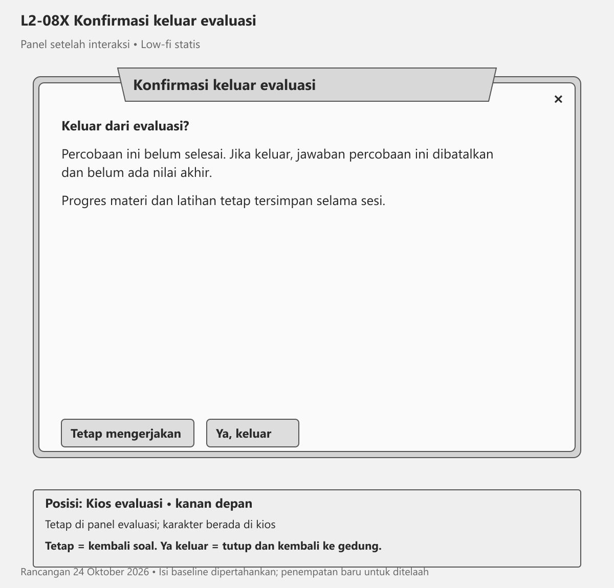

## L2-09B1 — Hasil Level 2 — lulus

Level 2 selesai.

Nilai jawaban: 75/100

Jawaban tepat: 3/4 • Alasan tepat: 2/4

Kamu memenuhi nilai minimal 75. Selanjutnya, keluar dari gedung dan ikuti penunjuk menuju Level 3.

Perilaku: Angka hanya ilustrasi. Nilai tier1 jumlah benar×25; alasan0–4 terpisah. Lanjut menutup panel, membuka akses belajar Level3 dan menampilkan arah ke pintu keluar lalu gedungLevel3. Tidak teleportasi dan tidak menambah tugas perjalanan. Lokasi/status: Kios evaluasi • kanan depan. Tetap di panel evaluasi; karakter berada di kios. Lanjut ke Level 3 → tutup panel → berjalan ke 10A pintu.

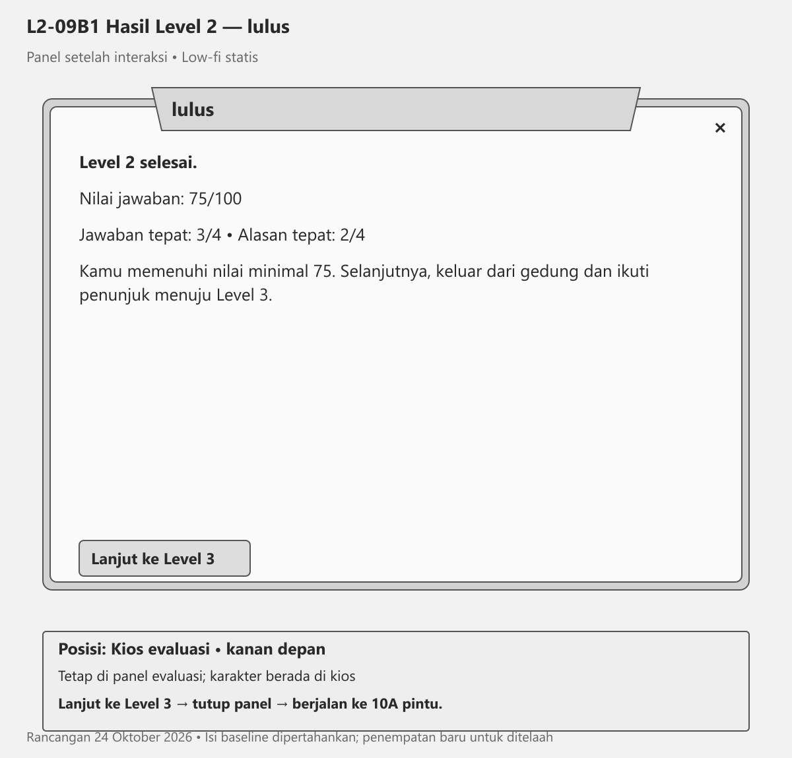

## L2-09B2 — Hasil Level 2 — belum lulus

Level 2 belum tuntas.

Nilai jawaban: 50/100

Jawaban tepat: 2/4 • Alasan tepat: 3/4

Nilai minimal untuk melanjutkan adalah 75. Baca kembali materi atau latihan, lalu kembali ke kios untuk mencoba lagi.

Perilaku: Angka hanya contoh. Belajar kembali menutup panel dan memberi arah ke papan berita; pengguna boleh membuka materi/latihan yang relevan tanpa mereset seluruh progres. AksesLevel3 belum dibuka. Batas waktu/percobaan dan nilai percobaan penelitian mengikuti SOP yang belum final. Lokasi/status: Kios evaluasi • kanan depan. Tetap di panel evaluasi; karakter berada di kios. Belajar kembali → tutup → jalan ke papan berita kiri.

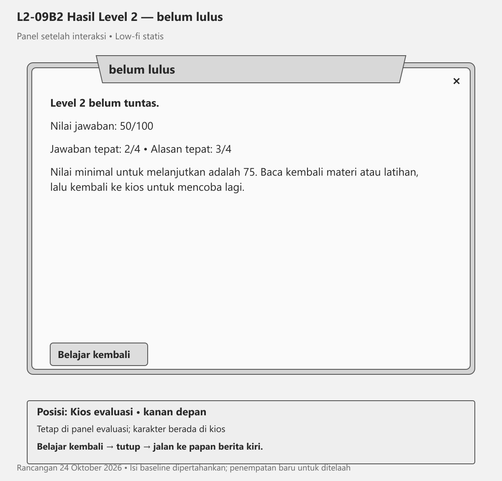

## L2-10A — Keluar gedung menuju Level 3

Tujuan: Keluar melalui pintu masuk, lalu menuju Level 3.

Pintu keluar

Ikuti penunjuk ke Level 3.

Perilaku: Sesudah lulus, pemain berjalan dari kios kanan depan menuju pintu tengah yang sama, lalu mengikuti penunjuk lama ke Level3. Seluruh kegiatanLevel2 di dalam gedung; tanpa interaksi perjalanan tambahan. Alur visual: Kios • sesudah lulus 09B1 → Berjalan ke pintu tengah. Setelah interaksi: Tanpa panel baru. Keluar gedung → ikuti penunjuk Level 3. Pemain dan NPC ditampilkan sebagai avatar blok; gambar adalah usulan gameplay, bukan screenshot Studio.

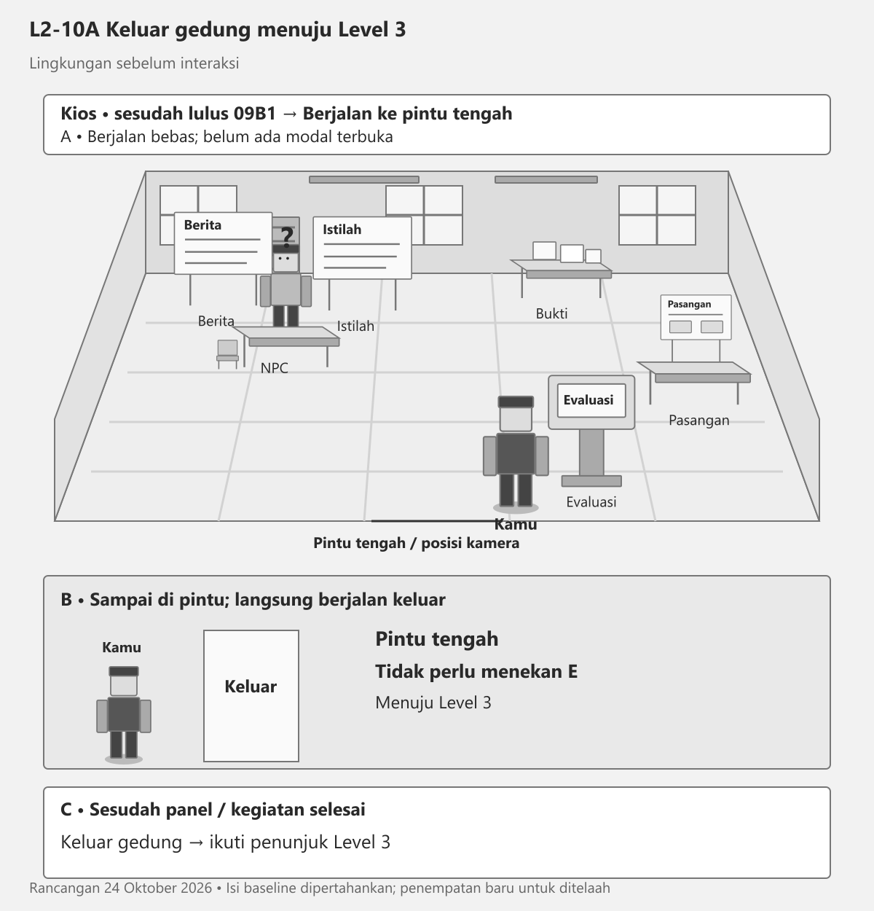
