# Storyboard Level 3 — fokus satu gedung, usulan24Oktober2026

Acuan: tab peta aktif dan foto40–55 DocsAll. Fokus hanyaLevel3; arsip aula ditunda.

## L3-00 — Peta kegiatan Level 3

Perilaku: Fokus hanya satu gedungLevel3. Pintu di tengah depan; kiri/kanan dilihat saat masuk. Kanan: NPC pembuka, papan istilah opsional, meja abstrak. Kiri: papan fungsi gagasan, papan batas simpulan, kios evaluasi dekat depan. Rute: masuk → NPC kanan → abstrak kanan → menyeberang melalui jalur tengah → gagasan kiri → simpulan kiri → kios kiri → setelah lulus pintu tengah. Ruang tetap terbuka tanpa sekat, tambahanNPC atau lantai. Enam titik kegiatan bukan enam ruangan. Posisi relatif, bukan CFrame terukur. Materi/latihan/soal dipertahankan. Aula dibahas terpisah setelahLevel3.

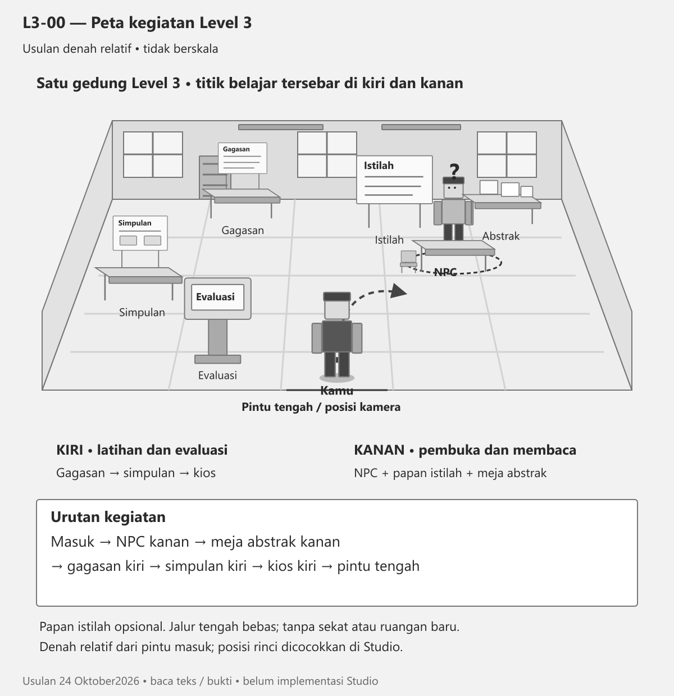

## L3-01A — Masuk gedung dan temui NPC

Tujuan: Temui pemandu Level 3.

Pemandu Level 3

Tahan E — Bicara

Perilaku: Akses gedung Level 3 terbuka setelah Level 2 lulus minimal 75. Jika belum, pemain tetap di luar dengan tulisan “Selesaikan Level 2 terlebih dahulu”; tidak ada modal atau tombol E di pintu. Setelah terbuka, masuk dari pintu tengah dan berjalan ke NPC lama di kanan. NPC langsung membuka pembuka, tanpa cabang penolakan akses. Tidak menambah tugas perjalanan; gedung sebelumnya tetap dapat dikunjungi. Posisi NPC dan isi pembelajaran dipertahankan.

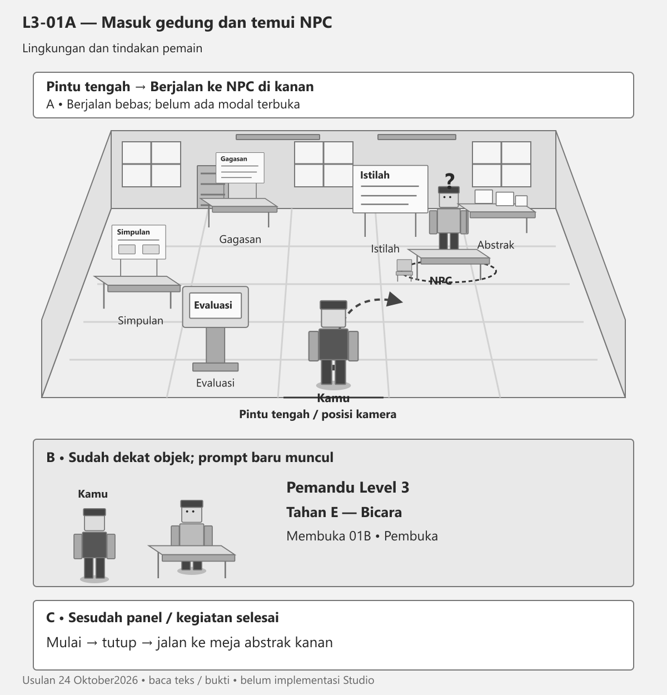

## L3-01B — NPC — pembuka membaca lanjutan

Selamat datang di Level 3 — Keterampilan Membaca Lanjutan.

Pada level ini, Anda akan membaca sebuah teks abstrak ilmiah yang membahas evolusi sistem operasi modern serta pergeseran dari pendekatan process-centric menuju data-centric.

Bacalah dengan saksama dan perhatikan hubungan antargagasan dalam setiap paragraf. Papan istilah tersedia bila diperlukan.

Setelah membaca, susun fungsi gagasan dan tuntaskan empat ronde pemeriksaan simpulan berdasarkan bukti, lalu kerjakan empat soal evaluasi.

Tekan Mulai untuk menuju meja abstrak.

Perilaku: Pembuka mengikuti versi sebelumnya. NPC tetap di kanan. Mulai menutup panel dan menunjuk meja abstrak di kanan; pemain berjalan lalu berinteraksi lagi. Isi tujuan membaca dan latihan dipertahankan.

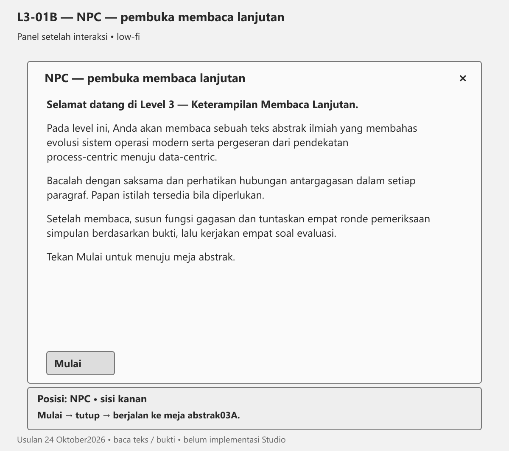

## L3-02A — Papan istilah di dekat NPC

Bantuan opsional: istilah dalam abstrak.

Istilah dalam abstrak

Tahan E — Lihat istilah

Perilaku: Papan istilah dekatNPC di kanan. Bantuan opsional tanpa skor/prasyarat. Tutup kembali ke posisi dan tujuan belajar sebelumnya.

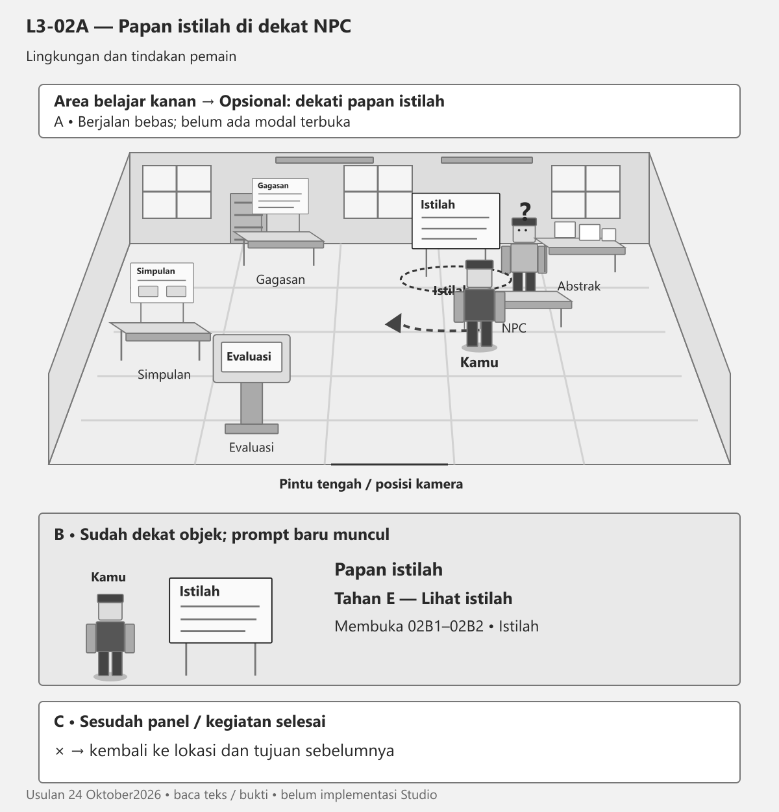

## L3-02B1 — Istilah — halaman 1/2

Inersia sistem operasi

Kecenderungan sistem operasi dan model pemrograman lama mempertahankan desain serta pendekatan tradisional meskipun teknologi perangkat keras berkembang.

Overhead

Beban tambahan untuk mendukung proses utama; pada bacaan muncul melalui lapisan kompatibilitas, pengelolaan kernel atau serialisasi.

Throughput dan latensi

Throughput: jumlah pekerjaan/data yang diproses per satuan waktu. Latensi: waktu untuk merespons permintaan.

Perilaku: Mengacu isi foto44, diringkas untuk keterbacaan. Istilah tetap bantuan memahami teks, tidak menjadi jawaban latihan otomatis. Berikutnya mengganti halaman pada papan yang sama.

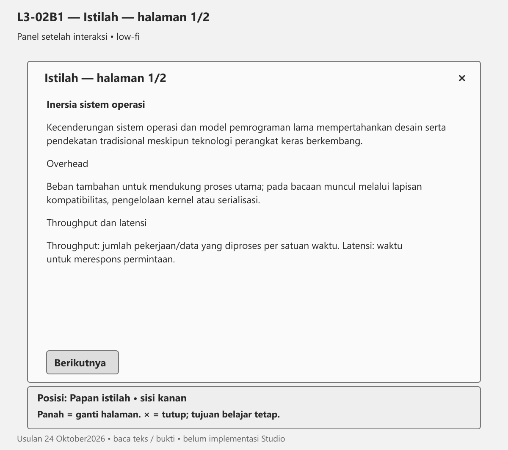

## L3-02B2 — Istilah — halaman 2/2

Kernel

Inti dari sistem operasi.

Persistensi data

Kemampuan data tetap tersimpan meskipun sistem dimatikan atau proses selesai.

Memori bersama

Mekanisme beberapa proses atau node mengakses area memori yang sama untuk pertukaran data.

Perilaku: Mengacu foto45. Definisi kernel hanya memakai frasa yang terlihat pada baseline; tidak menebak lanjutan kalimat yang terpotong. Tidak menambah materi teknis yang diuji terpisah.

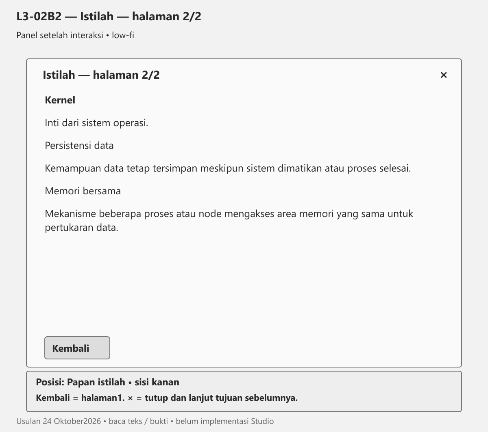

## L3-03A — Menuju meja abstrak

Tujuan: Baca abstrak di meja baca.

Abstrak Twizzler

Tahan E — Baca abstrak

Perilaku: Meja abstrak berada di kanan bersama kelompokNPC/papan istilah. Pemain berjalan pendek lalu tahanE. Satu pembaca tiga bagian; paragraf tidak dipindahkan menjadi tulisan kecil di permukaan meja. Setelah materi lengkap, tutup pembaca lalu menyeberang melalui jalur tengah ke papan gagasan kiri.

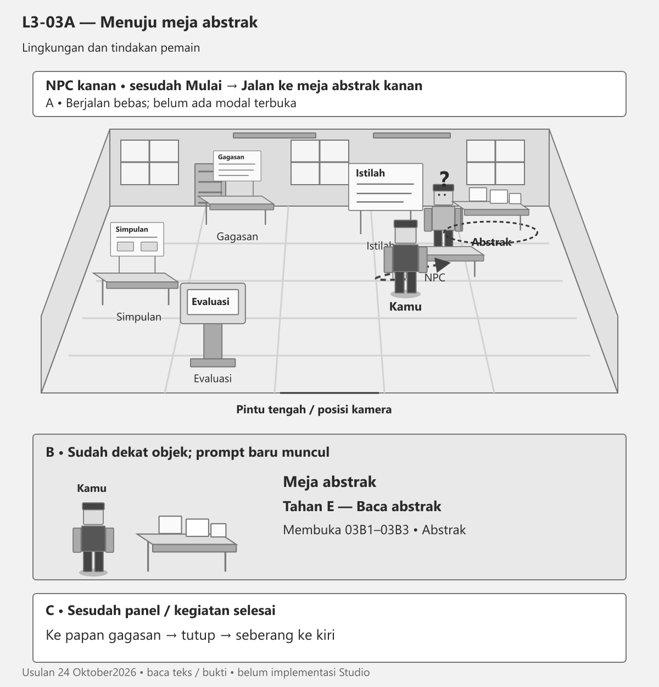

## L3-03B1 — Abstrak — bagian 1/3

Masalah dan motivasi

Sistem operasi dibangun dan dirancang berdasarkan dua kekuatan utama, yaitu kapabilitas perangkat keras dan tuntutan perangkat lunak. Namun, sistem operasi dan model pemrograman tradisional memiliki inersia, sehingga antarmuka untuk perangkat keras baru cenderung mengikuti desain antarmuka yang telah ada sebelumnya. Akibatnya, programmer menjadi terbatas dalam mengekspresikan bagian-bagian penting dari program mereka karena adanya lapisan kompatibilitas dan overhead yang terus dipertahankan, meskipun tuntutan terhadap throughput yang lebih tinggi dan latency yang lebih rendah terus meningkat. Oleh karena itu, abstraksi sistem operasi perlu berevolusi mengikuti perkembangan zaman, karena ketergantungan pada abstraksi lama yang berusia puluhan tahun serta perubahan yang bersifat inkremental berpotensi membatasi pemanfaatan perangkat keras modern hanya melalui antarmuka yang awalnya dirancang untuk media penyimpanan lama seperti pita magnetik dan spinning disk.

Perilaku: Paragraf1 utuh dari tab peta. Baca satu bagian pada satu waktu, Lanjut/Kembali dalam panel yang sama. Posisi baca dan bagian terakhir disimpan selama sesi. Tidak menganggap klikLanjut sebagai bukti pemahaman. Papan istilah dapat dibuka lalu kembali.

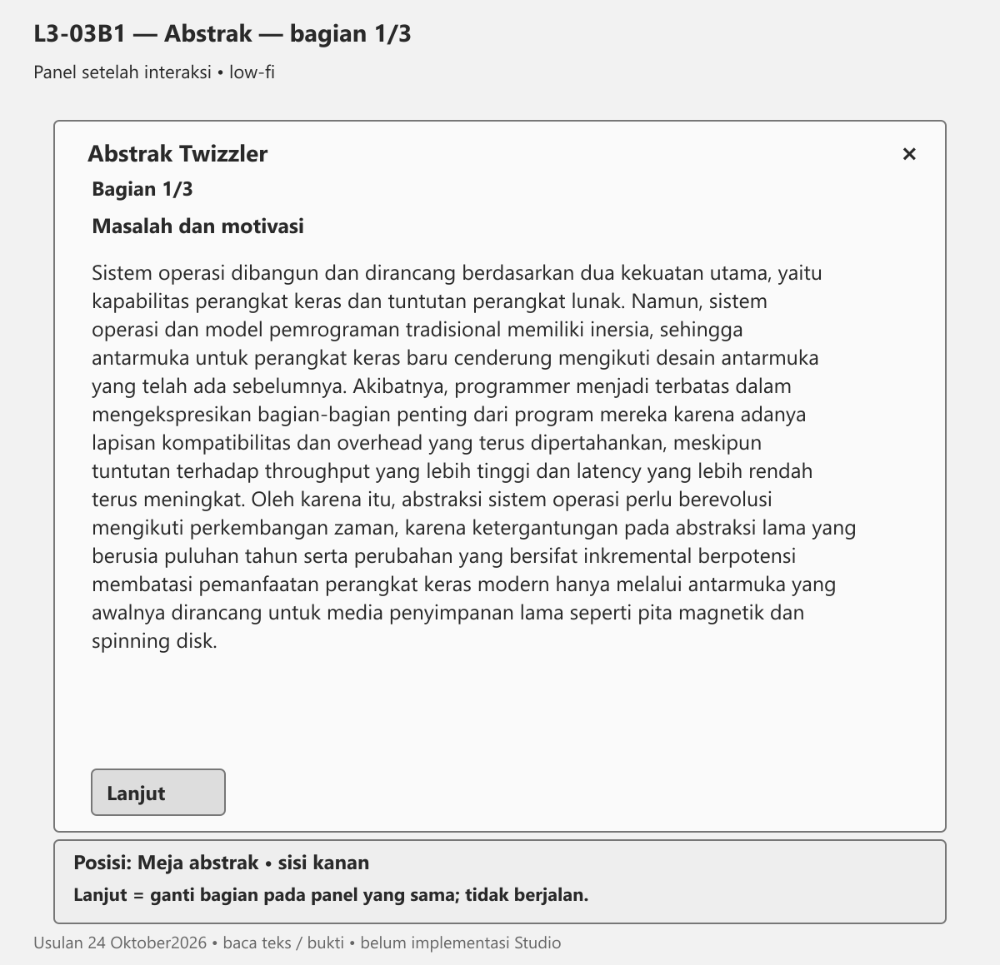

## L3-03B2a — Abstrak — bagian 2/3, posisi awal

Tren perangkat keras dan pendekatan

Saat ini, terdapat peluang untuk mengkaji bagaimana pertemuan berbagai tren dapat menggeser model pemrograman dari sudut pandang tradisional yang berpusat pada proses (process-centric) menuju pendekatan yang berpusat pada data (data-centric), di mana data menjadi entitas utama dalam sistem. Peluang ini muncul seiring dengan perkembangan perangkat keras yang secara langsung memengaruhi cara pandang terhadap jalur akses data serta tanggung jawab sistem operasi dan kernel. Meningkatnya kecepatan teknologi interkoneksi memperkecil jarak latensi antar node komputasi, sehingga meningkatkan efisiensi dan kegunaan shared memory. Selain itu, penyimpanan persisten yang sebelumnya berada di lapisan bawah hierarki memori kini bergerak ke lapisan yang lebih tinggi seiring meningkatnya kecepatan akses perangkat persisten. Kondisi ini menyebabkan overhead jalur akses data berbasis kernel tradisional menjadi faktor dominan dalam biaya akses data persisten. Di sisi lain, meningkatnya heterogenitas serta pemisahan (disaggregation) antara perangkat komputasi dan memori menuntut mobilitas data dan komputasi yang lebih tinggi agar perangkat lunak tetap skalabel, terdistribusi, dan memiliki kinerja tinggi.

Perilaku: Bagian2 mencakup paragraf2–3 utuh.03B2a menunjukkan posisi awal gulir paragraf2,03B2b posisi bawah paragraf3 pada panel yang SAMA. Tidak menambah bagian keempat atau menghapus isi panjang. Label2/3 tetap selama gulir.

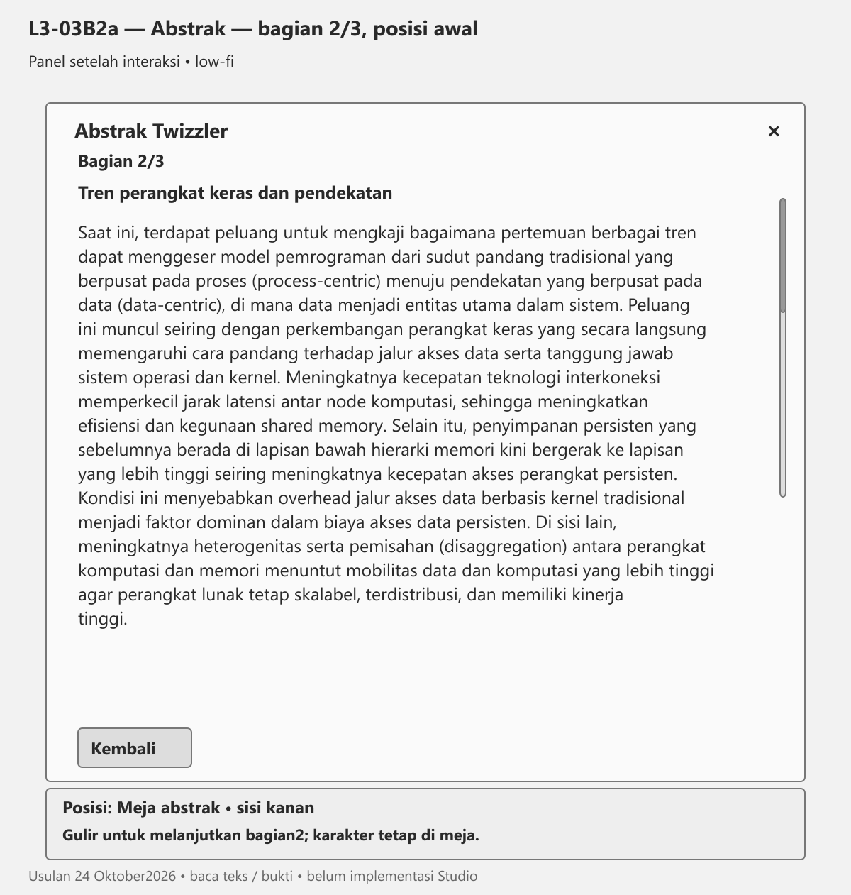

## L3-03B2b — Abstrak — bagian 2/3, posisi bawah

Tren perangkat keras dan pendekatan

Disertasi ini memperkenalkan sistem operasi dan model pemrograman baru yang berorientasi pada data (data-centric), yang dirancang berdasarkan tren-tren tersebut. Pendekatan ini merumuskan ulang tujuan sistem operasi dan memungkinkan peninjauan kembali teknik pemrograman sistem klasik ke dalam model yang memfasilitasi berbagi data, alih-alih menghambatnya. Model pemrograman sistem tradisional umumnya melibatkan kompleksitas dan overhead yang signifikan dalam pengelolaan persistensi dan berbagi data, seperti operasi persistensi berbutir kasar yang mahal, model data RPC yang kaku, serta kebutuhan serialisasi. Sebaliknya, pendekatan data-centric ini mengurangi keterlibatan kernel dalam jalur akses data, menjadikan data bersifat mobile melalui referensi invarian yang tidak bergantung pada ruang alamat atau mesin, serta menghilangkan kebutuhan akan serialisasi.

Perilaku: Paragraf3 utuh, posisi bawah bagian2 yang sama. Lanjut membuka bagian3. Pembaca memakaiScrollingFrame baseline, bukan kamera/objek baru.

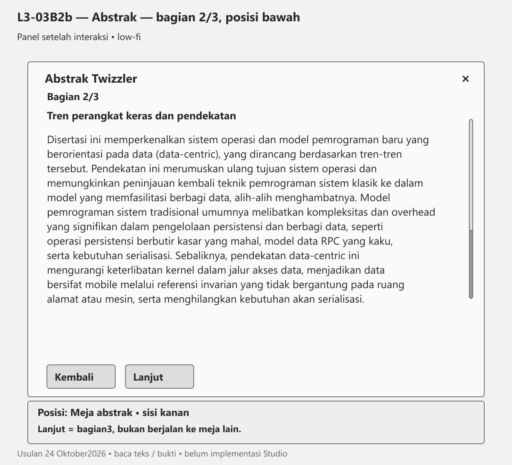

## L3-03B3 — Abstrak — bagian 3/3

Implementasi dan evaluasi

Penelitian ini membahas motivasi dan tren perangkat keras yang melatarbelakangi perancangan sistem tersebut, mendefinisikan ruang desain berdasarkan tren tersebut, serta memperkenalkan Twizzler sebagai salah satu implementasi dalam ruang desain tersebut yang merepresentasikan prinsip-prinsip yang diusulkan. Evaluasi terhadap Twizzler dilakukan melalui studi kasus yang menunjukkan perilaku sistem, efektivitas, dan kegunaan model pemrograman yang dikembangkan, dengan membangun sejumlah perangkat lunak baru khusus untuk Twizzler. Selain itu, aplikasi berukuran besar yang telah di-porting juga digunakan untuk menunjukkan kinerja Twizzler dan model pemrogramannya, yang dalam banyak kasus menunjukkan peningkatan performa semata-mata karena penyederhanaan lapisan perangkat lunak.

Perilaku: Paragraf4 utuh dari tab peta. Ke papan gagasan menutup pembaca dan menunjuk objek04A; tidak langsung membuka latihan. Progres tiga bagian adalah kunjungan, bukan klaim sudah memahami. Materi baseline parafrase Bittman2023 tetap ditelaah ahli; metadata artefak seperti LogoVIAFID tidak disalin.

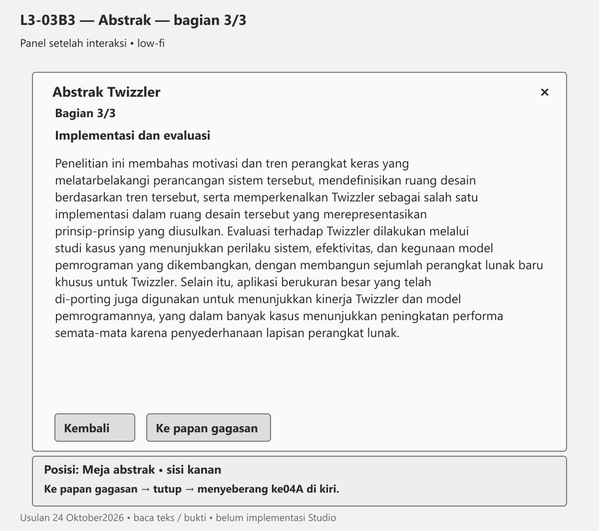

## L3-04A — Mendekati papan fungsi gagasan

Tujuan: Kenali fungsi gagasan dalam abstrak.

Latihan 1 — Fungsi gagasan

Tahan E — Buka latihan

Perilaku: Papan fungsi gagasan di kiri bagian dalam. Setelah membaca di kanan, tutup panel dan berjalan menyeberang melalui jalur tengah, lalu tahanE untuk latihan1. Bentuk meja/papan sederhana, mekanik drag2D dan isi latihan tetap. Jika materi belum lengkap, arahkan bagian yang belum dikunjungi.

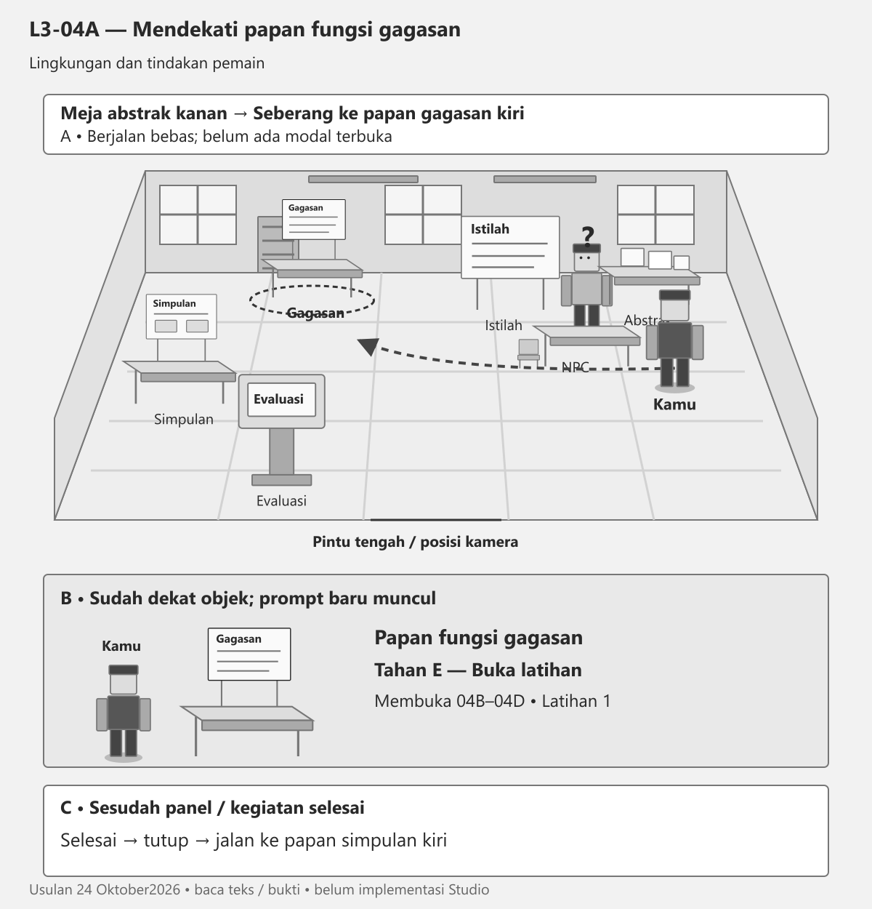

## L3-04B — Latihan 1 — susun fungsi gagasan

Baca potongan gagasan, lalu seret ke fungsi yang sesuai.

Lapisan kompatibilitas dan overhead membatasi pemanfaatan perangkat keras modern.

Pendekatan data-centric dirancang untuk memudahkan berbagi data dan mengurangi beban akses data.

Twizzler dievaluasi melalui studi kasus dan aplikasi yang di-porting.

Perilaku: Tujuan membaca: mengenali fungsi gagasan dan membatasi simpulan pada bukti abstrak; bukan hafalan teori OS. Latihan tanpa skor kelulusan.  Tiga potongan ini ringkasan setia pada bagian1,2,3, bukan kutipan verbatim. Kunci internal: potongan kendala→Masalah, usulan data-centric→Pendekatan, studi kasus→Evaluasi. Tidak meminta definisiOS. Tiga kartu/tiga kotak terlihat bersamaan; tahan→seret→lepas. Lepas di luar/kotak terisi kembali ke posisi sah sebelumnya; ganti dengan mengembalikan kartu ke area kartu dulu. Penilaian hanya setelah Periksa; pasangan salah boleh ditempatkan. Contoh salah: kendala diberiEvaluasi, studi kasus diberiMasalah; pendekatan tetap tepat. Koreksi: kendala melatarbelakangi penelitian, usulan menjelaskan pendekatan, studi kasus menjelaskan cara menilai. Sesudah salah pertama beri petunjuk bagian terkait; jika masih salah pada pemeriksaan berikutnya, tampilkan cuplikan relevan, pengguna tetap menyusun tepat danPeriksa. Status bantuan dibedakan. Jumlah percobaan bantuan usulan telaah, bukanSOP final. Baca abstrak membuka pembaca dan kembali dengan susunan tersimpan.

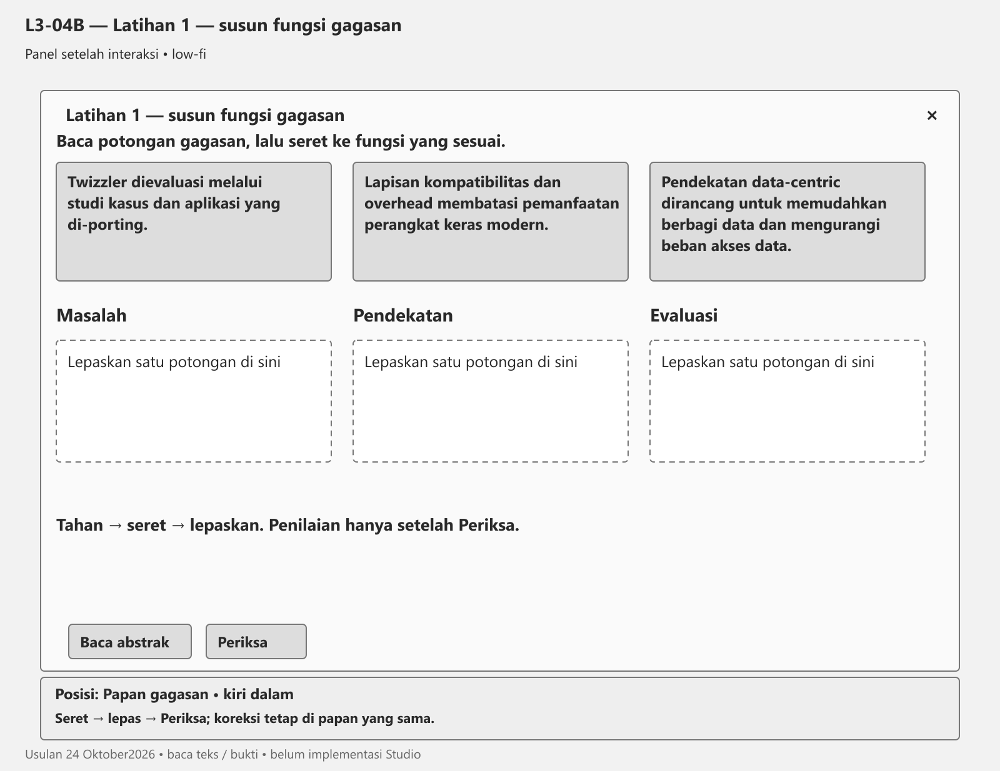

## L3-04C — Latihan 1 — contoh label tertukar

Baca potongan gagasan, lalu seret ke fungsi yang sesuai.

Lapisan kompatibilitas dan overhead membatasi pemanfaatan perangkat keras modern.

Pendekatan data-centric dirancang untuk memudahkan berbagi data dan mengurangi beban akses data.

Twizzler dievaluasi melalui studi kasus dan aplikasi yang di-porting.

Perilaku: Tujuan membaca: mengenali fungsi gagasan dan membatasi simpulan pada bukti abstrak; bukan hafalan teori OS. Latihan tanpa skor kelulusan.  Tiga potongan ini ringkasan setia pada bagian1,2,3, bukan kutipan verbatim. Kunci internal: potongan kendala→Masalah, usulan data-centric→Pendekatan, studi kasus→Evaluasi. Tidak meminta definisiOS. Tiga kartu/tiga kotak terlihat bersamaan; tahan→seret→lepas. Lepas di luar/kotak terisi kembali ke posisi sah sebelumnya; ganti dengan mengembalikan kartu ke area kartu dulu. Penilaian hanya setelah Periksa; pasangan salah boleh ditempatkan. Contoh salah: kendala diberiEvaluasi, studi kasus diberiMasalah; pendekatan tetap tepat. Koreksi: kendala melatarbelakangi penelitian, usulan menjelaskan pendekatan, studi kasus menjelaskan cara menilai. Sesudah salah pertama beri petunjuk bagian terkait; jika masih salah pada pemeriksaan berikutnya, tampilkan cuplikan relevan, pengguna tetap menyusun tepat danPeriksa. Status bantuan dibedakan. Jumlah percobaan bantuan usulan telaah, bukanSOP final. Baca abstrak membuka pembaca dan kembali dengan susunan tersimpan.

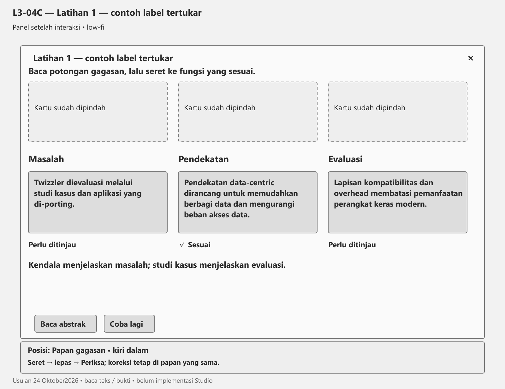

## L3-04D — Latihan 1 — fungsi gagasan sesuai

Baca potongan gagasan, lalu seret ke fungsi yang sesuai.

Lapisan kompatibilitas dan overhead membatasi pemanfaatan perangkat keras modern.

Pendekatan data-centric dirancang untuk memudahkan berbagi data dan mengurangi beban akses data.

Twizzler dievaluasi melalui studi kasus dan aplikasi yang di-porting.

Perilaku: Tujuan membaca: mengenali fungsi gagasan dan membatasi simpulan pada bukti abstrak; bukan hafalan teori OS. Latihan tanpa skor kelulusan.  Tiga potongan ini ringkasan setia pada bagian1,2,3, bukan kutipan verbatim. Kunci internal: potongan kendala→Masalah, usulan data-centric→Pendekatan, studi kasus→Evaluasi. Tidak meminta definisiOS. Tiga kartu/tiga kotak terlihat bersamaan; tahan→seret→lepas. Lepas di luar/kotak terisi kembali ke posisi sah sebelumnya; ganti dengan mengembalikan kartu ke area kartu dulu. Penilaian hanya setelah Periksa; pasangan salah boleh ditempatkan. Contoh salah: kendala diberiEvaluasi, studi kasus diberiMasalah; pendekatan tetap tepat. Koreksi: kendala melatarbelakangi penelitian, usulan menjelaskan pendekatan, studi kasus menjelaskan cara menilai. Sesudah salah pertama beri petunjuk bagian terkait; jika masih salah pada pemeriksaan berikutnya, tampilkan cuplikan relevan, pengguna tetap menyusun tepat danPeriksa. Status bantuan dibedakan. Jumlah percobaan bantuan usulan telaah, bukanSOP final. Ke papan simpulan menutup panel lalu pemain berjalan05A.

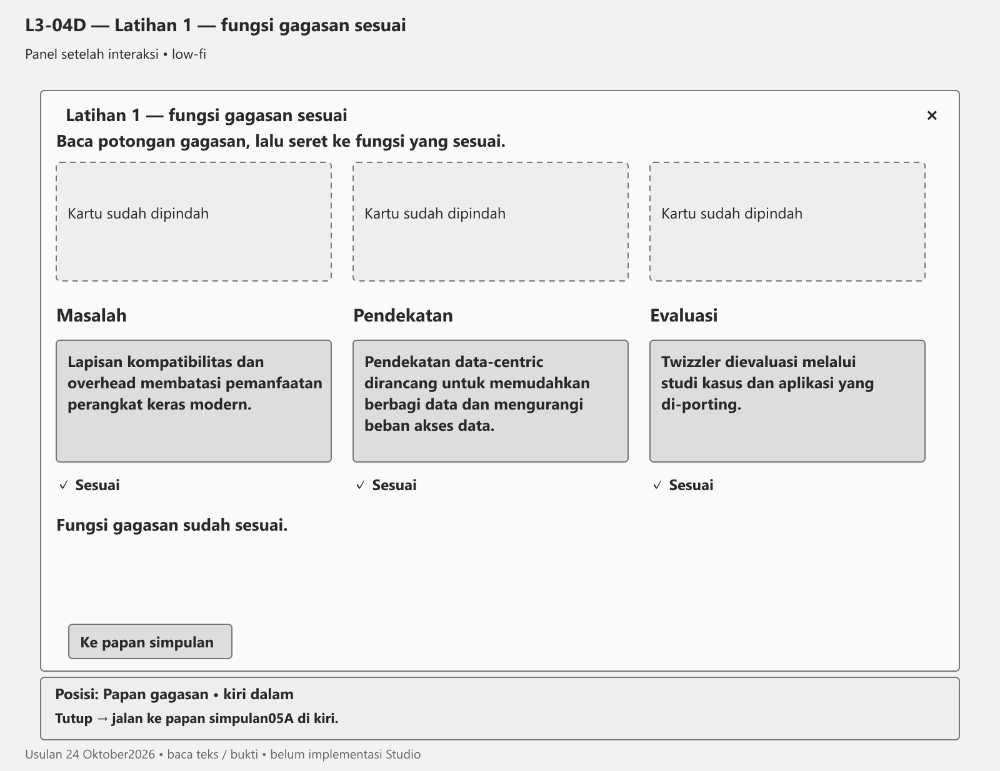

## L3-05A — Mendekati papan batas simpulan

Tujuan: Batasi simpulan sesuai bukti abstrak.

Latihan 2 — Batas simpulan

Tahan E — Buka latihan

Perilaku: Papan simpulan tetap di kiri tengah. Setelah latihan1, tutup, berjalan pendek lalu tahanE. Satu interaksi membuka latihan2 empat ronde bertahap, bukan empat objek/NPC baru. Semua ronde memakai dua pilihanID, draf dan bukti berbeda. Setelah tiap ronde tepat, Ronde berikutnya mengganti isi panel tanpa berjalan. Ke kios hanya setelah4/4 selesai.

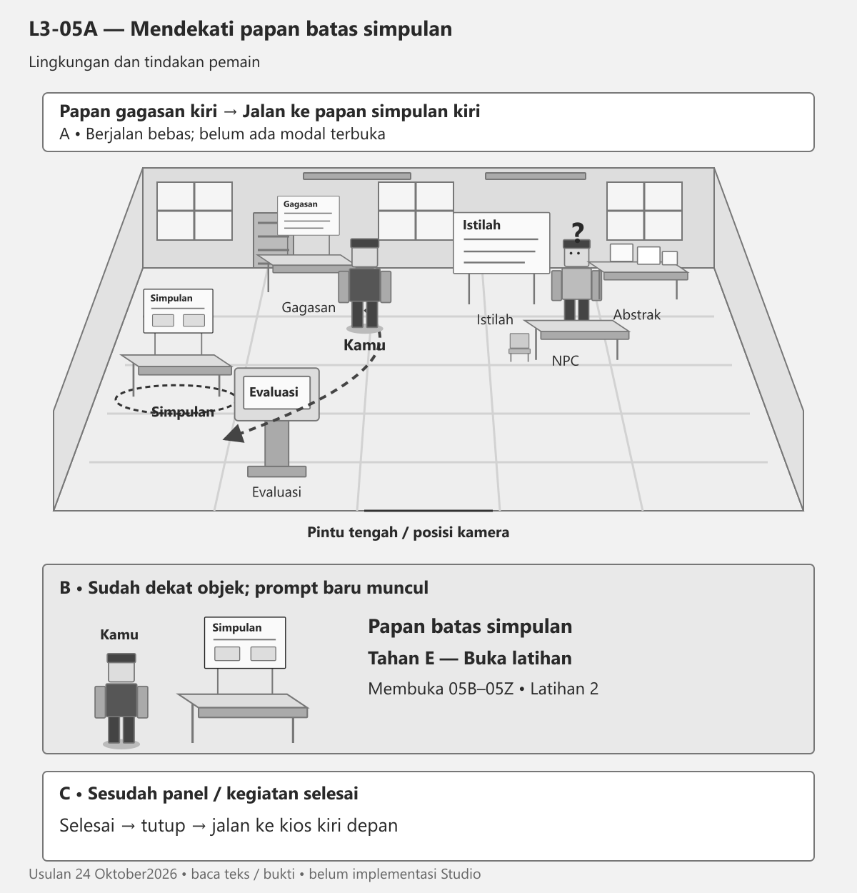

## L3-05B — Latihan 2 — ronde 1/4 — Kendala dalam bacaan

Coret akibat yang berlebihan. Tunjuk kalimat tentang keterbatasan programmer.

Sistem operasi dibangun dan dirancang berdasarkan dua kekuatan utama, yaitu kapabilitas perangkat keras dan tuntutan perangkat lunak.

Akibatnya, programmer menjadi terbatas dalam mengekspresikan bagian-bagian penting dari program mereka karena adanya lapisan kompatibilitas dan overhead yang terus dipertahankan, meskipun tuntutan terhadap throughput yang lebih tinggi dan latency yang lebih rendah terus meningkat.

Lapisan kompatibilitas dan overhead membatasi programmer dalam mengekspresikan bagian penting program,

meskipun tuntutan throughput lebih tinggi dan latensi lebih rendah meningkat;

akibatnya peningkatan perangkat keras tidak memberi manfaat apa pun.

Perilaku: Ronde 1/4. Sasaran: Menemukan akibat yang dinyatakan teks dan membedakannya dari akibat yang dibesar-besarkan. Sumber: paragraf1, kalimat1 dan 3 utuh; draf parafrase. Kunci penelaah d3+b2; ID tidak ditampilkan diUI. Klik satu rentang draf untuk coret dan satu kalimat sumber sebagai bukti; dapat dibatalkan/diganti. Periksa aktif setelah duaID terisi. Selesai ronde hanya jika keduanya cocok kunci. Empat kondisi revisi/bukti memberi koreksi sesuai komponen yang belum tepat; Coba lagi mempertahankan pilihan. Salah/bantuan tidak menuntaskan ronde. Tanpa mengetik, drag, timer atau poin latihan. Baca abstrak/Tutup kembali dengan ronde dan pilihan tersimpan. Bacaan menjelaskan keterbatasan, bukan ketiadaan seluruh manfaat perangkat keras. Petunjuk ini untuk penelaah/bantuan setelah salah, bukan kunci awalUI.

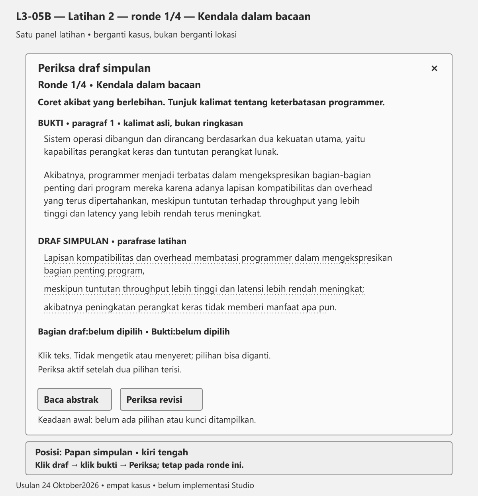

## L3-05C — Latihan 2 — ronde 1/4 — tinjau bukti

Coret akibat yang berlebihan. Tunjuk kalimat tentang keterbatasan programmer.

Sistem operasi dibangun dan dirancang berdasarkan dua kekuatan utama, yaitu kapabilitas perangkat keras dan tuntutan perangkat lunak.

Akibatnya, programmer menjadi terbatas dalam mengekspresikan bagian-bagian penting dari program mereka karena adanya lapisan kompatibilitas dan overhead yang terus dipertahankan, meskipun tuntutan terhadap throughput yang lebih tinggi dan latency yang lebih rendah terus meningkat.

Lapisan kompatibilitas dan overhead membatasi programmer dalam mengekspresikan bagian penting program,

meskipun tuntutan throughput lebih tinggi dan latensi lebih rendah meningkat;

akibatnya peningkatan perangkat keras tidak memberi manfaat apa pun.

Perilaku: Ronde 1/4. Sasaran: Menemukan akibat yang dinyatakan teks dan membedakannya dari akibat yang dibesar-besarkan. Sumber: paragraf1, kalimat1 dan 3 utuh; draf parafrase. Kunci penelaah d3+b2; ID tidak ditampilkan diUI. Klik satu rentang draf untuk coret dan satu kalimat sumber sebagai bukti; dapat dibatalkan/diganti. Periksa aktif setelah duaID terisi. Selesai ronde hanya jika keduanya cocok kunci. Empat kondisi revisi/bukti memberi koreksi sesuai komponen yang belum tepat; Coba lagi mempertahankan pilihan. Salah/bantuan tidak menuntaskan ronde. Tanpa mengetik, drag, timer atau poin latihan. Baca abstrak/Tutup kembali dengan ronde dan pilihan tersimpan. Contoh: d3 tepat, bukti yang dipilih belum sesuai. Kalimat yang dipilih menjelaskan dasar perancangan sistem. Cari akibat lapisan kompatibilitas terhadap programmer.

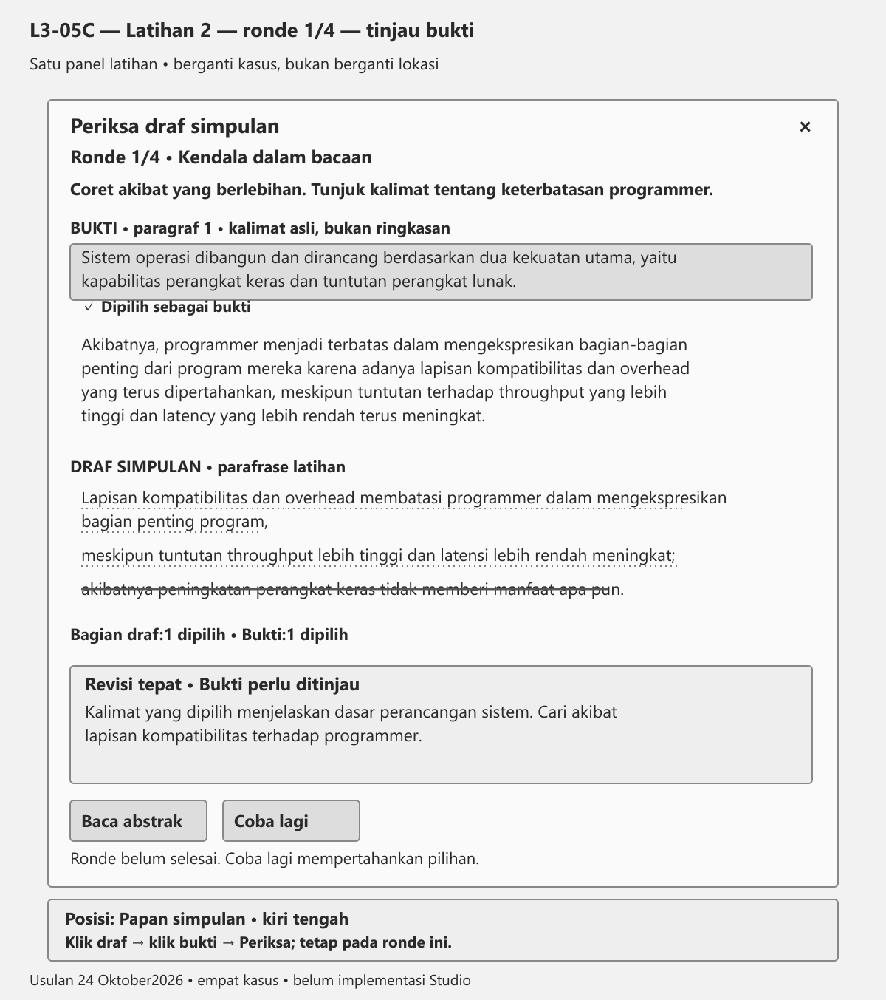

## L3-05D — Latihan 2 — ronde 1/4 — revisi sesuai

Coret akibat yang berlebihan. Tunjuk kalimat tentang keterbatasan programmer.

Sistem operasi dibangun dan dirancang berdasarkan dua kekuatan utama, yaitu kapabilitas perangkat keras dan tuntutan perangkat lunak.

Akibatnya, programmer menjadi terbatas dalam mengekspresikan bagian-bagian penting dari program mereka karena adanya lapisan kompatibilitas dan overhead yang terus dipertahankan, meskipun tuntutan terhadap throughput yang lebih tinggi dan latency yang lebih rendah terus meningkat.

Lapisan kompatibilitas dan overhead membatasi programmer dalam mengekspresikan bagian penting program,

meskipun tuntutan throughput lebih tinggi dan latensi lebih rendah meningkat;

akibatnya peningkatan perangkat keras tidak memberi manfaat apa pun.

Perilaku: Ronde 1/4. Sasaran: Menemukan akibat yang dinyatakan teks dan membedakannya dari akibat yang dibesar-besarkan. Sumber: paragraf1, kalimat1 dan 3 utuh; draf parafrase. Kunci penelaah d3+b2; ID tidak ditampilkan diUI. Klik satu rentang draf untuk coret dan satu kalimat sumber sebagai bukti; dapat dibatalkan/diganti. Periksa aktif setelah duaID terisi. Selesai ronde hanya jika keduanya cocok kunci. Empat kondisi revisi/bukti memberi koreksi sesuai komponen yang belum tepat; Coba lagi mempertahankan pilihan. Salah/bantuan tidak menuntaskan ronde. Tanpa mengetik, drag, timer atau poin latihan. Baca abstrak/Tutup kembali dengan ronde dan pilihan tersimpan. Ronde selesai menambah progres satu kali, bukan menuntaskan seluruh latihan. Berikutnya mengganti isi panel dengan kasus baru.

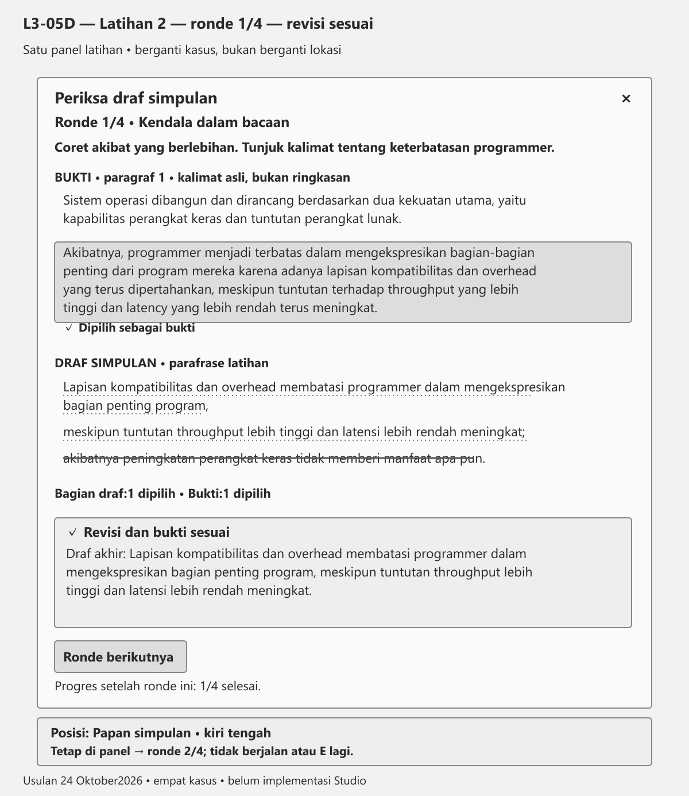

## L3-05R2A — Latihan 2 — ronde 2/4 — Peluang bukan hasil yang sudah terjadi

Coret klaim perubahan yang sudah pasti terjadi. Tunjuk kalimat tentang peluang pergeseran model.

Saat ini, terdapat peluang untuk mengkaji bagaimana pertemuan berbagai tren dapat menggeser model pemrograman dari sudut pandang tradisional yang berpusat pada proses (process-centric) menuju pendekatan yang berpusat pada data (data-centric), di mana data menjadi entitas utama dalam sistem.

Peluang ini muncul seiring dengan perkembangan perangkat keras yang secara langsung memengaruhi cara pandang terhadap jalur akses data serta tanggung jawab sistem operasi dan kernel.

Peralihan ke data-centric telah terjadi pada seluruh sistem operasi;

abstrak menyebut peluang mengkaji pergeseran model pemrograman

seiring pertemuan berbagai tren perangkat keras.

Perilaku: Ronde 2/4. Sasaran: Membedakan status peluang kajian dari klaim bahwa perubahan telah berlaku menyeluruh. Sumber: paragraf2, kalimat1 dan 2 utuh; draf parafrase. Kunci penelaah d1+b1; ID tidak ditampilkan diUI. Klik satu rentang draf untuk coret dan satu kalimat sumber sebagai bukti; dapat dibatalkan/diganti. Periksa aktif setelah duaID terisi. Selesai ronde hanya jika keduanya cocok kunci. Empat kondisi revisi/bukti memberi koreksi sesuai komponen yang belum tepat; Coba lagi mempertahankan pilihan. Salah/bantuan tidak menuntaskan ronde. Tanpa mengetik, drag, timer atau poin latihan. Baca abstrak/Tutup kembali dengan ronde dan pilihan tersimpan. Perhatikan status pernyataan: peluang untuk mengkaji tidak sama dengan perubahan menyeluruh yang telah selesai. Petunjuk ini untuk penelaah/bantuan setelah salah, bukan kunci awalUI.

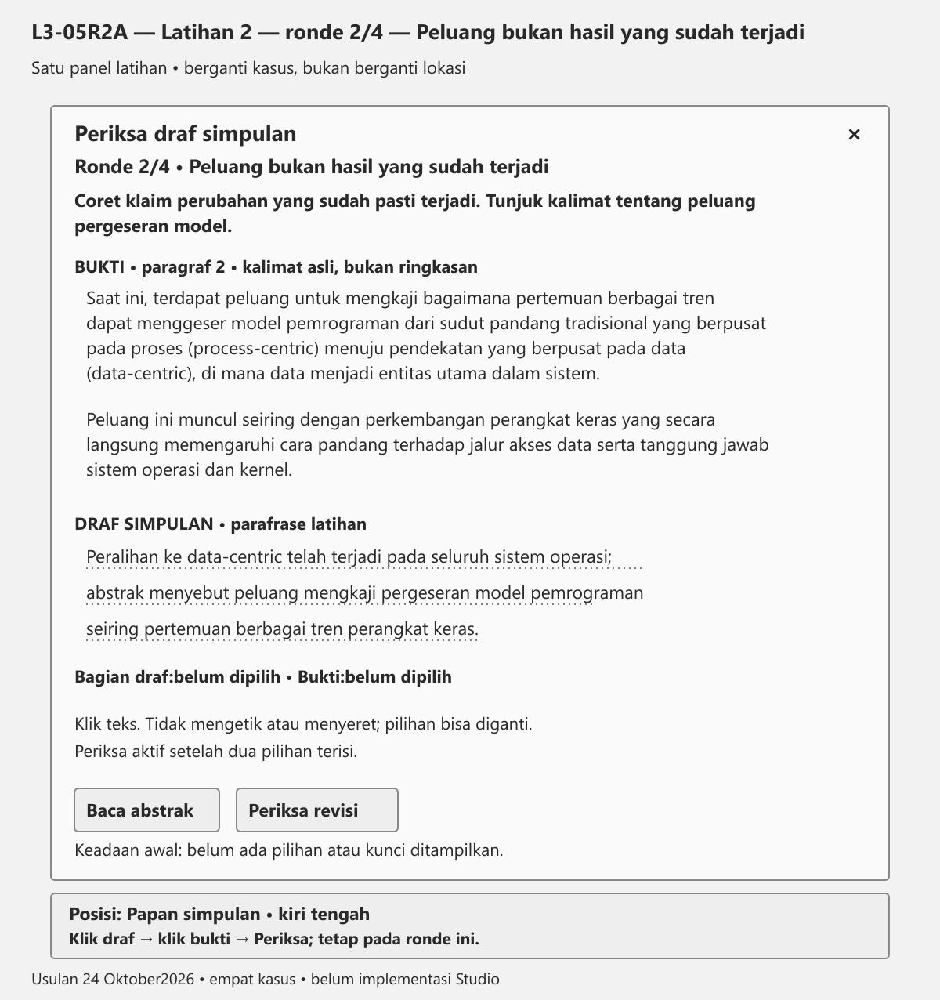

## L3-05R2B — Latihan 2 — ronde 2/4 — revisi sesuai

Coret klaim perubahan yang sudah pasti terjadi. Tunjuk kalimat tentang peluang pergeseran model.

Saat ini, terdapat peluang untuk mengkaji bagaimana pertemuan berbagai tren dapat menggeser model pemrograman dari sudut pandang tradisional yang berpusat pada proses (process-centric) menuju pendekatan yang berpusat pada data (data-centric), di mana data menjadi entitas utama dalam sistem.

Peluang ini muncul seiring dengan perkembangan perangkat keras yang secara langsung memengaruhi cara pandang terhadap jalur akses data serta tanggung jawab sistem operasi dan kernel.

Peralihan ke data-centric telah terjadi pada seluruh sistem operasi;

abstrak menyebut peluang mengkaji pergeseran model pemrograman

seiring pertemuan berbagai tren perangkat keras.

Perilaku: Ronde 2/4. Sasaran: Membedakan status peluang kajian dari klaim bahwa perubahan telah berlaku menyeluruh. Sumber: paragraf2, kalimat1 dan 2 utuh; draf parafrase. Kunci penelaah d1+b1; ID tidak ditampilkan diUI. Klik satu rentang draf untuk coret dan satu kalimat sumber sebagai bukti; dapat dibatalkan/diganti. Periksa aktif setelah duaID terisi. Selesai ronde hanya jika keduanya cocok kunci. Empat kondisi revisi/bukti memberi koreksi sesuai komponen yang belum tepat; Coba lagi mempertahankan pilihan. Salah/bantuan tidak menuntaskan ronde. Tanpa mengetik, drag, timer atau poin latihan. Baca abstrak/Tutup kembali dengan ronde dan pilihan tersimpan. Ronde selesai menambah progres satu kali, bukan menuntaskan seluruh latihan. Berikutnya mengganti isi panel dengan kasus baru.

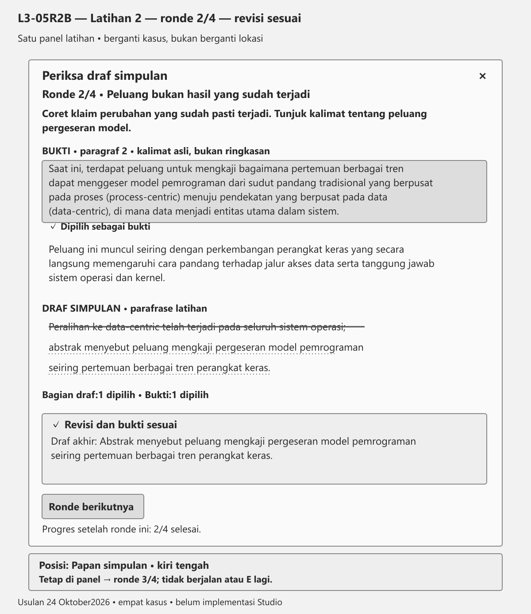

## L3-05R3A — Latihan 2 — ronde 3/4 — Batas perubahan yang diusulkan

Coret perubahan yang tidak didukung. Tunjuk kalimat yang menyebut kernel dan serialisasi.

Pendekatan ini merumuskan ulang tujuan sistem operasi dan memungkinkan peninjauan kembali teknik pemrograman sistem klasik ke dalam model yang memfasilitasi berbagi data, alih-alih menghambatnya.

Sebaliknya, pendekatan data-centric ini mengurangi keterlibatan kernel dalam jalur akses data, menjadikan data bersifat mobile melalui referensi invarian yang tidak bergantung pada ruang alamat atau mesin, serta menghilangkan kebutuhan akan serialisasi.

Pendekatan data-centric mengurangi keterlibatan kernel dalam jalur akses data,

menghilangkan seluruh kompleksitas dan biaya dalam setiap sistem operasi,

serta menghilangkan kebutuhan serialisasi pada model yang dijelaskan.

Perilaku: Ronde 3/4. Sasaran: Menghubungkan dua perubahan yang disebut teks dan menolak generalisasi di luar cakupannya. Sumber: paragraf3, kalimat2 dan 4 utuh; draf parafrase. Kunci penelaah d2+b2; ID tidak ditampilkan diUI. Klik satu rentang draf untuk coret dan satu kalimat sumber sebagai bukti; dapat dibatalkan/diganti. Periksa aktif setelah duaID terisi. Selesai ronde hanya jika keduanya cocok kunci. Empat kondisi revisi/bukti memberi koreksi sesuai komponen yang belum tepat; Coba lagi mempertahankan pilihan. Salah/bantuan tidak menuntaskan ronde. Tanpa mengetik, drag, timer atau poin latihan. Baca abstrak/Tutup kembali dengan ronde dan pilihan tersimpan. Teks menyebut perubahan tertentu, bukan penghapusan seluruh kompleksitas dan biaya pada setiap sistem. Petunjuk ini untuk penelaah/bantuan setelah salah, bukan kunci awalUI.

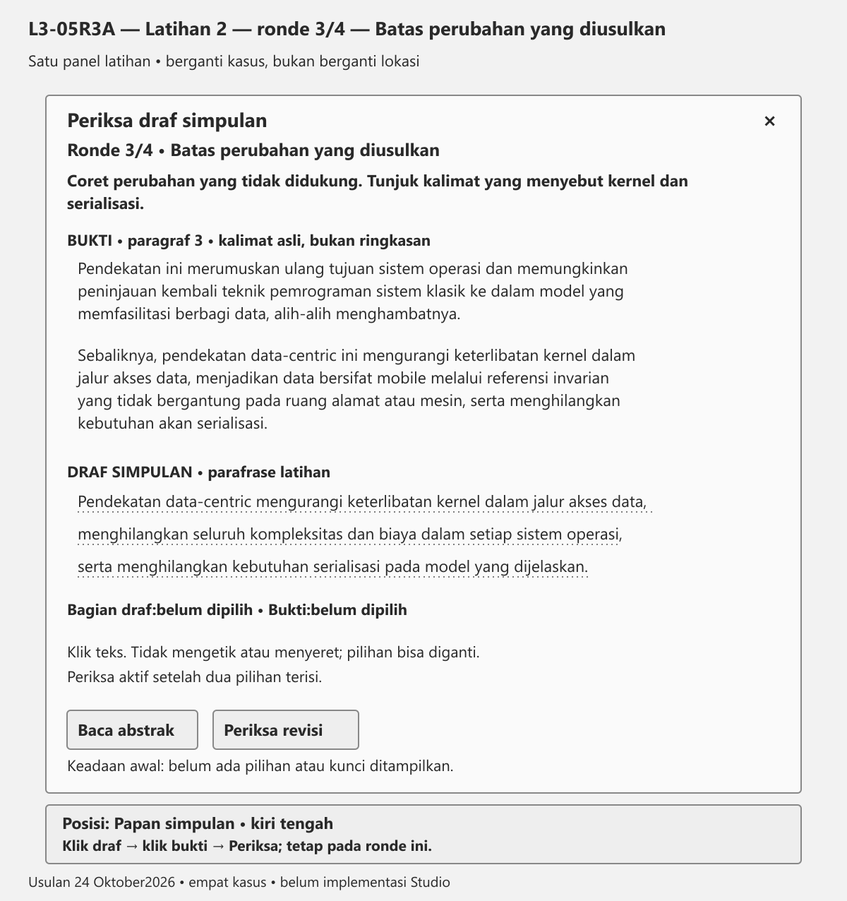

## L3-05R3B — Latihan 2 — ronde 3/4 — revisi sesuai

Coret perubahan yang tidak didukung. Tunjuk kalimat yang menyebut kernel dan serialisasi.

Pendekatan ini merumuskan ulang tujuan sistem operasi dan memungkinkan peninjauan kembali teknik pemrograman sistem klasik ke dalam model yang memfasilitasi berbagi data, alih-alih menghambatnya.

Sebaliknya, pendekatan data-centric ini mengurangi keterlibatan kernel dalam jalur akses data, menjadikan data bersifat mobile melalui referensi invarian yang tidak bergantung pada ruang alamat atau mesin, serta menghilangkan kebutuhan akan serialisasi.

Pendekatan data-centric mengurangi keterlibatan kernel dalam jalur akses data,

menghilangkan seluruh kompleksitas dan biaya dalam setiap sistem operasi,

serta menghilangkan kebutuhan serialisasi pada model yang dijelaskan.

Perilaku: Ronde 3/4. Sasaran: Menghubungkan dua perubahan yang disebut teks dan menolak generalisasi di luar cakupannya. Sumber: paragraf3, kalimat2 dan 4 utuh; draf parafrase. Kunci penelaah d2+b2; ID tidak ditampilkan diUI. Klik satu rentang draf untuk coret dan satu kalimat sumber sebagai bukti; dapat dibatalkan/diganti. Periksa aktif setelah duaID terisi. Selesai ronde hanya jika keduanya cocok kunci. Empat kondisi revisi/bukti memberi koreksi sesuai komponen yang belum tepat; Coba lagi mempertahankan pilihan. Salah/bantuan tidak menuntaskan ronde. Tanpa mengetik, drag, timer atau poin latihan. Baca abstrak/Tutup kembali dengan ronde dan pilihan tersimpan. Ronde selesai menambah progres satu kali, bukan menuntaskan seluruh latihan. Berikutnya mengganti isi panel dengan kasus baru.

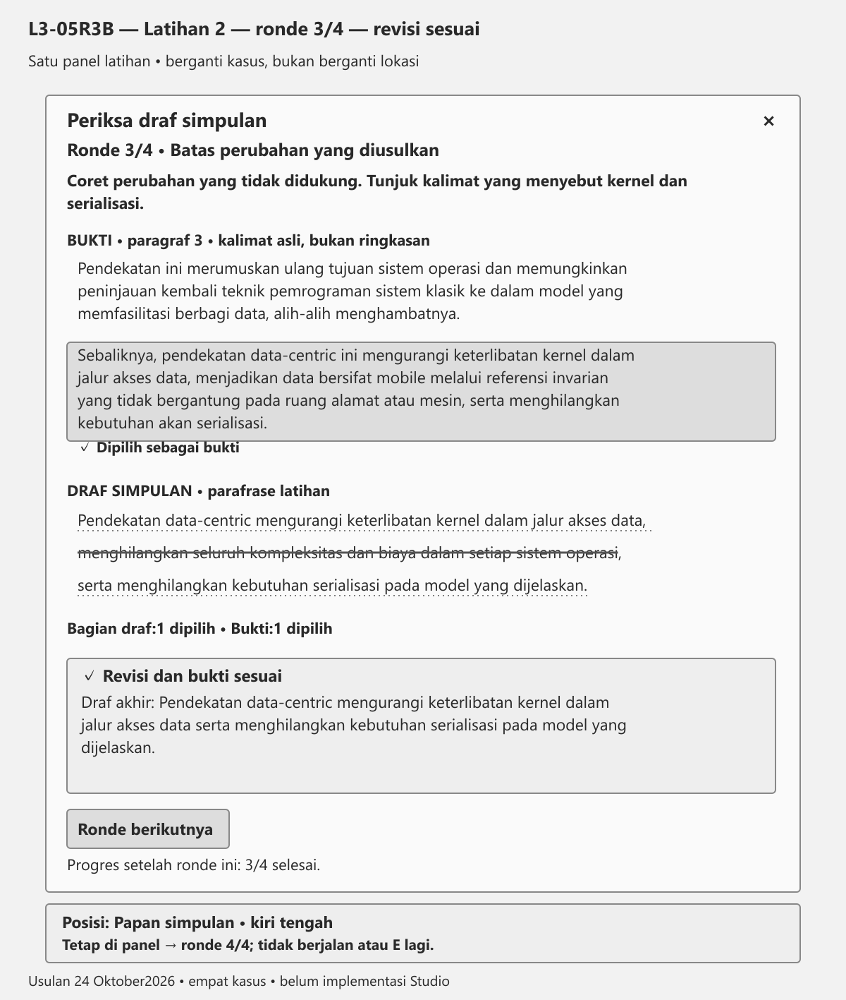

## L3-05R4A — Latihan 2 — ronde 4/4 — Hasil penelitian dan batas simpulan

Coret rekomendasi yang melampaui bukti. Tunjuk kalimat yang mendukung hasil kinerja.

Evaluasi terhadap Twizzler dilakukan melalui studi kasus yang menunjukkan perilaku sistem, efektivitas, dan kegunaan model pemrograman yang dikembangkan, dengan membangun sejumlah perangkat lunak baru khusus untuk Twizzler.

Selain itu, aplikasi berukuran besar yang telah di-porting juga digunakan untuk menunjukkan kinerja Twizzler dan model pemrogramannya, yang dalam banyak kasus menunjukkan peningkatan performa semata-mata karena penyederhanaan lapisan perangkat lunak.

Pada banyak kasus yang dilaporkan,

Twizzler menunjukkan peningkatan performa;

karena itu seluruh sistem operasi wajib diganti.

Perilaku: Ronde 4/4. Sasaran: Membedakan hasil kinerja yang dilaporkan dari rekomendasi universal yang tidak didukung. Sumber: paragraf4, kalimat2 dan 3 utuh; draf parafrase. Kunci penelaah d3+b2; ID tidak ditampilkan diUI. Klik satu rentang draf untuk coret dan satu kalimat sumber sebagai bukti; dapat dibatalkan/diganti. Periksa aktif setelah duaID terisi. Selesai ronde hanya jika keduanya cocok kunci. Empat kondisi revisi/bukti memberi koreksi sesuai komponen yang belum tepat; Coba lagi mempertahankan pilihan. Salah/bantuan tidak menuntaskan ronde. Tanpa mengetik, drag, timer atau poin latihan. Baca abstrak/Tutup kembali dengan ronde dan pilihan tersimpan. Hasil pada banyak kasus tidak menetapkan kewajiban mengganti seluruh sistem operasi. Petunjuk ini untuk penelaah/bantuan setelah salah, bukan kunci awalUI.

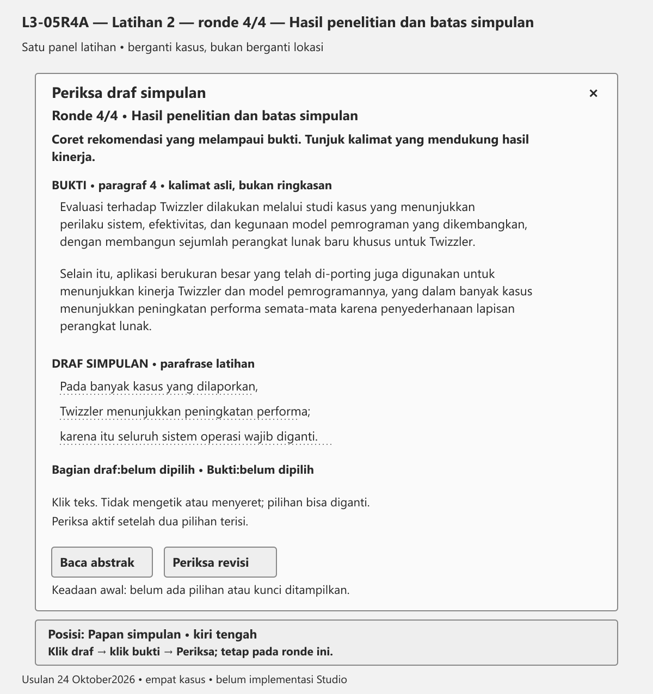

## L3-05R4B — Latihan 2 — ronde 4/4 — revisi sesuai

Coret rekomendasi yang melampaui bukti. Tunjuk kalimat yang mendukung hasil kinerja.

Evaluasi terhadap Twizzler dilakukan melalui studi kasus yang menunjukkan perilaku sistem, efektivitas, dan kegunaan model pemrograman yang dikembangkan, dengan membangun sejumlah perangkat lunak baru khusus untuk Twizzler.

Selain itu, aplikasi berukuran besar yang telah di-porting juga digunakan untuk menunjukkan kinerja Twizzler dan model pemrogramannya, yang dalam banyak kasus menunjukkan peningkatan performa semata-mata karena penyederhanaan lapisan perangkat lunak.

Pada banyak kasus yang dilaporkan,

Twizzler menunjukkan peningkatan performa;

karena itu seluruh sistem operasi wajib diganti.

Perilaku: Ronde 4/4. Sasaran: Membedakan hasil kinerja yang dilaporkan dari rekomendasi universal yang tidak didukung. Sumber: paragraf4, kalimat2 dan 3 utuh; draf parafrase. Kunci penelaah d3+b2; ID tidak ditampilkan diUI. Klik satu rentang draf untuk coret dan satu kalimat sumber sebagai bukti; dapat dibatalkan/diganti. Periksa aktif setelah duaID terisi. Selesai ronde hanya jika keduanya cocok kunci. Empat kondisi revisi/bukti memberi koreksi sesuai komponen yang belum tepat; Coba lagi mempertahankan pilihan. Salah/bantuan tidak menuntaskan ronde. Tanpa mengetik, drag, timer atau poin latihan. Baca abstrak/Tutup kembali dengan ronde dan pilihan tersimpan. Ronde4 selesai→rangkuman; akses ke kios memerlukan empat ronde selesai.

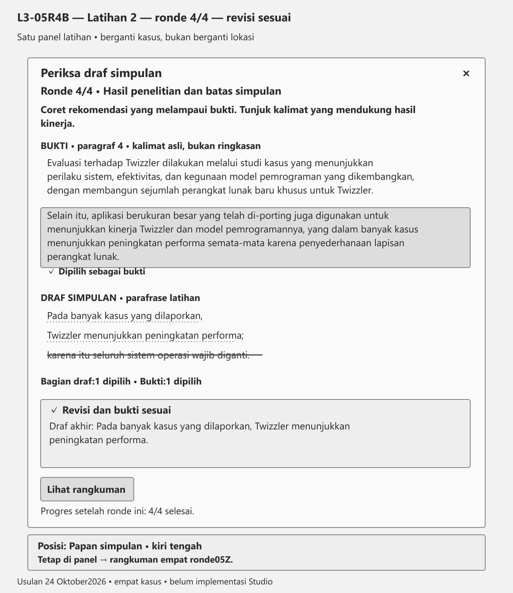

## L3-05Z — Latihan 2 — empat ronde selesai

Latihan simpulan selesai — 4/4 ronde.

✓ Kendala dalam bacaan.

✓ Peluang dan status usulan.

✓ Batas perubahan pendekatan.

✓ Hasil penelitian dan batas simpulan.

Kamu telah memeriksa empat draf dengan kalimat bukti yang sesuai. Lanjutkan ke kios evaluasi.

Perilaku: Contoh keadaan semua ronde selesai. Ringkasan membaca status empat ronde aktual, bukan sekadar telah membuka layar. Tombol Ke kios hanya aktif jika r1–r4 selesai; menutup panel tidak menghapusnya. Jumlah percobaan dan bantuan dicatat terpisah, bukan nilai kelulusan. Ini progres latihan, bukan bukti keterampilan telah meningkat. Ke kios menutup panel lalu pemain berjalan06A di kiri depan. Salah/tutup di ronde sebelumnya tidak boleh menampilkan4/4.

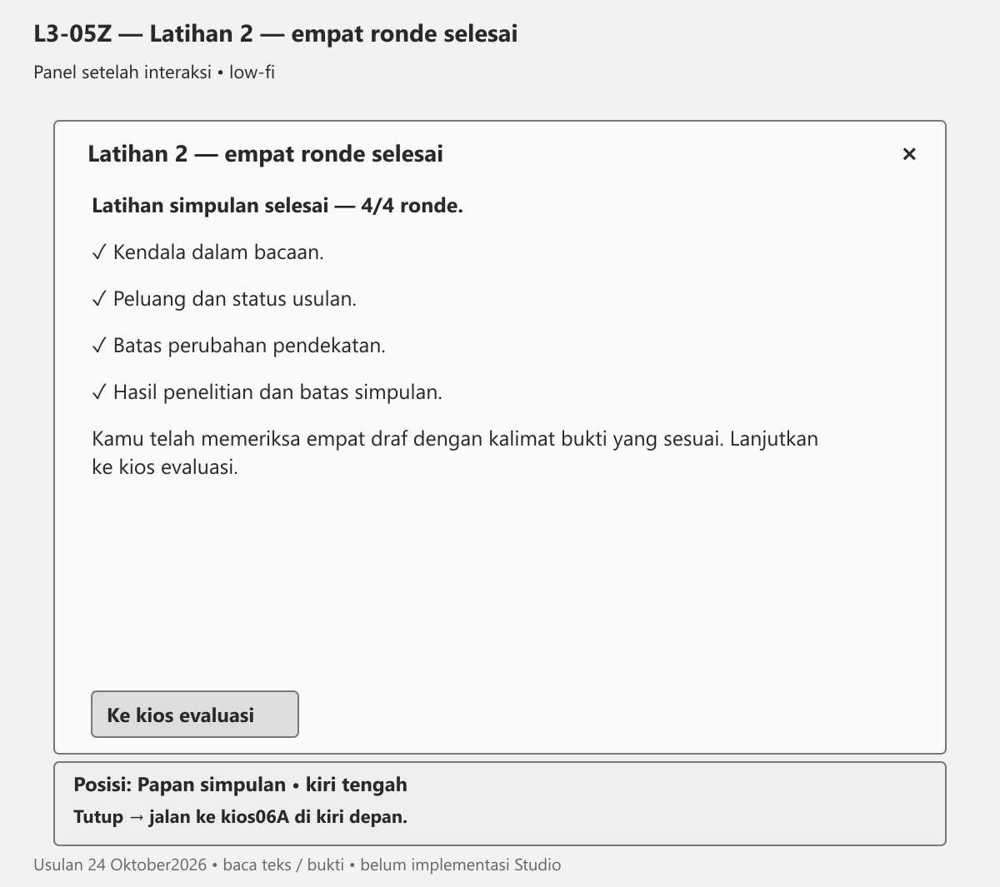

## L3-06A — Mendekati kios evaluasi Level 3

Tujuan: Kerjakan evaluasi membaca Level 3.

Evaluasi Level 3

Tahan E — Buka evaluasi

Perilaku: Kios evaluasi di kiri depan, dekat jalur ke pintu tengah tanpa menghalangi akses. Setelah dua latihan selesai, berjalan dari papan simpulan kiri lalu tahanE. Soal/alasan/feedback/hasil tetap dalam satu rangkaian panel di kios. Sesudah lulus, tutup lalu berjalan ke pintu tengah. Isi dan prasyarat tetap.

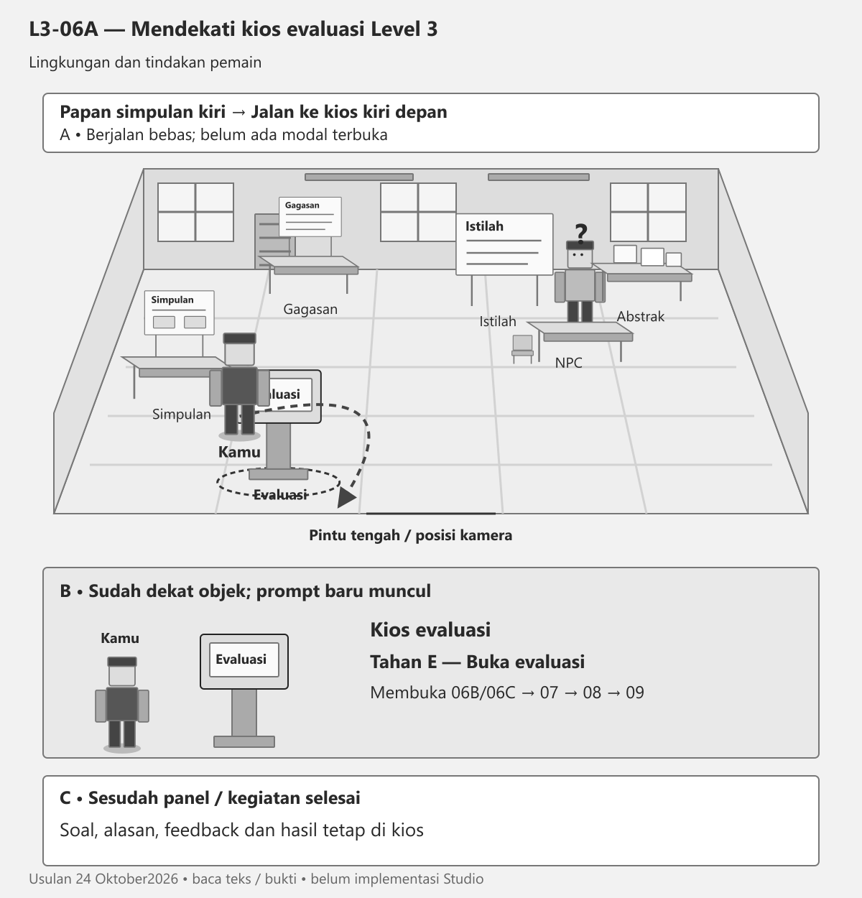

## L3-06B — Kios — contoh prasyarat belum lengkap

Evaluasi belum dapat dimulai.

Materi: 3/3 bagian dikunjungi.

Fungsi gagasan: selesai.

Latihan simpulan: 2/4 ronde selesai.

Perilaku: Contoh prasyarat belum lengkap, bukan angka tetap. Kios memerlukan tiga bagian materi, latihan1, dan empat ronde latihan2 selesai. Kembali belajar menutup panel dan menunjuk papan simpulan jika ronde belum lengkap; lanjutkan ronde pertama yang belum selesai dengan pilihan tersimpan. Papan istilah tetap opsional. Empat soal evaluasi dan aturan skor tidak diubah.

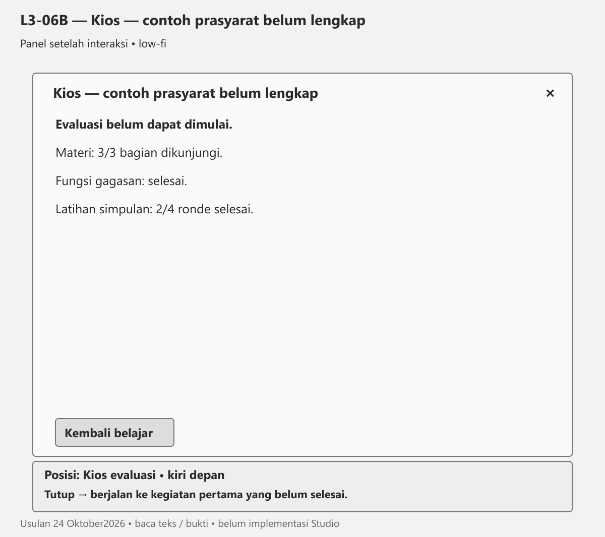

## L3-06C — Kios — petunjuk sebelum evaluasi

Siap mengikuti evaluasi Level 3?

Ada empat soal. Pilih jawaban, kunci, lalu pilih alasan. Penjelasan tampil setelah keduanya dikirim.

Jawaban tepat bernilai25; nilai minimal75. Ketepatan alasan ditampilkan terpisah.

Nanti dulu untuk membaca kembali sebelum mulai.

Perilaku: Pola samaLevel1/2. Nanti dulu menutup, Mulai evaluasi membuka soal1 di kios yang sama. Selama evaluasi materi/bantuan tidak dibuka. Durasi, percobaan ulang dan skor penelitian harus mengikutiSOP A/B yang belumfinal; jangan menambah aturan baru.

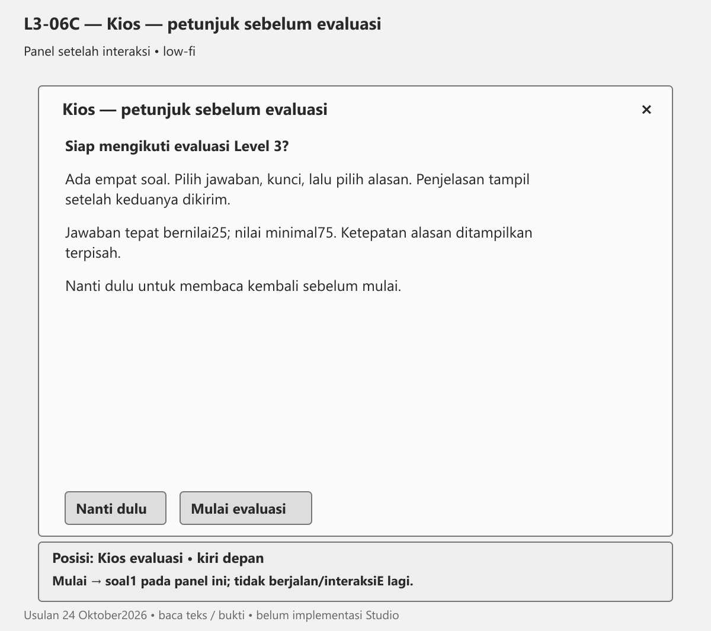

## L3-07Q1A — Evaluasi 1/4 — jawaban

Menurut abstrak, faktor utama yang mendorong pergeseran dari model process-centric menuju data-centric adalah …

A. Meningkatnya kebutuhan antarmuka grafis pada sistem operasi

B. Perkembangan bahasa pemrograman tingkat tinggi

C. Tuntutan kompatibilitas perangkat lunak lintas platform

D. Tren perangkat keras seperti peningkatan kecepatan interkoneksi dan penyimpanan persisten

E. Dominasi sistem operasi berbasis mobile

Perilaku: Kunci tier 1: D. Batang, opsi, dan kunci mengikuti baseline Sanubari. Isi sesuai tab peta aktif. Kunci khusus penelaah; tidak ditunjukkan diUI. Pilihan dapat diganti sebelum Kunci jawaban; nonaktif bila belum memilih. Setelah dikunci buka alasan tanpa membocorkan benar/salah.

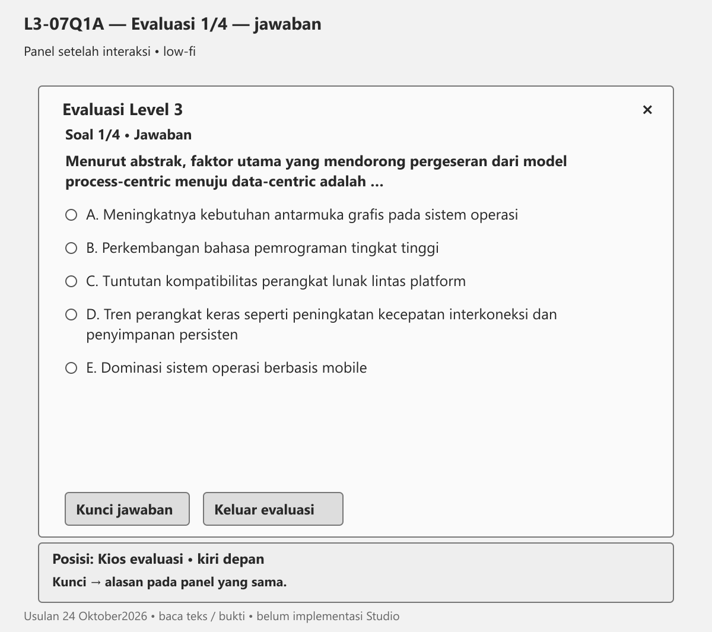

## L3-07Q1B — Evaluasi 1/4 — alasan

Alasan atau bukti manakah yang paling tepat mendukung jawaban pada tingkat pertama?

A. Abstrak menekankan perubahan antarmuka grafis sebagai pendorong perubahan model sistem operasi.

B. Abstrak menekankan kemunculan bahasa pemrograman baru sebagai pendorong perubahan model sistem operasi.

C. Abstrak mengaitkan perubahan model dengan interkoneksi cepat dan akses penyimpanan persisten.

D. Abstrak menekankan penggantian seluruh server oleh perangkat mobile sebagai pendorong perubahan model.

Perilaku: Kunci tier 2: C. Bukti penjelas: Abstrak mengaitkan perubahan model dengan interkoneksi cepat dan akses penyimpanan persisten. Opsi persis tab peta. Ringkasan jawaban adalah ilustrasi pilihanUI, bukan jawaban otomatis. Kirim aktif setelah memilih alasan; penjelasan setelah kedua tier dikirim.

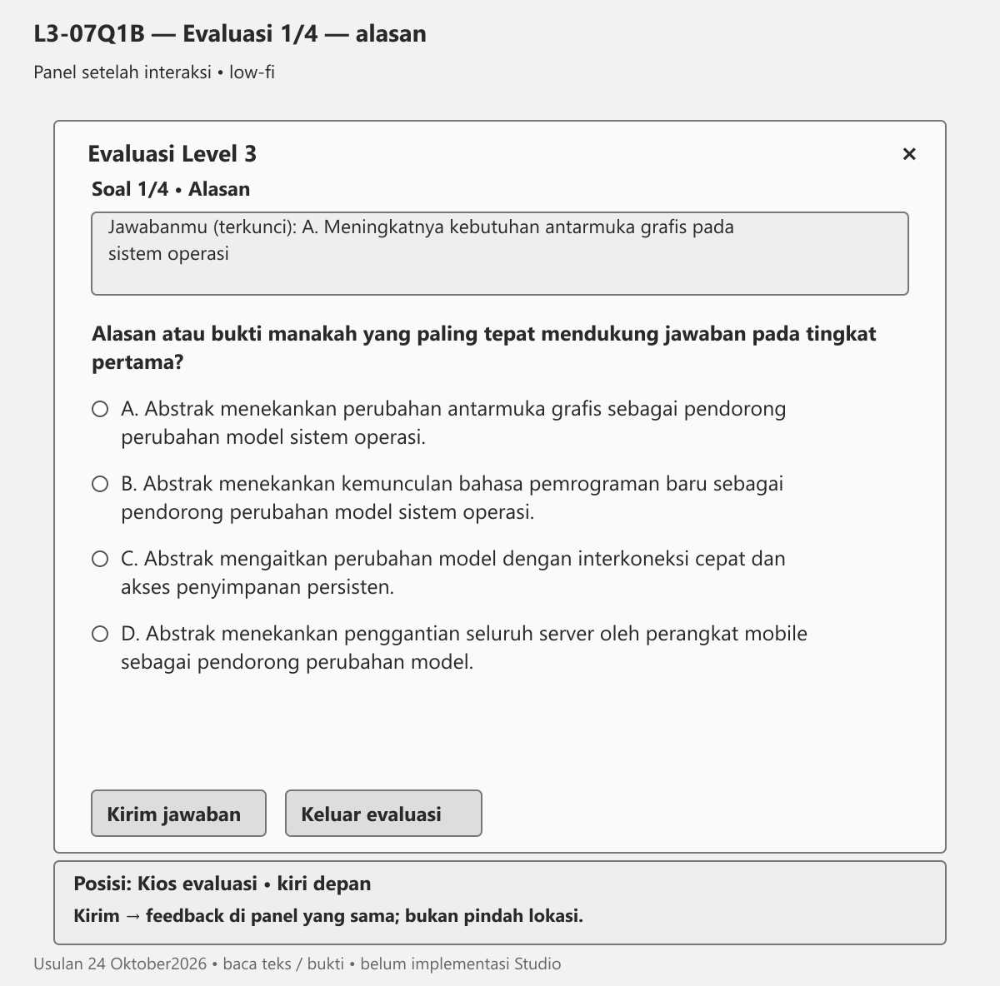

## L3-07Q2A — Evaluasi 2/4 — jawaban

Keunggulan utama pendekatan data-centric yang diperkenalkan melalui sistem Twizzler dibandingkan pendekatan tradisional adalah …

A. Penggunaan kernel yang lebih kompleks untuk mengatur data

B. Penggunaan model RPC yang lebih ketat dan terstruktur

C. Penghapusan sepenuhnya peran kernel dalam sistem operasi

D. Ketergantungan penuh pada teknologi virtualisasi

E. Penyederhanaan jalur akses data dan pengurangan kebutuhan serialisasi

Perilaku: Kunci tier 1: E. Batang, opsi, dan kunci mengikuti baseline Sanubari. Isi sesuai tab peta aktif. Kunci khusus penelaah; tidak ditunjukkan diUI. Pilihan dapat diganti sebelum Kunci jawaban; nonaktif bila belum memilih. Setelah dikunci buka alasan tanpa membocorkan benar/salah.

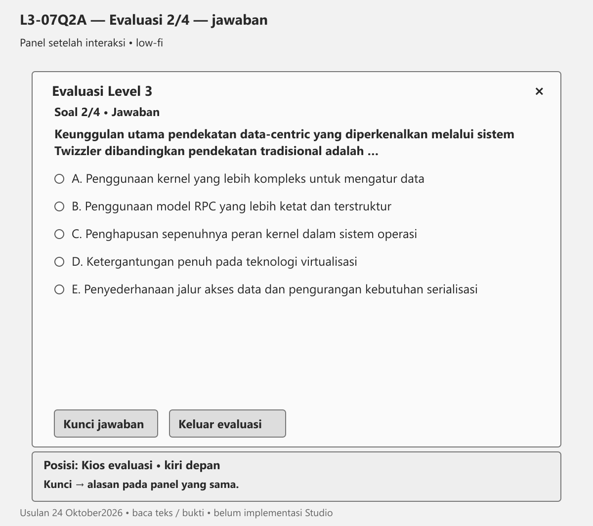

## L3-07Q2B — Evaluasi 2/4 — alasan

Alasan atau bukti manakah yang paling tepat mendukung jawaban pada tingkat pertama?

A. Abstrak menjelaskan penyederhanaan akses data dan penghilangan kebutuhan serialisasi.

B. Abstrak menjelaskan penghapusan seluruh peran kernel dalam pengelolaan sistem komputer.

C. Abstrak menjelaskan pengetatan mekanisme RPC dalam pertukaran data antarprogram komputer.

D. Abstrak menjelaskan kewajiban virtualisasi untuk menjalankan setiap aplikasi dalam sistem.

Perilaku: Kunci tier 2: A. Bukti penjelas: Abstrak menjelaskan penyederhanaan jalur akses data dan hilangnya kebutuhan serialisasi dalam pendekatan yang dibahas. Opsi persis tab peta. Ringkasan jawaban adalah ilustrasi pilihanUI, bukan jawaban otomatis. Kirim aktif setelah memilih alasan; penjelasan setelah kedua tier dikirim.

## L3-07Q3A — Evaluasi 3/4 — jawaban

Mengapa model pemrograman tradisional dianggap kurang sesuai dengan perkembangan perangkat keras modern?

A. Karena model tradisional menimbulkan overhead dan keterbatasan yang menghambat pemanfaatan perangkat keras modern secara optimal

B. Karena perangkat keras modern tidak lagi membutuhkan sistem operasi

C. Karena perangkat keras modern hanya mendukung sistem operasi berbasis cloud

D. Karena semua aplikasi modern menggunakan bahasa pemrograman baru

E. Karena sistem operasi modern tidak memerlukan kernel

Perilaku: Kunci tier 1: A. Batang, opsi, dan kunci mengikuti baseline Sanubari. Isi sesuai tab peta aktif. Kunci khusus penelaah; tidak ditunjukkan diUI. Pilihan dapat diganti sebelum Kunci jawaban; nonaktif bila belum memilih. Setelah dikunci buka alasan tanpa membocorkan benar/salah.

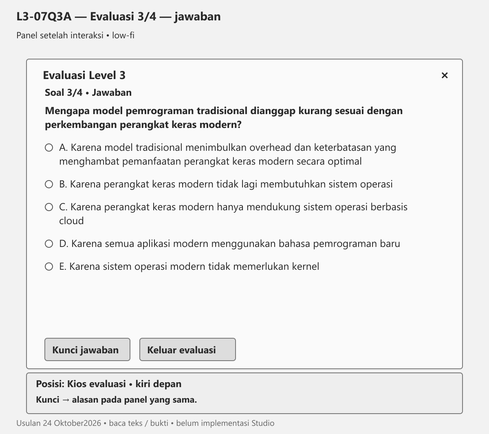

## L3-07Q3B — Evaluasi 3/4 — alasan

Alasan atau bukti manakah yang paling tepat mendukung jawaban pada tingkat pertama?

A. Abstrak menyatakan perangkat modern dapat bekerja tanpa menggunakan sistem operasi.

B. Abstrak mengaitkan lapisan kompatibilitas dan overhead dengan keterbatasan perangkat baru.

C. Abstrak menyatakan perangkat modern hanya dapat bekerja melalui layanan berbasis cloud.

D. Abstrak menyatakan antarmuka lama selalu optimal untuk memanfaatkan kemampuan perangkat modern.

Perilaku: Kunci tier 2: B. Bukti penjelas: Abstrak mengaitkan lapisan kompatibilitas dan overhead model lama dengan keterbatasan pemanfaatan perangkat baru. Opsi persis tab peta. Ringkasan jawaban adalah ilustrasi pilihanUI, bukan jawaban otomatis. Kirim aktif setelah memilih alasan; penjelasan setelah kedua tier dikirim.

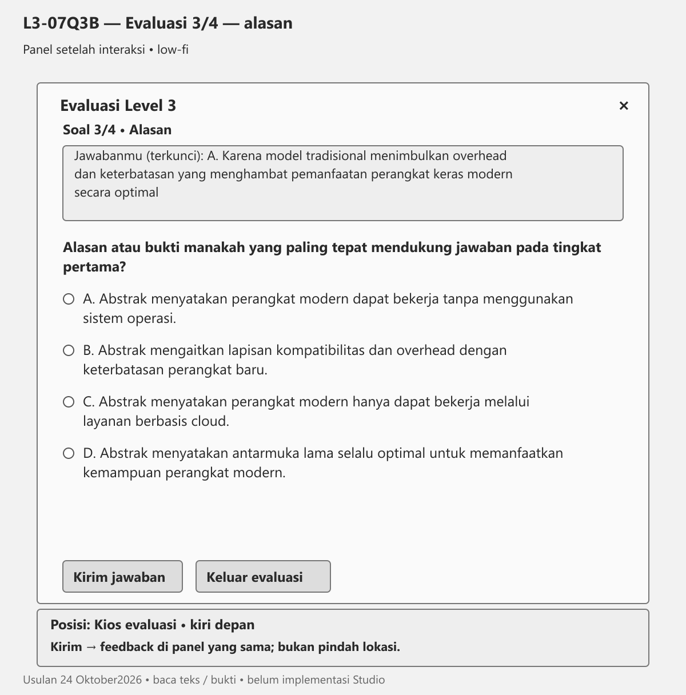

## L3-07Q4A — Evaluasi 4/4 — jawaban

Berdasarkan evaluasi yang dijelaskan dalam abstrak, kesimpulan manakah yang paling dapat dipertanggungjawabkan?

A. Twizzler harus mengganti semua OS modern.

B. Kinerja Twizzler selalu unggul pada seluruh aplikasi.

C. Studi kasus dan beberapa aplikasi menunjukkan kegunaan serta peningkatan kinerja pada konteks yang diuji.

D. Seluruh peran kernel sudah tidak diperlukan.

E. Semua komputer telah memakai Twizzler.

Perilaku: Kunci tier 1: C. Soal dan kunci merupakan usulan pengganti baseline untuk ditelaah ahli. Isi sesuai tab peta aktif. Soal4 merupakan usulan pengganti baseline yang sudah tercatat, belumACC ahli. Kunci khusus penelaah; tidak ditunjukkan diUI. Pilihan dapat diganti sebelum Kunci jawaban; nonaktif bila belum memilih. Setelah dikunci buka alasan tanpa membocorkan benar/salah.

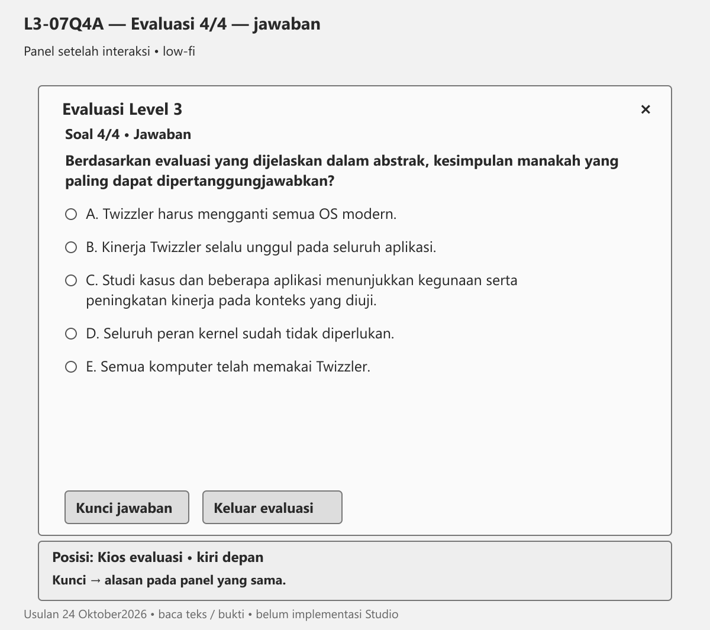

## L3-07Q4B — Evaluasi 4/4 — alasan

Alasan atau bukti manakah yang paling tepat mendukung jawaban pada tingkat pertama?

A. Abstrak melaporkan pengujian seluruh aplikasi dan mesin sehingga hasilnya dapat digeneralisasikan.

B. Abstrak menetapkan Twizzler sebagai standar wajib yang harus diterapkan pada seluruh komputer.

C. Abstrak membuktikan seluruh OS komersial lebih lambat daripada Twizzler dalam setiap kondisi.

D. Abstrak melaporkan kasus dan aplikasi tertentu sehingga kesimpulannya belum berlaku universal.

Perilaku: Kunci tier 2: D. Bukti penjelas: Abstrak melaporkan studi kasus dan aplikasi tertentu sehingga generalisasi universal belum dapat disimpulkan. Opsi persis tab peta. Ringkasan jawaban adalah ilustrasi pilihanUI, bukan jawaban otomatis. Kirim aktif setelah memilih alasan; penjelasan setelah kedua tier dikirim.

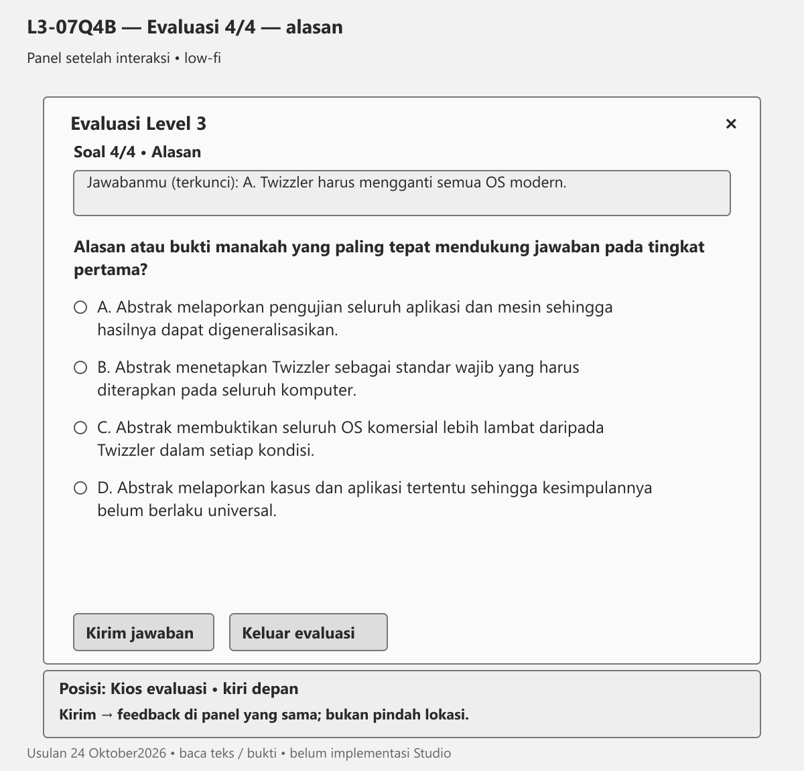

## L3-08F1 — Umpan balik — Jawaban tepat • alasan tepat

Jawaban tepat • alasan tepat

Contoh soal1 • Jawaban D • Alasan C

Benar. Interkoneksi cepat dan penyimpanan persisten termasuk tren yang dibahas.

Alasan C tepat: perubahan model dikaitkan dengan interkoneksi dan penyimpanan persisten.

Nilai jawaban soal ini: 25/25. Alasan dicatat terpisah.

Perilaku: Contoh UI bukan data penelitian. Gunakan36pesan per pilihanLevel3 pada tab peta untuk kombinasi yang benar-benar dikirim. Empat keadaan ditangani tanpa mengubah skor tier1. Tombol pada soal1–3 Soal berikutnya, soal4 Lihat hasil.

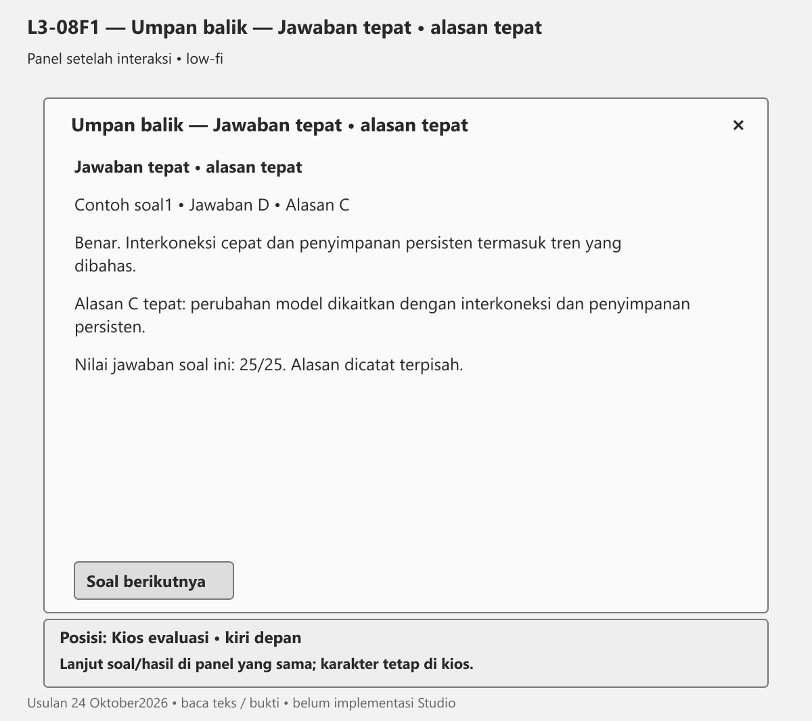

## L3-08F2 — Umpan balik — Jawaban belum tepat • alasan tepat

Jawaban belum tepat • alasan tepat

Contoh soal1 • Jawaban A • Alasan C

Pendorong yang disebut abstrak adalah tren perangkat keras, bukan kebutuhan tampilan grafis.

Alasan C tepat: perubahan model dikaitkan dengan interkoneksi dan penyimpanan persisten.

Nilai jawaban soal ini: 0/25. Alasan dicatat terpisah.

Perilaku: Contoh UI bukan data penelitian. Gunakan36pesan per pilihanLevel3 pada tab peta untuk kombinasi yang benar-benar dikirim. Empat keadaan ditangani tanpa mengubah skor tier1. Tombol pada soal1–3 Soal berikutnya, soal4 Lihat hasil.

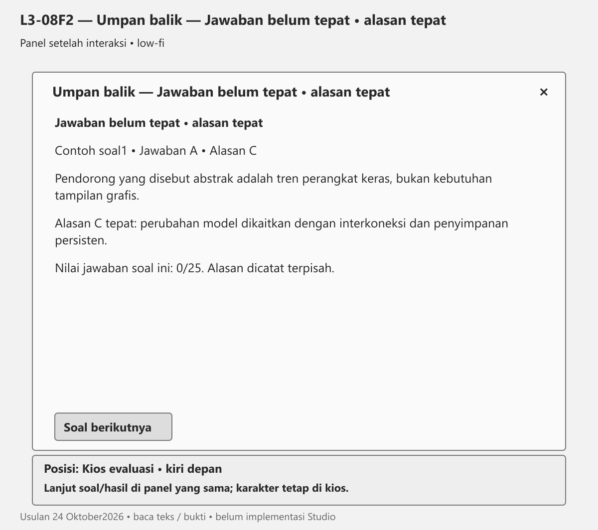

## L3-08F3 — Umpan balik — Jawaban tepat • alasan belum tepat

Jawaban tepat • alasan belum tepat

Contoh soal1 • Jawaban D • Alasan A

Benar. Interkoneksi cepat dan penyimpanan persisten termasuk tren yang dibahas.

Alasan A berfokus pada grafis yang tidak menjadi motivasi utama abstrak.

Nilai jawaban soal ini: 25/25. Alasan dicatat terpisah.

Perilaku: Contoh UI bukan data penelitian. Gunakan36pesan per pilihanLevel3 pada tab peta untuk kombinasi yang benar-benar dikirim. Empat keadaan ditangani tanpa mengubah skor tier1. Tombol pada soal1–3 Soal berikutnya, soal4 Lihat hasil.

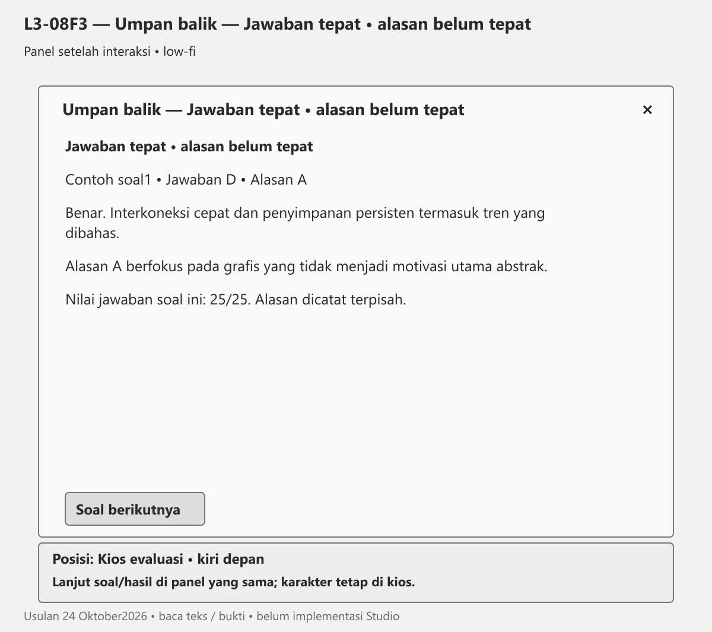

## L3-08F4 — Umpan balik — Jawaban dan alasan belum tepat

Jawaban dan alasan belum tepat

Contoh soal1 • Jawaban A • Alasan A

Pendorong yang disebut abstrak adalah tren perangkat keras, bukan kebutuhan tampilan grafis.

Alasan A berfokus pada grafis yang tidak menjadi motivasi utama abstrak.

Nilai jawaban soal ini: 0/25. Alasan dicatat terpisah.

Perilaku: Contoh UI bukan data penelitian. Gunakan36pesan per pilihanLevel3 pada tab peta untuk kombinasi yang benar-benar dikirim. Empat keadaan ditangani tanpa mengubah skor tier1. Tombol pada soal1–3 Soal berikutnya, soal4 Lihat hasil.

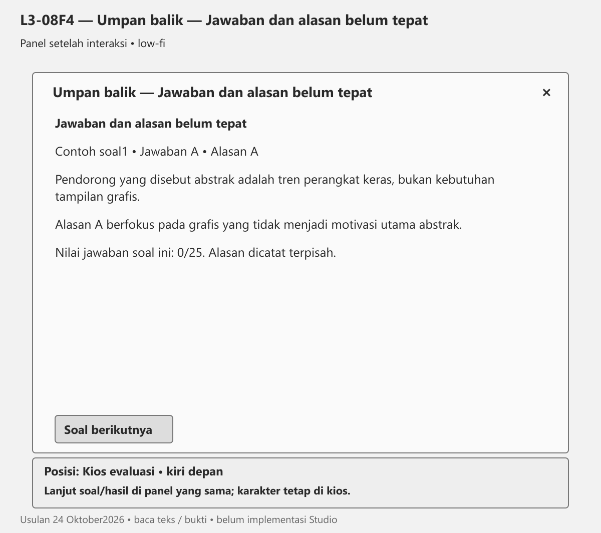

## L3-08X — Konfirmasi keluar evaluasi

Keluar dari evaluasi?

Percobaan ini belum selesai. Jawaban percobaan ini dibatalkan dan belum ada nilai akhir.

Progres materi dan latihan tetap tersimpan selama sesi.

Perilaku: Tetap kembali ke soal/pilihan sama. Ya keluar membatalkan percobaan belum selesai, bukan hasilgagal0; kembali ke kios untuk belajar. Tidak mengubah aturan retryLevel1/2.

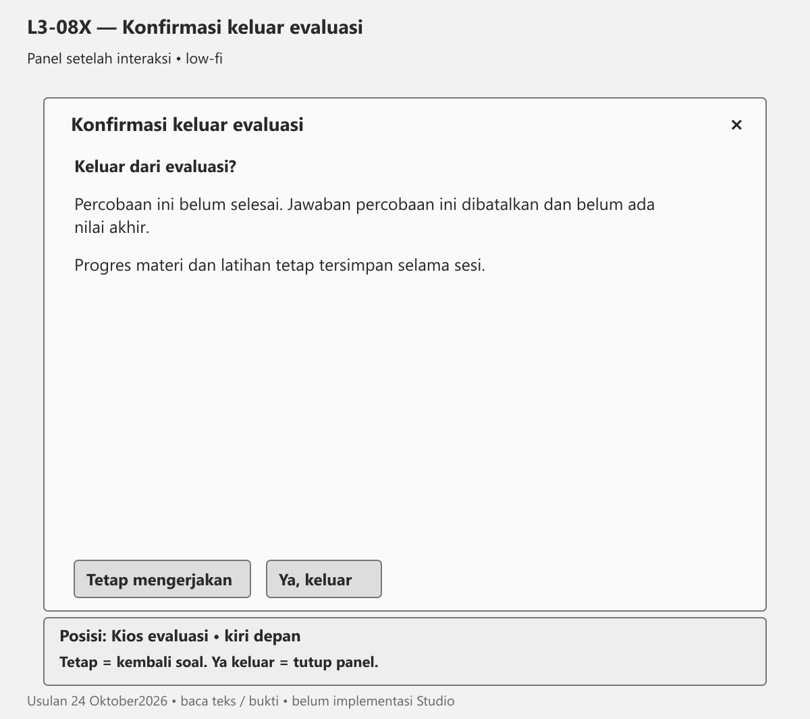

## L3-09B1 — Hasil Level 3 — lulus

Level 3 selesai.

Nilai jawaban:75/100

Jawaban tepat:3/4 • Alasan tepat:2/4

Nilai minimal75 terpenuhi. Tutup panel, lalu keluar melalui pintu tengah.

Perilaku: Angka ilustrasi. Skor tier1 benar×25, alasan0–4 terpisah. Keluar Level3 menutup panel, membuka akses melanjutkan dan menunjuk pintu tengah. Pemain berjalan dari kios kiri depan; tidak teleportasi. Pembahasan rancangan saat ini berakhir di pintu keluar, tanpa merinci aula.

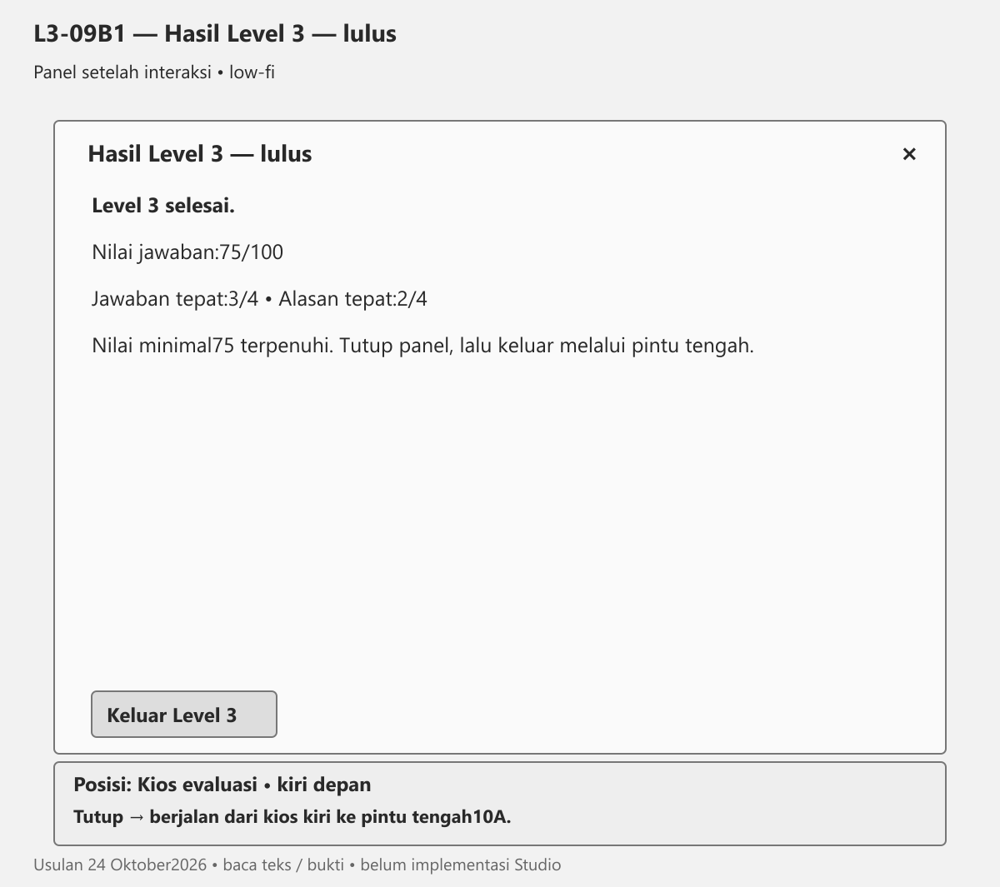

## L3-09B2 — Hasil Level 3 — belum lulus

Level 3 belum tuntas.

Nilai jawaban:50/100

Jawaban tepat:2/4 • Alasan tepat:3/4

Nilai minimal75. Baca kembali bagian yang diperlukan, kemudian kembali ke kios untuk mencoba lagi.

Perilaku: Angka ilustrasi. Belajar kembali menutup panel dan menunjuk meja abstrak kanan; pemain berjalan dari kios kiri melalui jalur tengah. Materi/latihan dapat dibaca ulang tanpa reset seluruhprogres. Kebijakan percobaan/skor penelitian mengikutiSOP, belum dikunci.

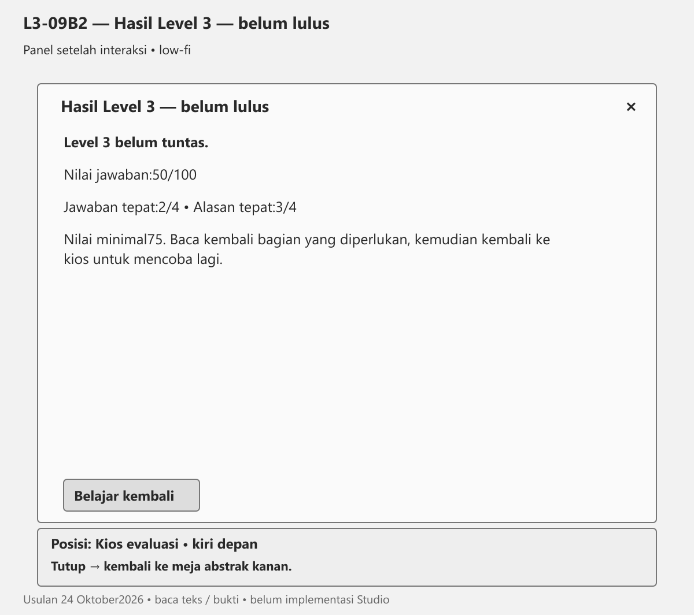

## L3-10A — Keluar gedung — Level 3 selesai

Tujuan: Keluar melalui pintu tengah.

Pintu keluar Level 3

Langsung berjalan keluar.

Perilaku: Setelah lulus, dari kios kiri depan berjalan menuju pintu tengah yang sama dengan saat masuk. Tidak perluE dan tidak membuka modal baru di pintu. RancanganLevel3 selesai pada tahap ini; desain gedung berikutnya ditunda untuk pembahasan selanjutnya.

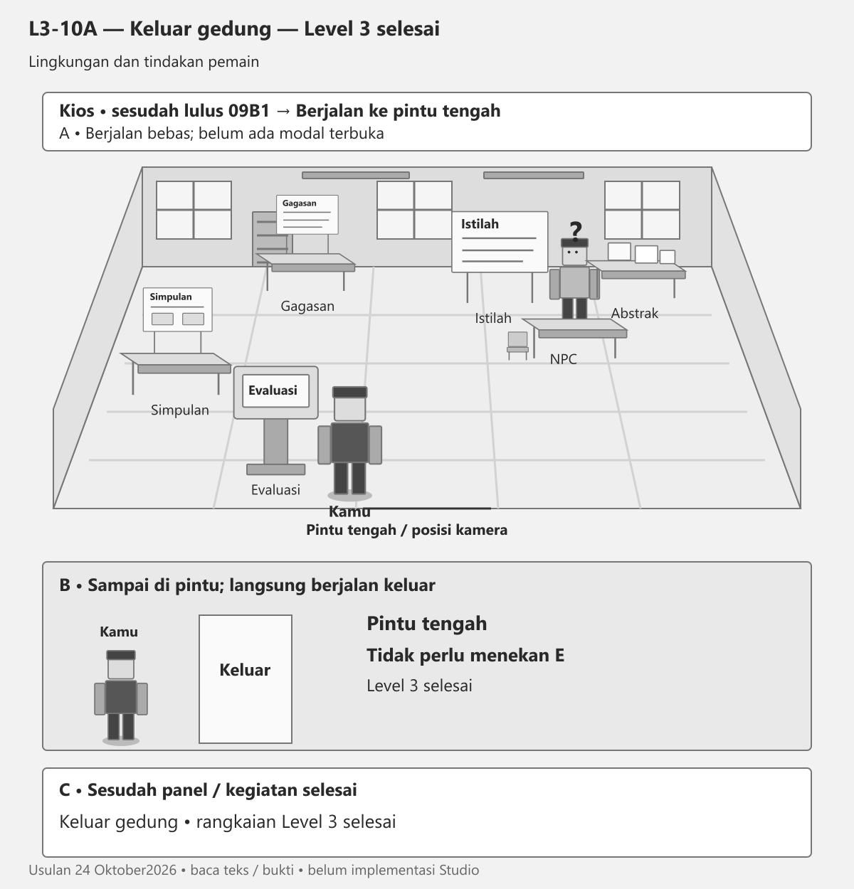
