# Storyboard aktif — Pembuka sampai Level 1

Koreksi 22 Oktober: tiga audio tetap terpisah. Full berarti progres0–100% untuk setiap klip, BUKAN narasi panjang gabungan. Tutor1 audio1; Tutor2 audio2/3. Konsep yang diterima dipertahankan.

## 00 — Denah pembuka dan Level 1

Perilaku: Posisi mengikuti foto10–11: dua NPC berdampingan di depan air mancur dari arah masuk, Tutor1 kiri pemain dan Tutor2 kanan. Keduanya dekat garis tengah jalur. Label objek tambahan di tepi adalah usulan penempatan, belum koordinat Studio. Alur tetap: panduan → Tutor1/audio1 → papan informasi → Tutor2/audio2 lalu audio3 pada NPC yang sama → papan latihan → kios → Level2. Audio tetap tiga klip pendek.

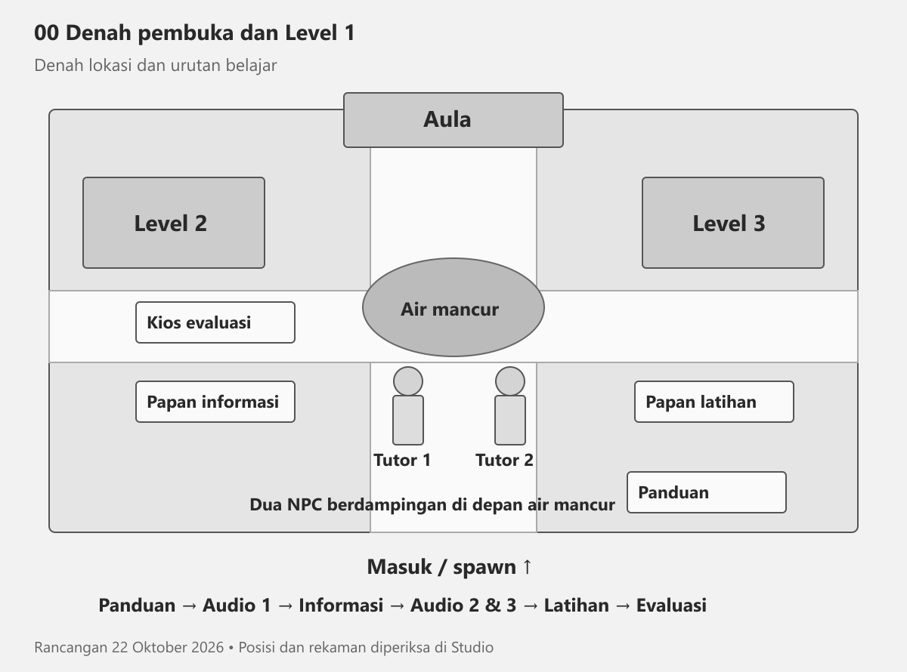

## 01A — Spawn — lingkungan awal

Tujuan: Baca sambutan, lalu kunjungi papan panduan.

PAPAN PANDUAN PERMAINAN

Peta • Cara belajar • Tujuan perjalanan

Perilaku: Pemain muncul menghadap jalur masuk kampus. Sambutan terbuka otomatis setelah UI siap. Ini tampilan lingkungan acuan; saat sambutan terbuka, gerak pemain dinonaktifkan sementara.

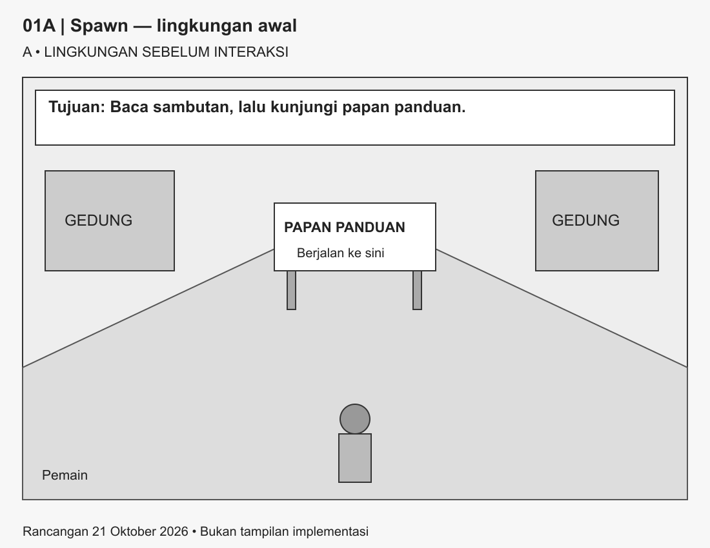

## 01B — Spawn — modal sambutan

Selamat Datang di Petualangan Bahasa!

Dalam permainan ini, kamu akan menjelajahi lingkungan kampus virtual dan mengikuti tiga tingkat pembelajaran yang dirancang untuk meningkatkan keterampilan mendengarkan dan membaca dalam bidang Teknologi Informasi.

Perilaku: Wording judul, isi dan tombol Lanjut dipertahankan dari foto 01 tab [23 April] REVIEW ROBLOX. Sambutan otomatis satu halaman; Lanjut menutup modal dan mengaktifkan gerak. Tujuan berikutnya pada HUD adalah mengunjungi papan panduan. Tidak menambah uraian materi/latihan pada sambutan.

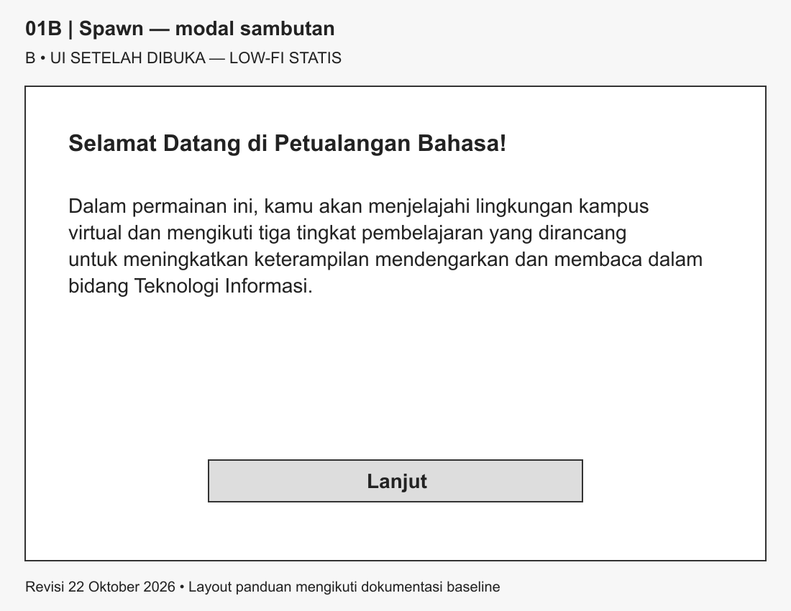

## 02A — Berjalan dan mendekati papan panduan

Tujuan: Kunjungi papan panduan di depan jalur masuk.

PANDUAN PERMAINAN

Peta kampus dan urutan belajar

Tahan E — Baca panduan

Perilaku: Setelah sambutan ditutup, tampilkan satu tujuan pada HUD dan penanda di papan. Pemain berjalan sendiri. Prompt hanya muncul saat dekat; modal terbuka setelah interaksi selesai. Pada perangkat sentuh, gunakan prompt sentuh yang setara.

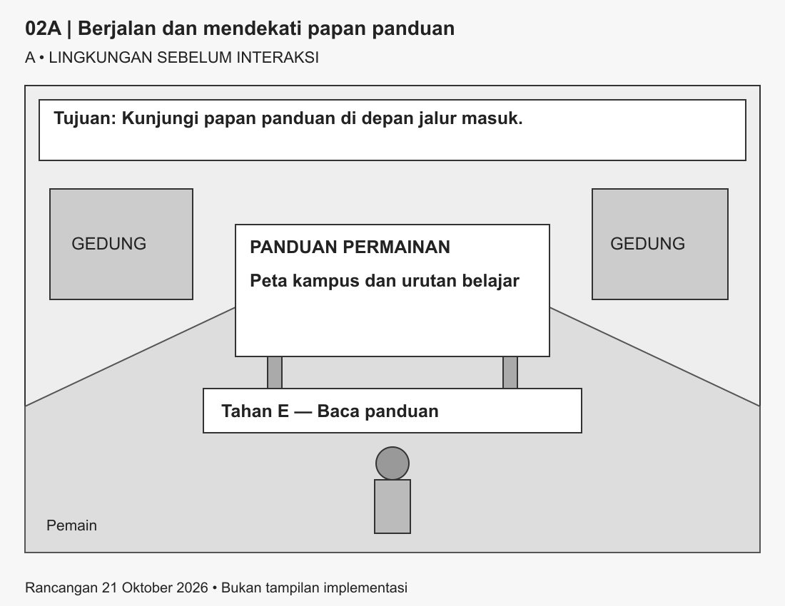

## 02B1 — Panduan 1/5 — peta kampus

Detail Peta

Kamu berada di pintu masuk. Ikuti urutan Level 1 → Level 2 → Level 3 → Aula.

Perilaku: Peta orientasi global disederhanakan menjadi pintu masuk, Level 1 di area tengah/air mancur, Level 2 di gedung kiri, Level 3 di gedung kanan dan Aula/Hall Akhir di belakang. Tidak menampilkan tutor, papan informasi, latihan atau kios Level 1. Rincian tersebut hanya pada denah perancangan 00. Berikutnya membuka panduan 2/5; Tutup kembali ke map. Panduan dapat dibuka ulang.

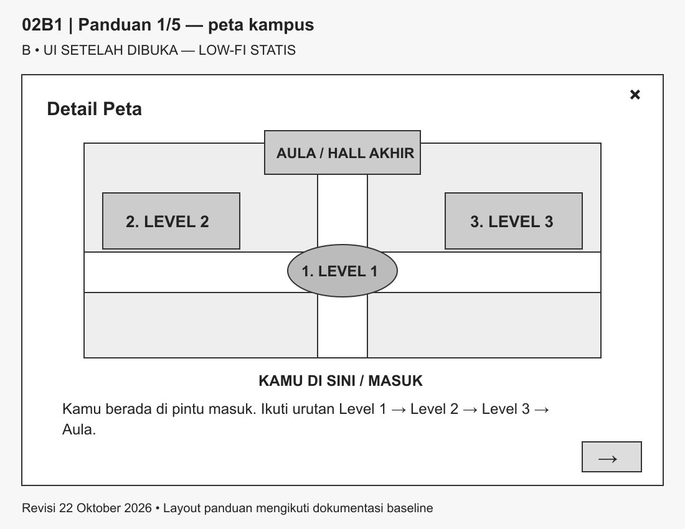

## 02B2 — Panduan 2/5 — Level 1

Ruang 1: Keterampilan Menyimak

Pada tahap pertama, kamu akan menyimak narasi tentang sistem operasi di area air mancur.

Dengarkan informasi dengan saksama. Kamu dapat menjeda dan memutar ulang audio.

Setelah menyimak, kerjakan latihan pesan utama dan informasi pendukung, lalu evaluasi sebelum melanjutkan ke tahap berikutnya.

Perilaku: Layout mengikuti foto 06: gambar lokasi di kiri, penjelasan di kanan, panah kembali/berikut di bawah dan tombol tutup di kanan atas. Wording disesuaikan dengan alur baru; tidak wajib identik dengan foto. Gambar kiri adalah low-fi area air mancur, bukan denah rinci aktivitas.

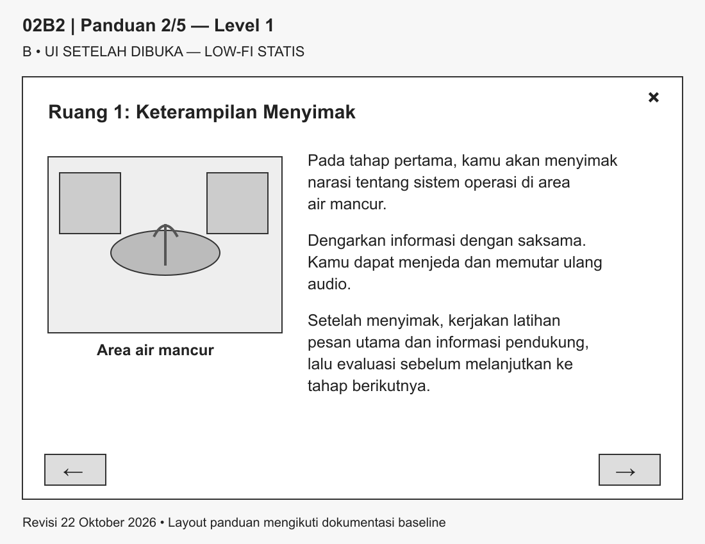

## 02B3 — Panduan 3/5 — Level 2

Ruang 2: Keterampilan Membaca

Pada tahap kedua, kamu akan membaca berita Cloud AI Pad di gedung Level 2.

Bacalah dengan teliti. Temukan gagasan utama, informasi penting dan bukti yang mendukung isi berita.

Gunakan papan istilah bila diperlukan, lalu kerjakan latihan dan evaluasi sebelum melanjutkan ke Level 3.

Perilaku: Layout mengikuti foto 07: gambar gedung Level 2 di kiri dan teks di kanan. Latihan dan evaluasi disebut sebagai bagian Level 2, bukan hanya Level 1. Bentuk rinci latihan Level 2 masih ditelaah pada tahap berikutnya. Papan istilah bantuan, bukan gerbang wajib.

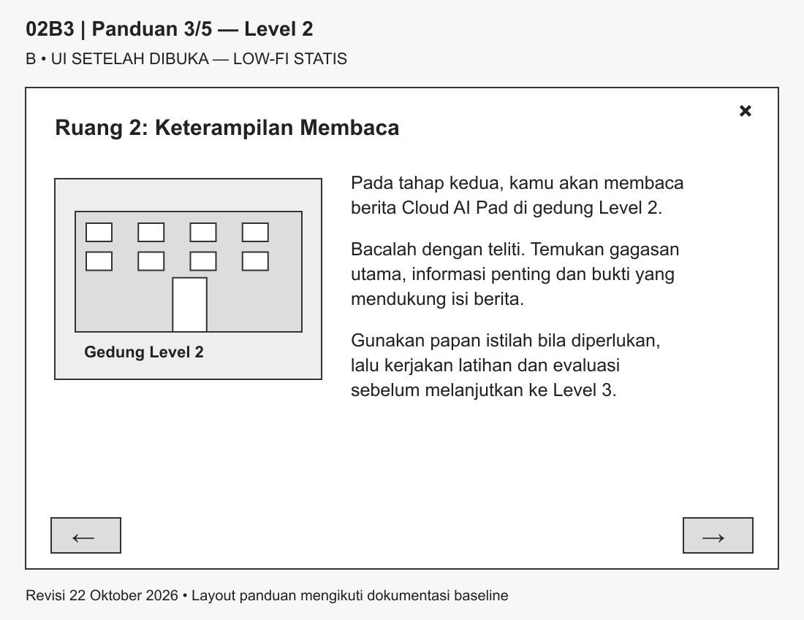

## 02B4 — Panduan 4/5 — Level 3

Ruang 3: Membaca Lanjutan

Pada tahap terakhir, kamu akan membaca teks akademik berupa abstrak tentang Twizzler di gedung Level 3.

Perhatikan masalah, pendekatan, bukti evaluasi, dan kesimpulan yang didukung bacaan.

Kerjakan latihan dan evaluasi, kemudian lanjutkan ke aula untuk melihat hasil pembelajaran.

Perilaku: Layout mengikuti foto 08: gambar gedung Level 3 di kiri dan teks di kanan; panah di bawah, tutup di atas. Membaca lanjutan di sini adalah membaca teks akademik. Halaman hanya orientasi; tidak mengunci bentuk latihan Level 3.

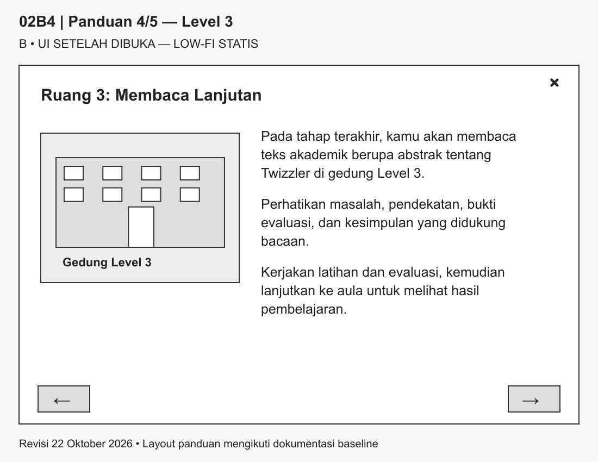

## 02B5 — Panduan 5/5 — aula

Aula

Setelah menyelesaikan ketiga level, kamu akan memasuki aula sebagai penutup perjalanan belajar.

Di sini, kamu dapat melihat nilai tiap level dan rekap nilai keseluruhan.

Kamu juga akan memperoleh penghargaan medali berdasarkan nilai yang dicapai selama pembelajaran.

Perilaku: Layout mengikuti foto 09: gambar aula di kiri dan teks di kanan, panah kembali di kiri bawah serta tutup di kanan atas. Tidak ada panah berikut pada halaman terakhir. Tutup kembali ke map; untuk pemain yang baru mulai, tujuan HUD tetap Tutor 1 di air mancur. Jenis/ambang medali belum disimpulkan dari contoh foto. Wording panduan boleh disesuaikan, layout menjadi acuan.

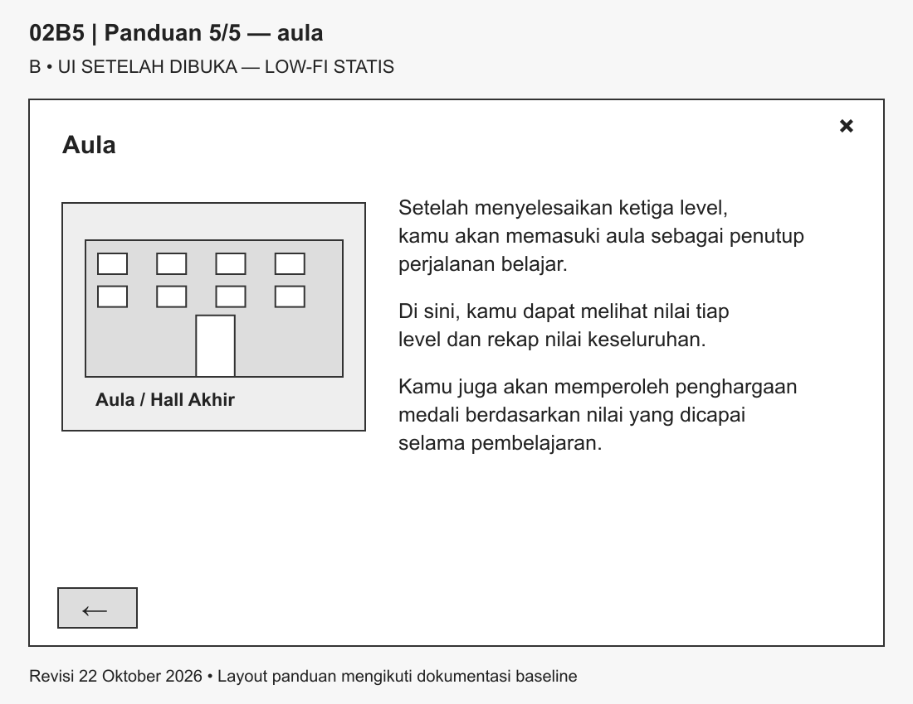

## 03A — Perjalanan ke Tutor 1

Tujuan: Temui Tutor 1 di depan air mancur.

Tutor 1

Tahan E — Bicara

Perilaku: Dua NPC lama berdampingan di depan air mancur. Tutor1 adalah NPC di kiri dari arah pemain; Tutor2 di kanan. Penanda tujuan aktif menunjuk Tutor1. Tahan E membuka03B. Tidak memindahkan NPC ke taman samping atau memutar audio otomatis dari jauh.

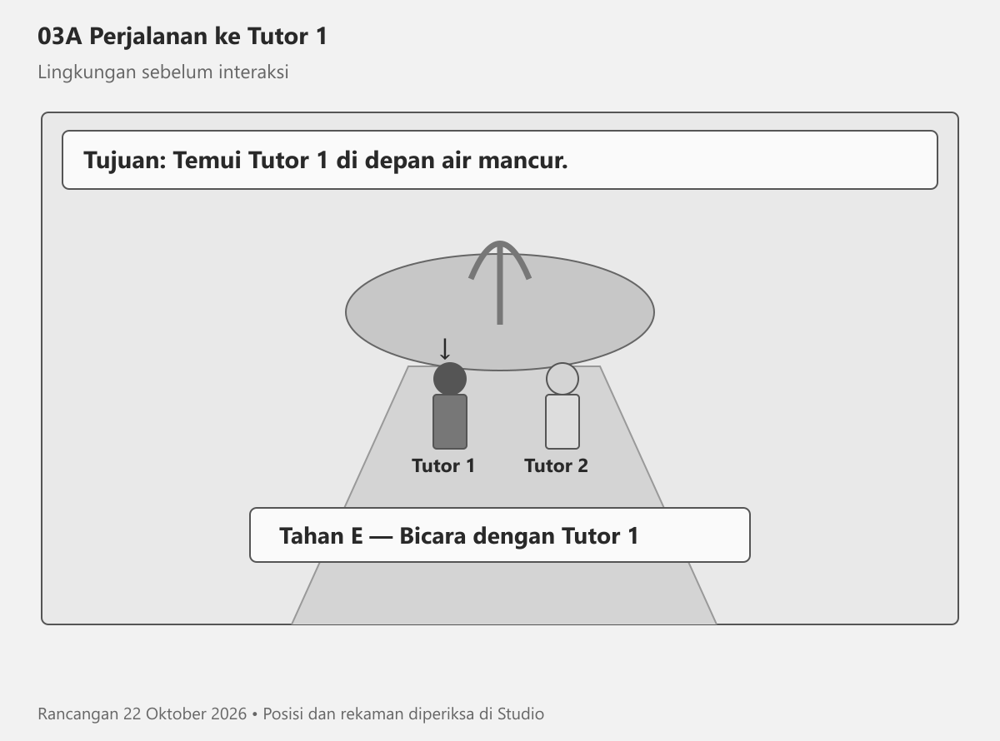

## 03B — Tutor 1 — orientasi menyimak

Selamat datang di Level 1 — Keterampilan Menyimak.

Pada tahap ini, kamu akan mendengarkan sebuah narasi singkat yang berisi informasi dasar mengenai bidang Teknologi Informasi, khususnya tentang sistem operasi. Narasi ini dirancang untuk melatih kemampuanmu dalam memahami isi informasi yang disampaikan secara lisan.

Selama audio diputar, perhatikan dengan saksama setiap informasi penting, seperti pengertian, fungsi, serta peran sistem operasi dalam kehidupan sehari-hari dan dunia kerja.

Setelah selesai mendengarkan, kamu akan diminta mengerjakan latihan dan kuis yang menguji pemahamanmu terhadap isi narasi tersebut.

Dengarkan dengan fokus, karena setiap detail informasi akan membantumu menjawab pertanyaan dengan tepat.

Perilaku: Pembuka mengikuti foto12 baseline. Penyesuaian terbatas: Sistem Informasi menjadi sistem operasi sesuai naskah/soal, serta latihan sebelum kuis. Mulai membuka audio1, bukan keseluruhan narasi sekaligus. Tiga bagian tetap mengikuti rancangan penelitian. Tutup kembali ke map.

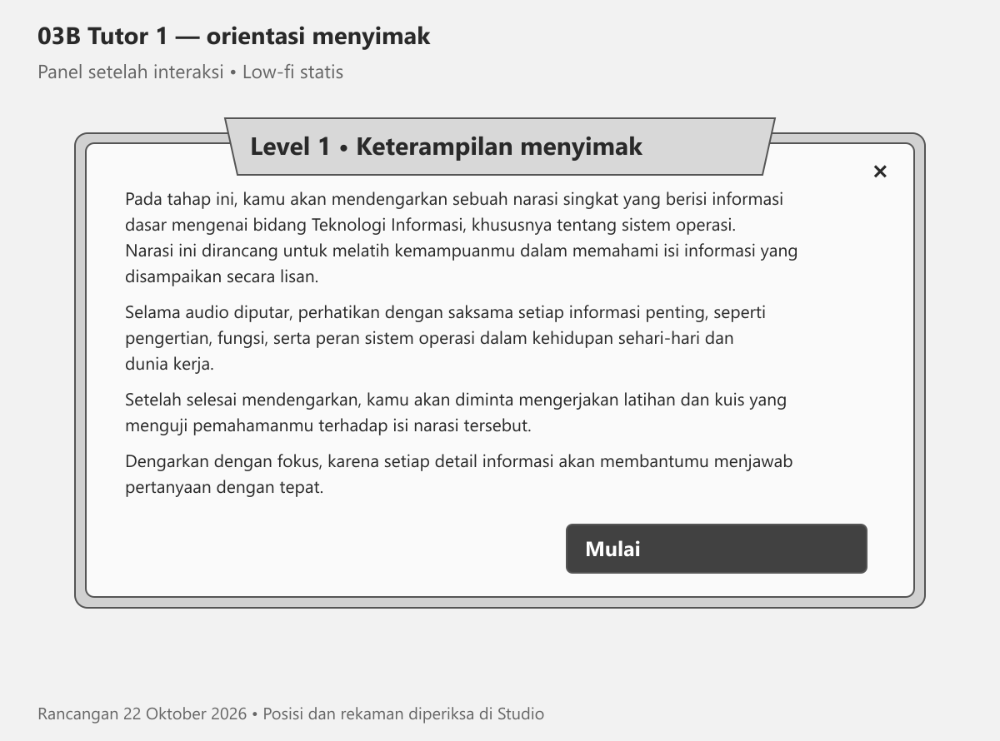

## 04B — Tutor 1 — audio 1/3

Pengertian dan sumber daya

Perilaku: Audio1 mencakup kalimat1–2 naskah awal. Panel mengikuti pola pemutar baseline dengan judul singkat, putar/jeda, satu bar penuh sepanjang jalur, dan satu CTA berikutnya. Bar0–100% serta waktu hanya untuk klip audio1, bukan sepertiga durasi seluruh narasi. Tampilan awal0%; setelah klip selesai100%. Ke papan informasi nonaktif sampai akhir normal audio1. Tombol putar berubah menjadi jeda saat berjalan dan putar ulang setelah selesai, tanpa menambah tombol navigasi. Tutup menjeda dan membuka kembali melanjutkan posisi klip. Titik potong/durasi/SoundId perlu dicocokkan di Studio.

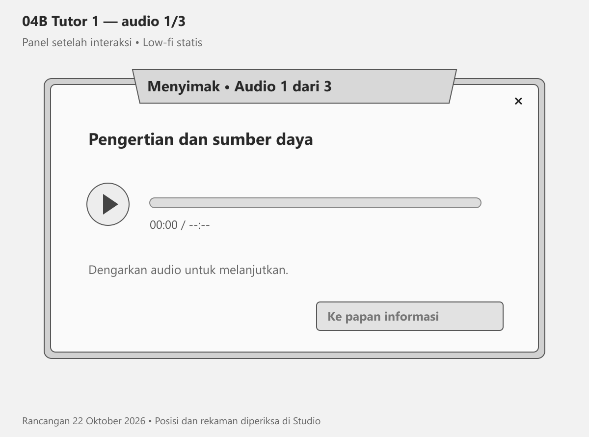

## 04C1 — Audio 1 — selesai

Audio 1 selesai.

Selanjutnya, lihat papan informasi.

Perilaku: Keadaan selesai audio1: bar milik klip ini100%, bukan sepertiga bar gabungan. Pemberitahuan singkat dan satu tombol ke papan informasi. Tombol menutup panel lalu mengarahkan pemain berjalan ke05A. Audio2 dan3 tetap menunggu di Tutor2; tidak digabung ke audio1.

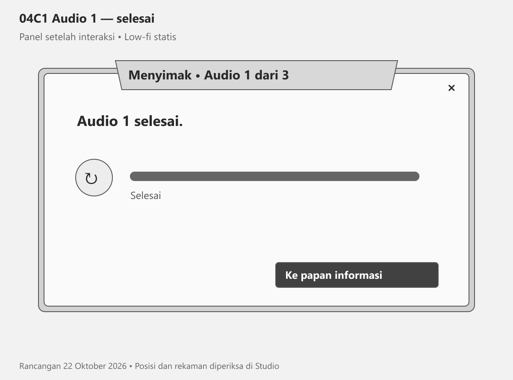

## 04C2 — Audio — gagal dimuat

Audio belum dapat diputar.

Coba muat ulang.

Perilaku: Hanya muncul saat pemuatan klip aktif gagal dan pemeriksaan status memastikan belum siap setelah batas tunggu; periksa lagi status sebelum menampilkan. Jeda pengguna, tutup panel, akhir normal, atau audio yang sudah berhasil dimuat tidak boleh memunculkan error. Timeout saja bukan bukti pasti gagal. Coba lagi memuat ulang klip aktif dan membersihkan pesan setelah berhasil. Klip belum ditandai selesai. Kondisi teknis ini masih perlu diuji di Studio.

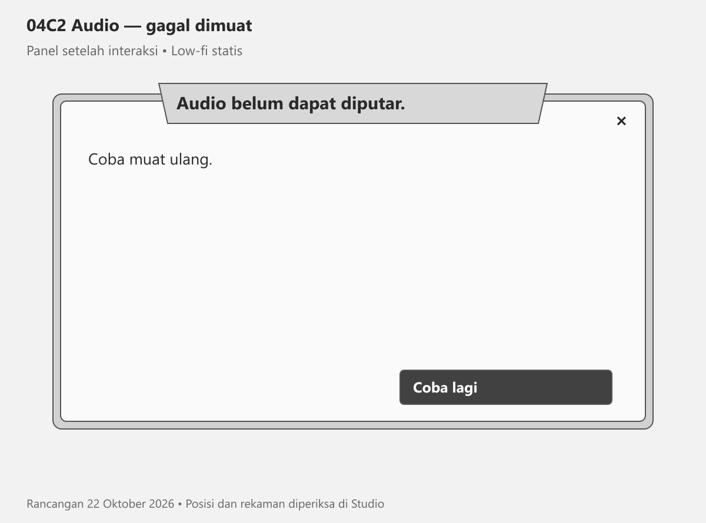

## 05A — Mendekati papan informasi

Tujuan: Lihat papan informasi di dekat Tutor 1.

KENALI SISTEM OPERASI

Perangkat lunak • Pengelola sumber daya

Tahan E — Lihat informasi

Perilaku: Bentuk papan yang telah diterima dipertahankan. Papan tambahan di dekat Tutor1 menguatkan isi audio1. Letak tepi jalur masih usulan; dua NPC tetap di depan air mancur. Jika audio1 belum selesai, arahkan kembali ke Tutor1. Tidak mengubah isi materi awal.

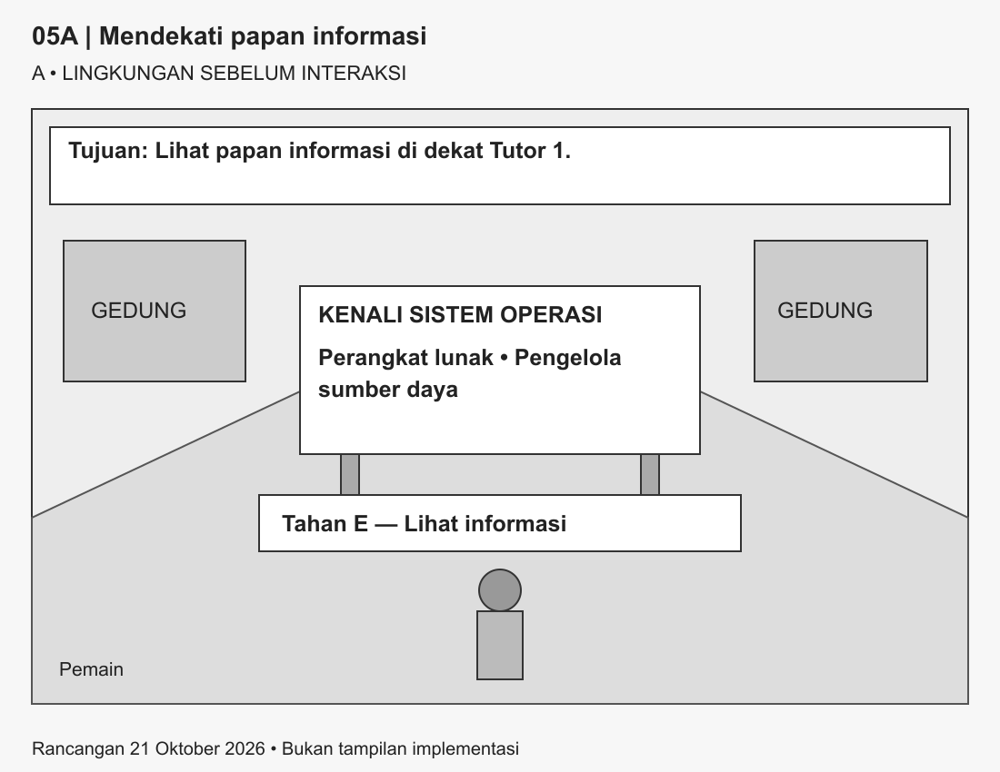

## 05B — Papan informasi — penguatan singkat

Kenali sistem operasi

Sistem operasi adalah perangkat lunak.

Mengelola sumber daya komputer:

Prosesor • Memori • Penyimpanan • Perangkat input dan output

Selanjutnya, temui Tutor 2.

Perilaku: Papan ini tambahan rancangan, tidak ada padanannya pada foto baseline Level1. Isinya tetap dari naskah awal audio1: OS perangkat lunak dan sumber daya yang dikelola; tidak menambah konsep baru. Ke Tutor2 menutup panel dan menunjuk NPC kanan yang berdampingan dengan Tutor1. Tutor2 melanjutkan audio2 dan3, bukan sekadar pemberi arahan. Jika audio1 belum selesai, arahkan kembali ke Tutor1.

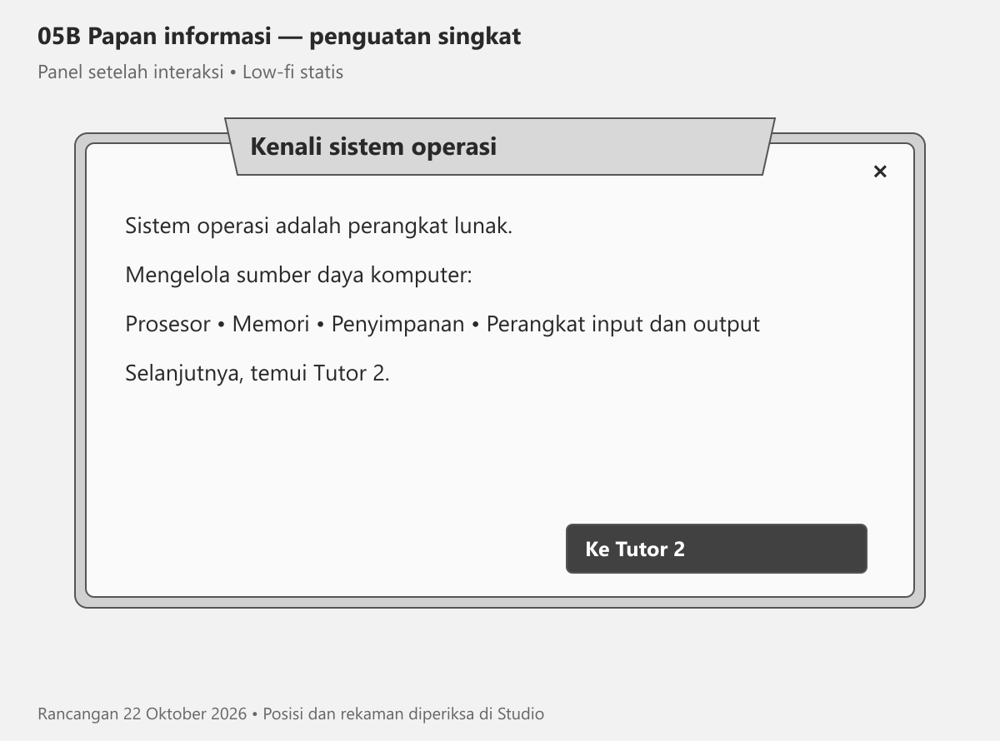

## 06A — Mendekati Tutor 2

Tujuan: Temui Tutor 2 di depan air mancur.

Tutor 2

Tahan E — Bicara

Perilaku: NPC kanan di depan air mancur, berdampingan dengan Tutor1. Setelah papan informasi, penanda aktif menunjuk NPC ini untuk audio2 dan3. Tahan E membuka06B1. Jika audio1 belum selesai, arahkan ke Tutor1. Tidak membuat lokasi/NPC baru.

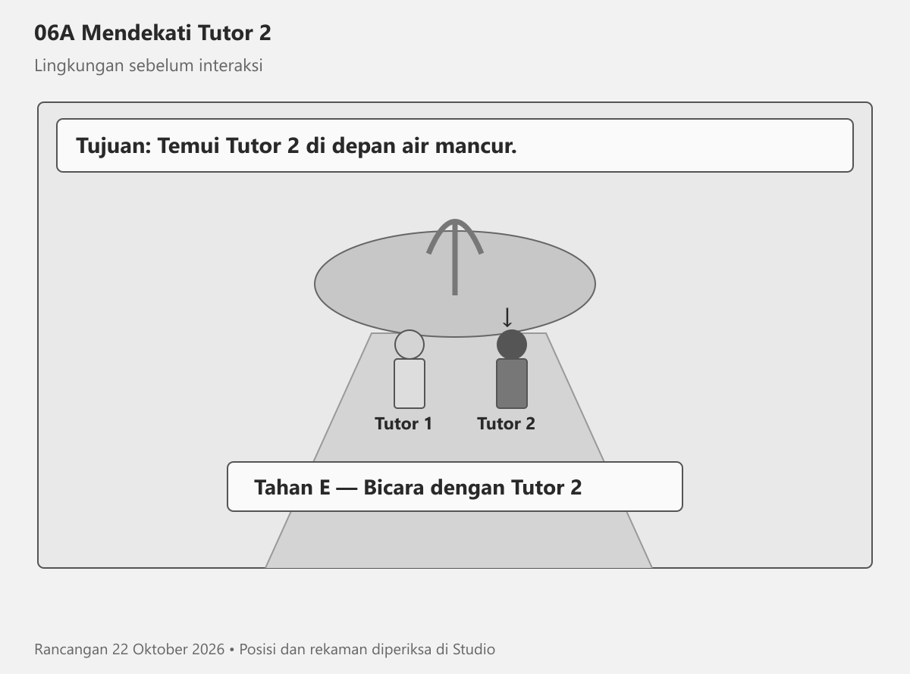

## 06B1 — Tutor 2 — audio 2/3

Peran dan contoh sistem operasi

Perilaku: Tetap konsep sebelumnya: Tutor2 memutar audio2, kalimat3–6. Bar dan waktu0–100% milik klip audio2 sendiri. Tidak dimulai pada sepertiga bar narasi panjang dan tidak dipotong di tengah klip. Putar/jeda satu kontrol; satu CTA Lanjut ke audio3 aktif setelah akhir normal klip. Tombol tersebut mengganti halaman pemutar pada Tutor2 yang sama, bukan menyuruh pemain pindah NPC. Tutup menjeda; akses ulang memulihkan posisi. Tidak menambah empat tombol navigasi.

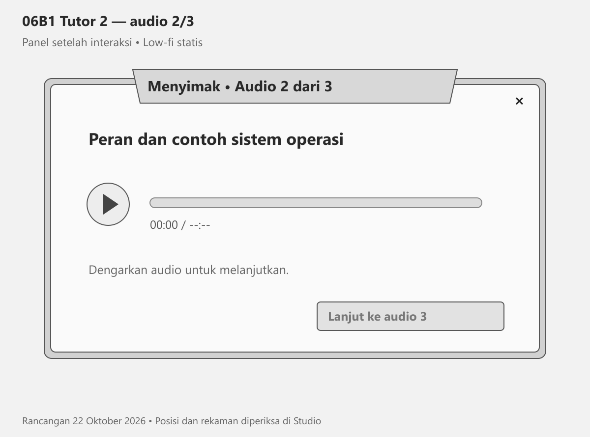

## 06B2 — Tutor 2 — audio 3/3

Tujuan dan manfaat pemahaman

Perilaku: Masih NPC Tutor2 yang sama. Ini halaman kedua pemutar pada NPC tersebut: audio3, kalimat7–9. Bar dan waktu0–100% berlaku untuk klip audio3 sendiri. Ke papan latihan aktif setelah akhir normal audio3, lalu menutup panel dan memberi arah berjalan ke07A. Tautan Kembali ke audio2 kecil tersedia untuk mengulang bagian sebelumnya; tidak mereset status selesai audio2. Tidak ada audio panjang gabungan.

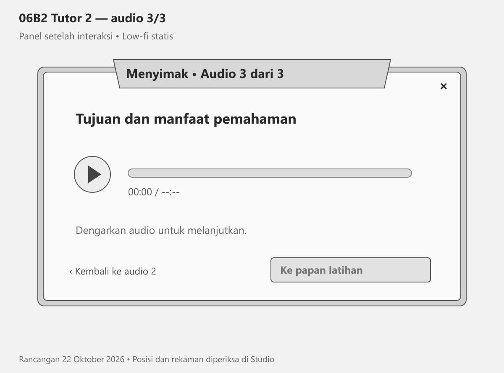

## 07A — Mendekati papan latihan

Tujuan: Lengkapi papan informasi dari audio.

LATIHAN MENYIMAK

Pesan utama dan informasi pendukung

Tahan E — Buka latihan

Perilaku: Latihan yang telah diterima dipertahankan. Akses aktif setelah tiga klip audio1–3 selesai. Jika belum, tampilkan bagian yang tersisa dan arahkan ke Tutor1 atau Tutor2 sesuai bagian. Papan di tepi jalur adalah usulan penempatan untuk diperiksa di Studio.

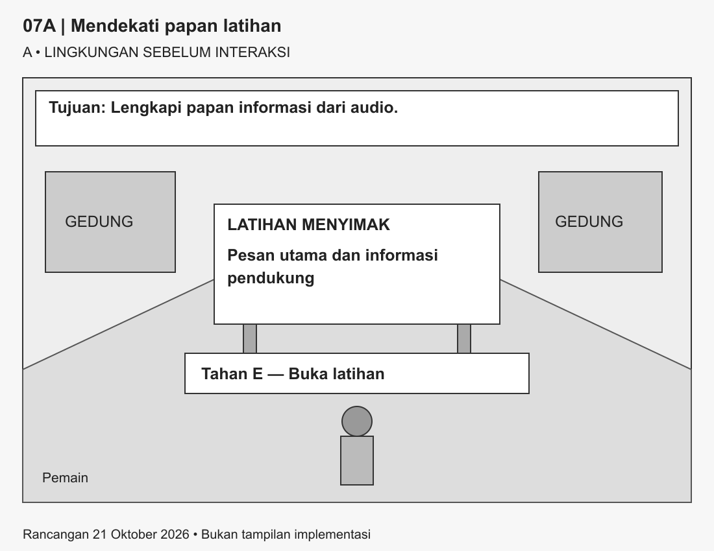

## 07B1 — Latihan — papan kosong

Lengkapi informasi dari audio

Pilih kartu, lalu klik tempatnya. Isi satu pesan utama dan satu informasi pendukung. Dua kartu tidak digunakan.

A. Sistem operasi berperan penting dalam mengelola sumber daya dan mendukung penggunaan komputer.

B. Sumber daya yang dikelola mencakup prosesor, memori, penyimpanan, serta perangkat input dan output.

C. Rekaman menjelaskan langkah memasang sistem operasi.

D. Sistem operasi merupakan perangkat keras yang mengelola sumber daya komputer.

Perilaku: Bentuk latihan yang sudah diterima dipertahankan. Satu kartu hanya satu tempat. Klik kartu memberi seleksi, bukan status benar. Klik tempat terisi mengganti kartu; kartu lama kembali ke pilihan. Kartu boleh dipindahkan tanpa duplikasi. Periksa aktif setelah dua tempat terisi. Huruf kartu untuk rujukan, tidak menandai kunci.

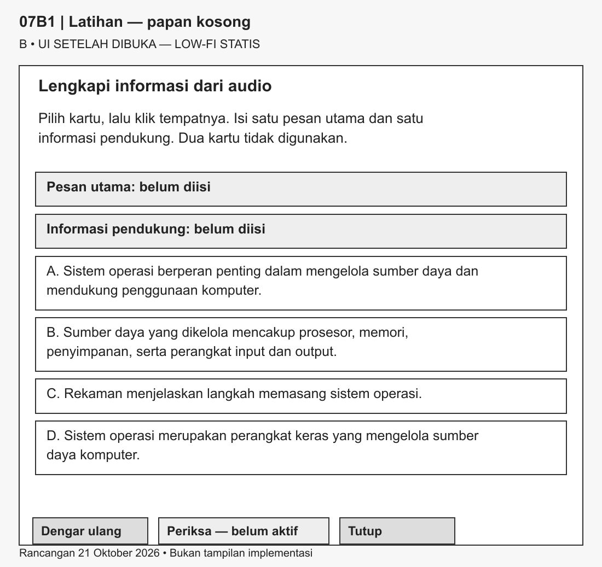

## 07B2 — Latihan — satu tempat terisi

Lengkapi informasi dari audio

Isi kedua tempat terlebih dahulu.

A. Sistem operasi berperan penting dalam mengelola sumber daya dan mendukung penggunaan komputer.

B. Sumber daya yang dikelola mencakup prosesor, memori, penyimpanan, serta perangkat input dan output.

C. Rekaman menjelaskan langkah memasang sistem operasi.

D. Sistem operasi merupakan perangkat keras yang mengelola sumber daya komputer.

Perilaku: Kartu A sudah di Pesan utama; pendukung belum diisi, jadi Periksa belum aktif. Tutup mempertahankan susunan selama sesi. Dengar ulang menawarkan audio1,2,3 secara terpisah. Kembali ke papan mempertahankan kartu; pemutar lain berhenti sebelum klip baru diputar.

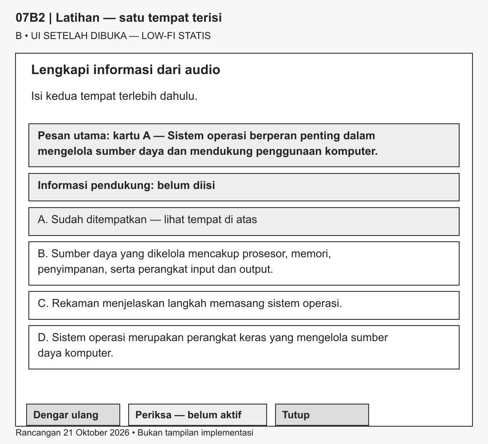

## 07B3 — Latihan — contoh kartu tertukar

Periksa kembali penempatannya

Kedua informasi sesuai narasi. Mana yang merangkum seluruh pembahasan, dan mana yang memberi rincian khusus?

A. Sistem operasi berperan penting dalam mengelola sumber daya dan mendukung penggunaan komputer.

B. Sumber daya yang dikelola mencakup prosesor, memori, penyimpanan, serta perangkat input dan output.

C. Rekaman menjelaskan langkah memasang sistem operasi.

D. Sistem operasi merupakan perangkat keras yang mengelola sumber daya komputer.

Perilaku: Contoh ini muncul setelah Periksa: A/B terbalik. Beri label Perlu diperbaiki pada masing-masing tempat, tidak hanya warna. Jika C dipilih: Apakah narasi menjelaskan langkah memasang sistem operasi? Jika D dipilih: Dengarkan bagaimana narasi menjelaskan OS: perangkat lunak atau perangkat keras? Tempat tepat dipertahankan; hanya yang salah diperbaiki.

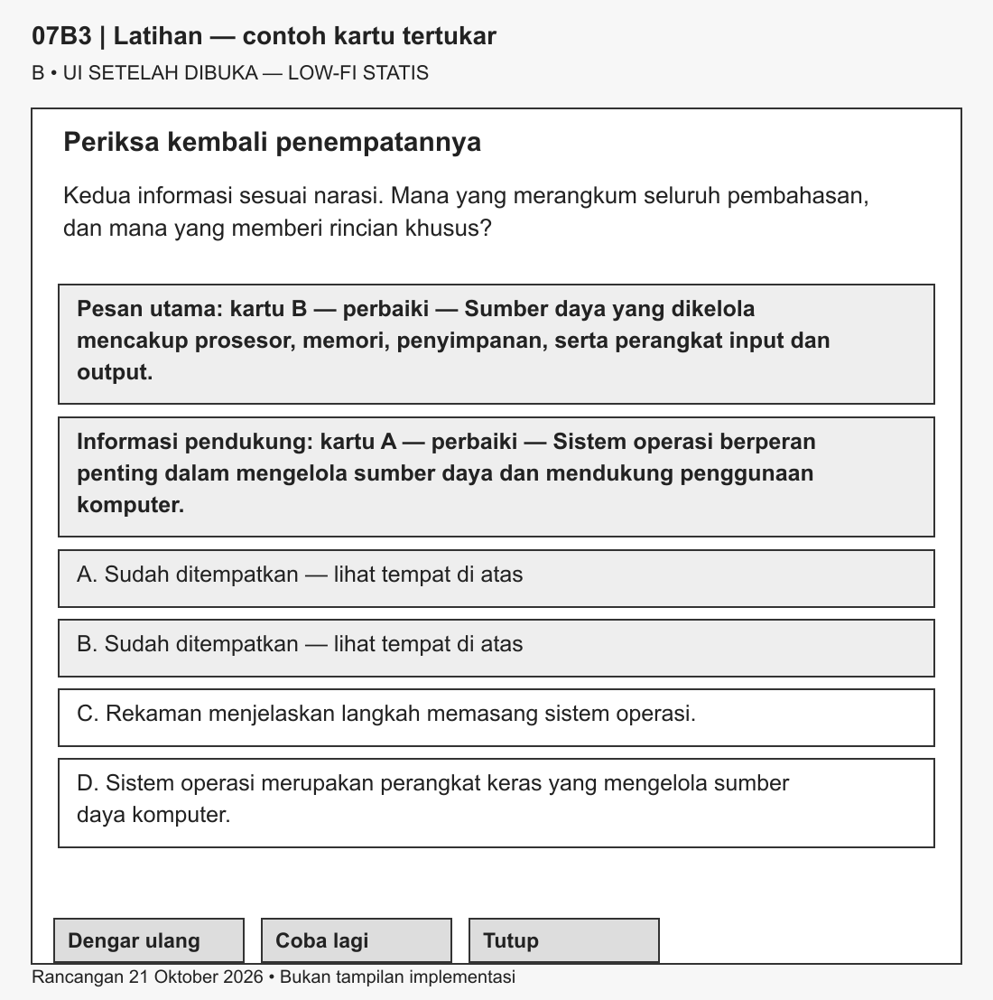

## 07B4 — Latihan — pembahasan berbantuan

Pembahasan papan informasi

Pesan utama: Sistem operasi berperan penting dalam mengelola sumber daya dan mendukung penggunaan komputer.

Informasi pendukung: Sumber daya yang dikelola mencakup prosesor, memori, penyimpanan, serta perangkat input dan output.

Pesan utama mencakup peran sistem operasi secara umum. Informasi pendukung merinci sumber daya yang dikelola.

Langkah memasang OS tidak dibahas. OS disebut perangkat lunak, bukan perangkat keras.

Perilaku: Setelah pemeriksaan kedua masih salah, tawarkan Lihat pembahasan atau Coba lagi. Membuka pembahasan belum menyelesaikan aktivitas sampai Saya memahami pembahasan dipilih. Setelah konfirmasi, status Selesai dengan bantuan. Ambang dua pemeriksaan adalah aturan desain awal untuk ditelaah, bukan aturan final eksperimen.

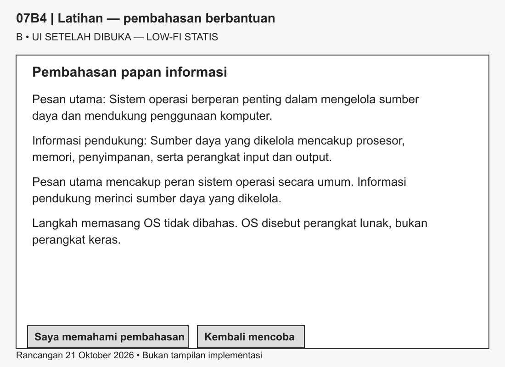

## 07B5 — Latihan — selesai dan tujuan berikutnya

Latihan selesai

Tepat. Pesan utama merangkum peran sistem operasi; rincian pendukung menyebut sumber daya yang dikelolanya.

A. Sistem operasi berperan penting dalam mengelola sumber daya dan mendukung penggunaan komputer.

B. Sumber daya yang dikelola mencakup prosesor, memori, penyimpanan, serta perangkat input dan output.

C. Rekaman menjelaskan langkah memasang sistem operasi.

D. Sistem operasi merupakan perangkat keras yang mengelola sumber daya komputer.

Perilaku: A/B tepat menampilkan Selesai; setelah pembahasan dikonfirmasi gunakan Selesai dengan bantuan. Latihan tidak menambah nilai kelulusan. Ke kios evaluasi menutup papan dan memberi arah berjalan; tidak langsung membuka soal. Susunan dan status selesai bertahan selama sesi.

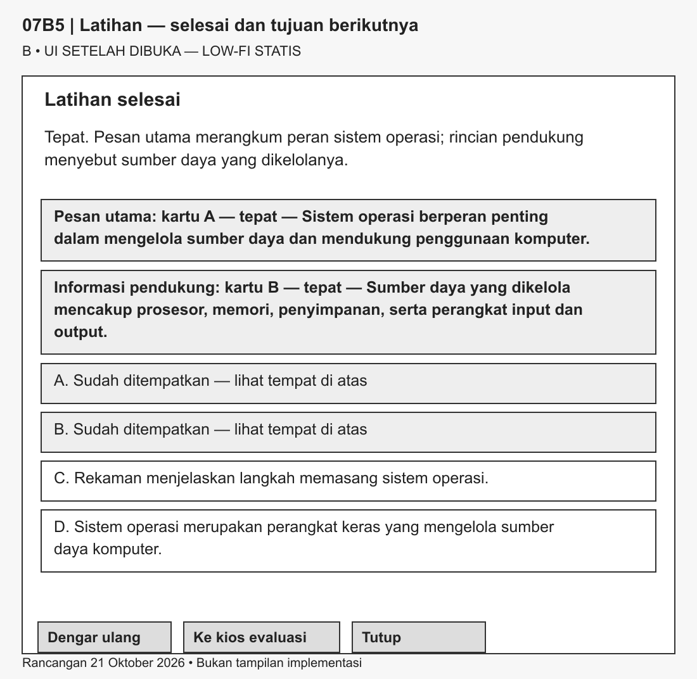

## 07B6 — Latihan — pilih audio untuk didengar ulang

Dengar ulang narasi

Audio 1 — Pengertian dan sumber daya

Audio 2 — Peran dan contoh

Audio 3 — Tujuan dan manfaat pemahaman

Perilaku: Dengar ulang tetap tiga klip terpisah, bukan satu narasi panjang. Memilih satu klip membuka pemutar sederhana dengan bar0–100% untuk klip tersebut dan Kembali ke papan. Susunan/seleksi kartu tetap. Tidak memindahkan avatar, membuat rekaman baru, atau menumpuk dua pemutar. Status selesai materi yang sah tetap tersimpan selama sesi.

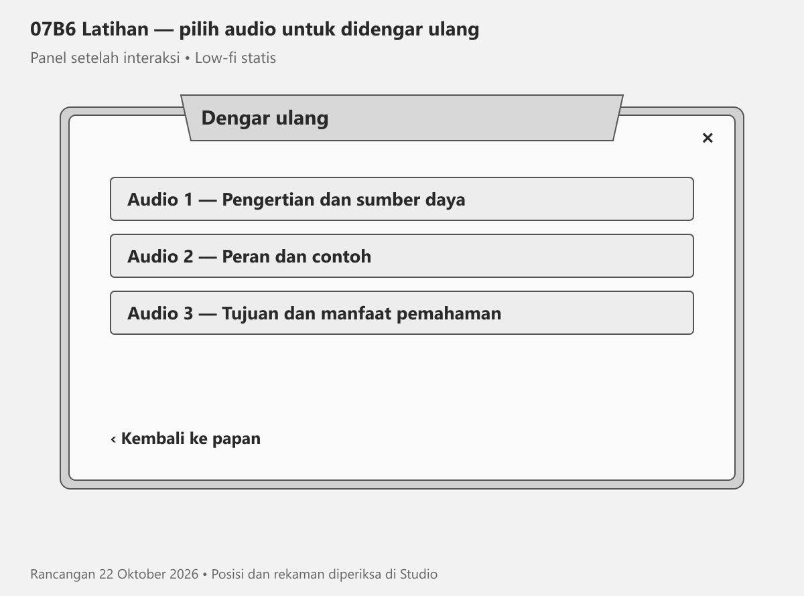

## 08A — Mendekati kios evaluasi

Tujuan: Kerjakan evaluasi Level 1 di kios.

EVALUASI LEVEL 1

4 soal • Jawaban dan alasan

Tahan E — Buka evaluasi

Perilaku: Objek baru berupa kios/papan tegak sederhana di tepi jalur ke gedung Level 2. Penanda tujuan mengarah ke kios setelah latihan selesai. Pemain berjalan ke kios; kedekatan saja tidak membuka soal.

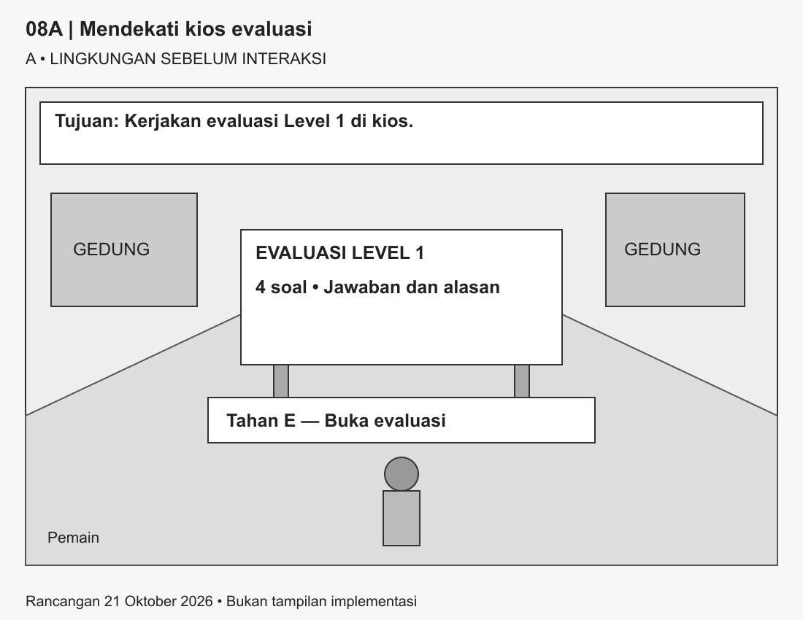

## 08B1 — Kios — contoh akses belum siap

Evaluasi belum dapat dimulai.

Audio: 2 dari 3 bagian selesai.

Latihan: belum selesai.

Perilaku: Contoh akses terlalu awal; status berasal dari progres aktual tiga klip audio dan latihan. Jika audio belum lengkap, arahkan ke NPC/klip pertama yang belum selesai; jika seluruh audio selesai tetapi latihan belum, arahkan ke papan latihan. Tidak lagi memakai syarat satu audio utuh. Tutup kembali ke map.

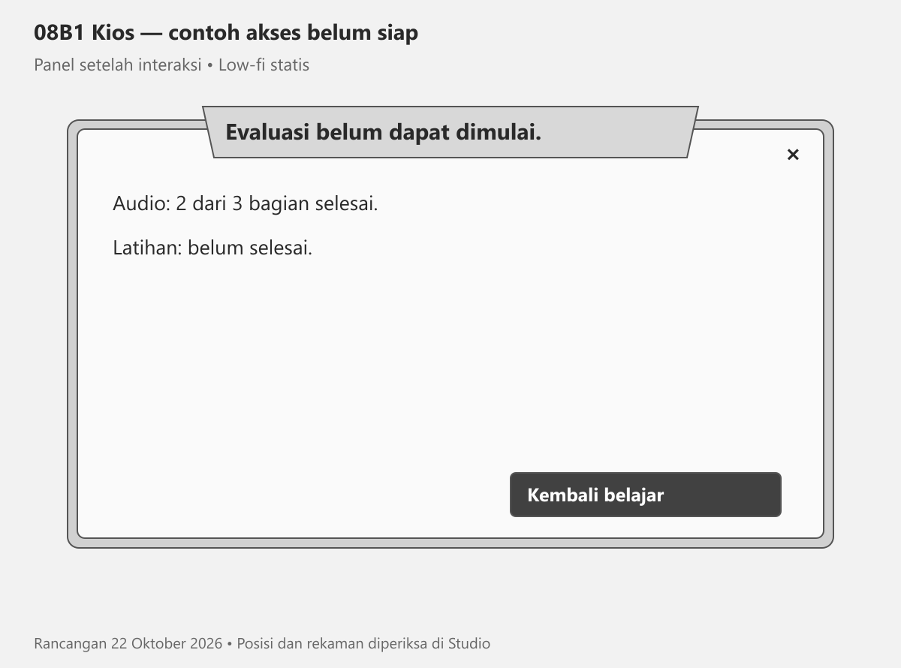

## 08B2 — Kios — petunjuk dan konfirmasi

Siap mengikuti evaluasi Level 1?

Ada empat soal. Pada setiap soal, pilih satu jawaban, kunci jawaban tersebut, lalu pilih satu alasan.

Penjelasan ditampilkan setelah jawaban dan alasan dikirim. Jawaban yang sudah dikirim tidak dapat diganti pada percobaan ini.

Jawaban benar bernilai 25; nilai minimal 75 untuk melanjutkan. Ketepatan alasan dicatat terpisah dari nilai jawaban.

Selama evaluasi, akses materi dan bantuan latihan ditutup. Jika ingin belajar lagi, pilih Nanti dulu sebelum mulai.

Perilaku: Terbuka setelah ketiga klip audio selesai dan latihan selesai, sesuai rancangan semula. Soal, opsi, kunci, feedback, skor dan batas perlakuan tidak diubah. Mulai evaluasi memulai percobaan; Nanti dulu kembali ke map. Keluar memakai konfirmasi. Aturan percobaan/durasi tetap perlu diselaraskan dengan SOP A/B.

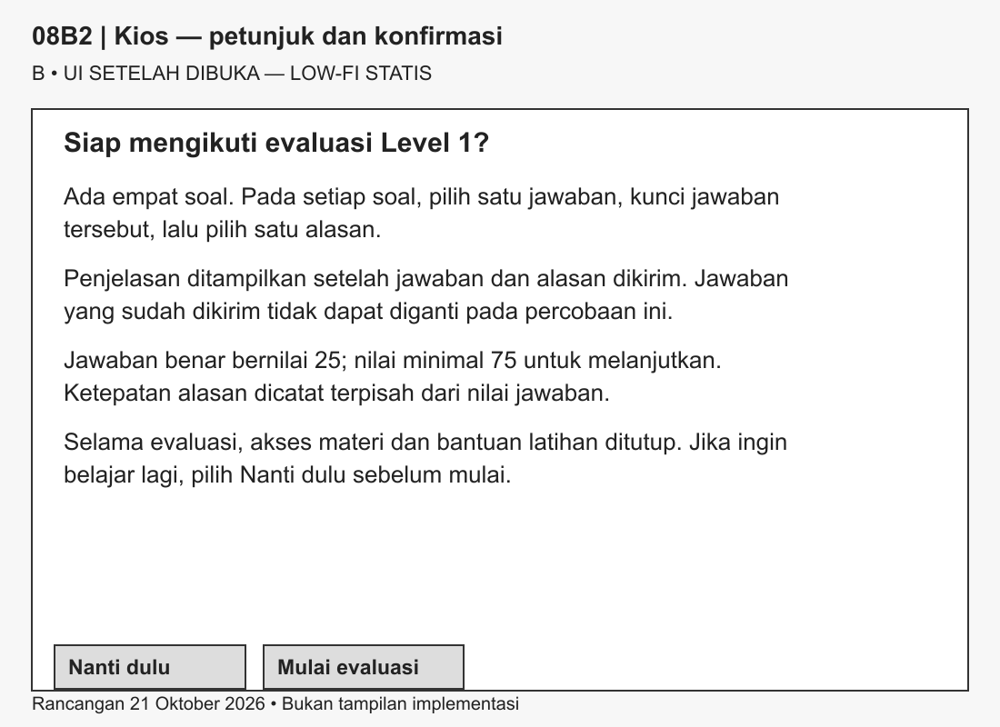

## 09Q1A — Evaluasi 1/4 — pilih jawaban

Berdasarkan narasi audio yang disampaikan, sistem operasi dapat diartikan sebagai …

A. Perangkat keras utama yang berfungsi menjalankan aplikasi

B. Perangkat lunak yang berfungsi mengelola sumber daya komputer

C. Program tambahan yang digunakan untuk mempercepat kinerja komputer

D. Sistem jaringan yang menghubungkan komputer dengan internet

E. Media penyimpanan data yang digunakan oleh pengguna

Perilaku: Soal mengikuti tab Peta tujuan pembelajaran tiga level tanpa perubahan isi. Sebelum memilih, Kunci jawaban belum aktif. Pilihan boleh diganti sebelum dikunci. Setelah dikunci, tampilkan tier 2 tanpa warna benar/salah atau penjelasan. Kunci penelaah: Kunci tier 1: B. Batang, opsi, dan kunci mengikuti baseline Sanubari. Kunci tidak ditampilkan pada UI mahasiswa.

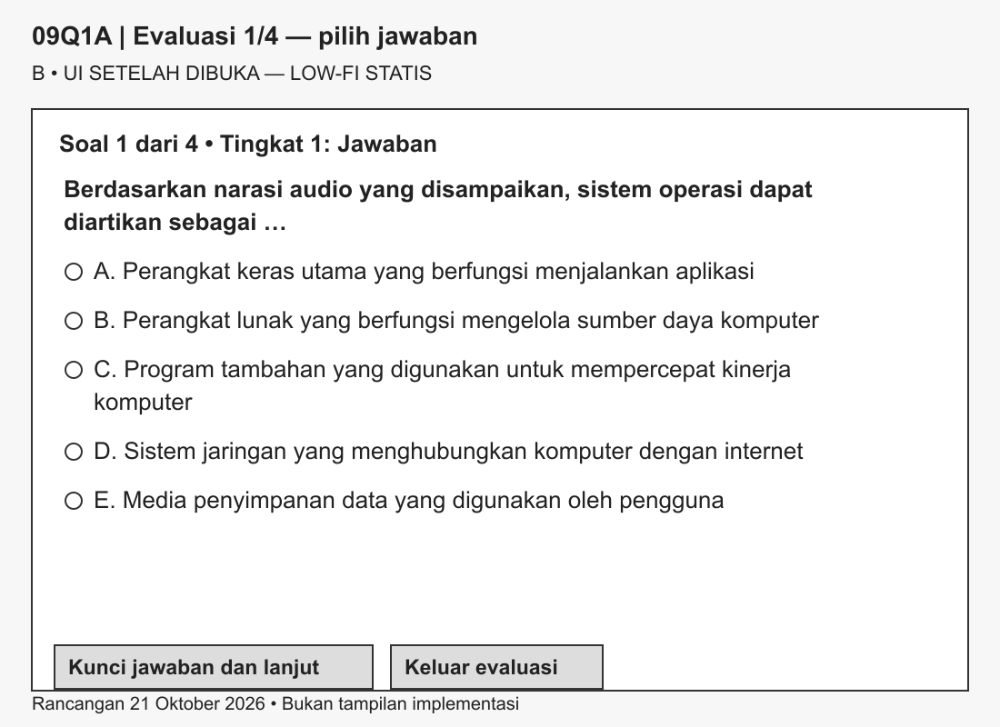

## 09Q1B — Evaluasi 1/4 — pilih alasan

Alasan atau bukti manakah yang paling tepat mendukung jawaban pada tingkat pertama?

A. Narasi menyebut OS sebagai perangkat keras yang menjalankan aplikasi.

B. Narasi menyebut OS sebagai perangkat lunak pengelola sumber daya.

C. Narasi membatasi tugas OS pada pengaturan jaringan dan akses internet.

D. Narasi menyamakan OS dengan perangkat penyimpanan data milik pengguna.

Perilaku: Ringkasan jawaban tier 1 yang dipilih terlihat di kotak atas dengan teks pilihan aktual; jawaban sudah terkunci. Pilihan pada low-fi adalah contoh tampilan, bukan penanda kunci bagi pemain. Kirim jawaban aktif setelah satu alasan dipilih. Tidak memberi petunjuk benar/salah sebelum dikirim. Kunci penelaah: Kunci tier 2: B. Bukti penjelas: Narasi menyebut pengelolaan prosesor, memori, penyimpanan, dan I/O oleh perangkat lunak. Setelah Kirim, kedua jawaban tidak dapat diganti dan feedback sesuai pilihan tampil.

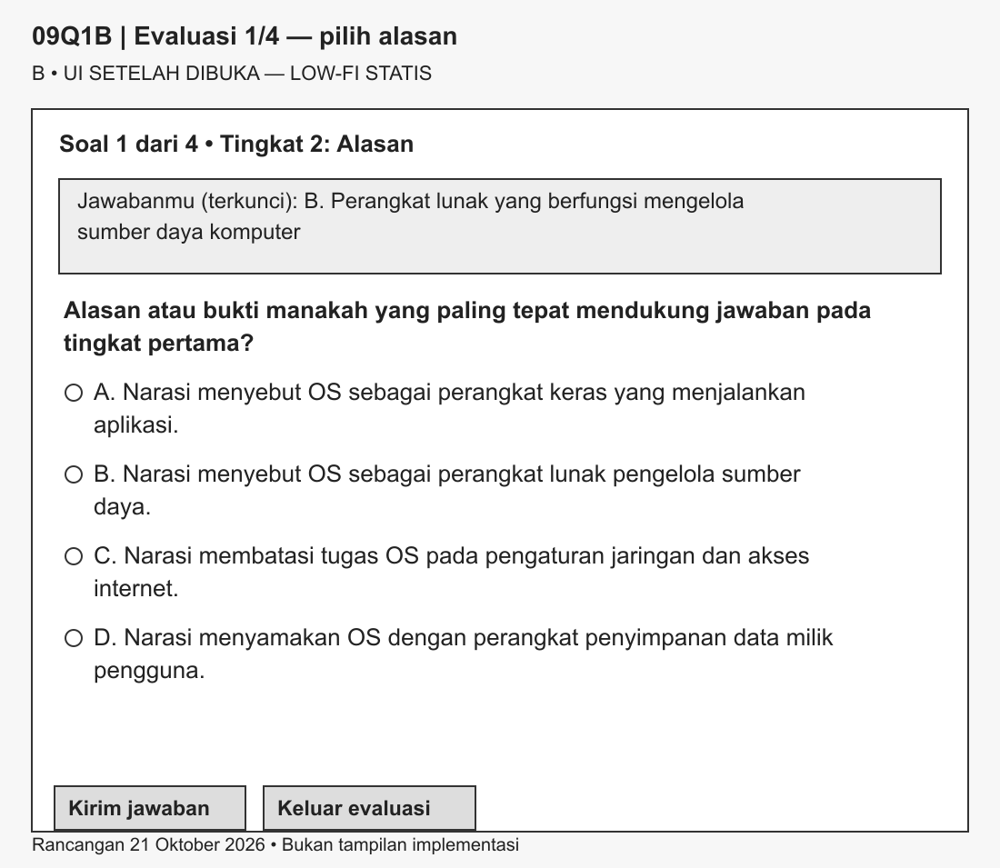

## 09Q2A — Evaluasi 2/4 — pilih jawaban

Salah satu peran utama sistem operasi menurut narasi audio adalah …

A. Menggantikan fungsi perangkat keras komputer

B. Menyimpan seluruh data pengguna secara permanen

C. Menjadi penghubung antara pengguna dan aplikasi

D. Mengendalikan jaringan internet secara langsung

E. Menjalankan aplikasi tanpa bantuan perangkat keras

Perilaku: Soal mengikuti tab Peta tujuan pembelajaran tiga level tanpa perubahan isi. Sebelum memilih, Kunci jawaban belum aktif. Pilihan boleh diganti sebelum dikunci. Setelah dikunci, tampilkan tier 2 tanpa warna benar/salah atau penjelasan. Kunci penelaah: Kunci tier 1: C. Batang, opsi, dan kunci mengikuti baseline Sanubari. Kunci tidak ditampilkan pada UI mahasiswa.

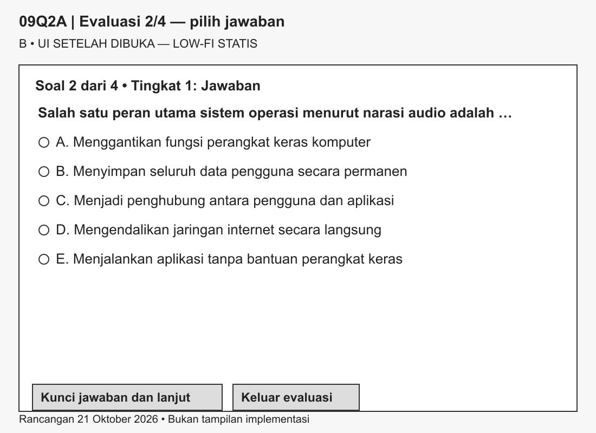

## 09Q2B — Evaluasi 2/4 — pilih alasan

Alasan atau bukti manakah yang paling tepat mendukung jawaban pada tingkat pertama?

A. Narasi menyebut OS sebagai penghubung antara pengguna dan aplikasi.

B. Narasi menyebut OS sebagai pengganti seluruh perangkat keras komputer.

C. Narasi menyebut OS sebagai tempat penyimpanan permanen seluruh data.

D. Narasi menyebut OS sebagai pengelola layanan internet pada komputer.

Perilaku: Ringkasan jawaban tier 1 yang dipilih terlihat di kotak atas dengan teks pilihan aktual; jawaban sudah terkunci. Pilihan pada low-fi adalah contoh tampilan, bukan penanda kunci bagi pemain. Kirim jawaban aktif setelah satu alasan dipilih. Tidak memberi petunjuk benar/salah sebelum dikirim. Kunci penelaah: Kunci tier 2: A. Bukti penjelas: Narasi menyatakan OS menghubungkan pengguna dan aplikasi. Setelah Kirim, kedua jawaban tidak dapat diganti dan feedback sesuai pilihan tampil.

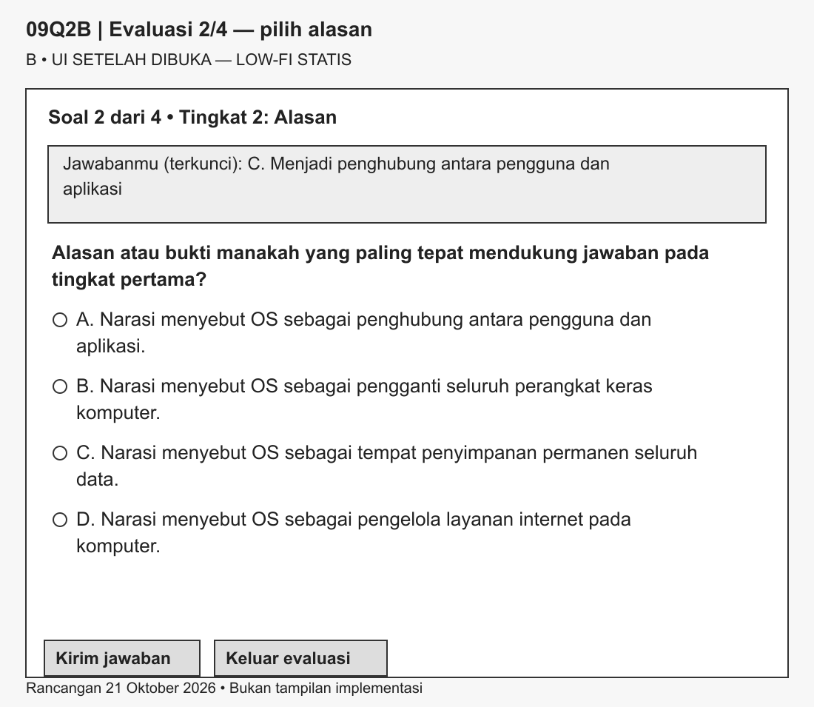

## 09Q3A — Evaluasi 3/4 — pilih jawaban

Implementasi nyata dari pemahaman fungsi sistem operasi dalam mengelola sumber daya komputer secara optimal adalah...

A. Mendesain ulang perangkat keras komputer agar seluruh aplikasi berjalan tanpa sistem operasi

B. Mengatur alokasi prosesor dan memori agar aplikasi dan sistem dapat bekerja secara terpadu

C. Menghubungkan komputer ke jaringan internet agar semua perangkat lunak dapat diperbarui secara otomatis

D. Menambahkan perangkat penyimpanan eksternal untuk memperbesar kapasitas data pengguna

E. Menginstal sebanyak mungkin aplikasi agar kinerja komputer meningkat secara maksimal

Perilaku: Soal mengikuti tab Peta tujuan pembelajaran tiga level tanpa perubahan isi. Sebelum memilih, Kunci jawaban belum aktif. Pilihan boleh diganti sebelum dikunci. Setelah dikunci, tampilkan tier 2 tanpa warna benar/salah atau penjelasan. Kunci penelaah: Kunci tier 1: B. Batang, opsi, dan kunci mengikuti baseline Sanubari. Kunci tidak ditampilkan pada UI mahasiswa.

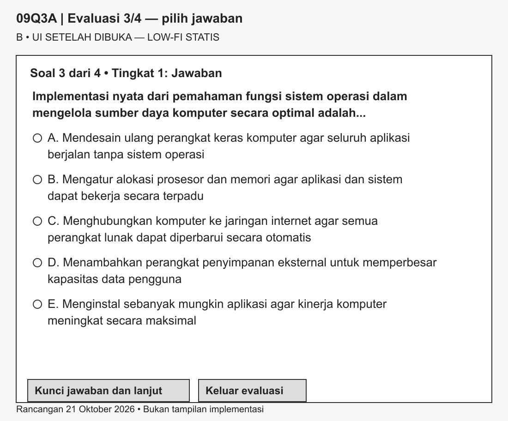

## 09Q3B — Evaluasi 3/4 — pilih alasan

Alasan atau bukti manakah yang paling tepat mendukung jawaban pada tingkat pertama?

A. Audio mengaitkan penambahan jumlah aplikasi dengan peningkatan kinerja komputer.

B. Audio mengaitkan pemasangan perangkat tambahan dengan percepatan seluruh aplikasi.

C. Audio mengaitkan pengelolaan sumber daya dengan kerja terpadu aplikasi dan sistem.

D. Audio mengaitkan penggunaan internet dengan penggantian fungsi pengelolaan memori komputer.

Perilaku: Ringkasan jawaban tier 1 yang dipilih terlihat di kotak atas dengan teks pilihan aktual; jawaban sudah terkunci. Pilihan pada low-fi adalah contoh tampilan, bukan penanda kunci bagi pemain. Kirim jawaban aktif setelah satu alasan dipilih. Tidak memberi petunjuk benar/salah sebelum dikirim. Kunci penelaah: Kunci tier 2: C. Bukti penjelas: Audio mengaitkan pengelolaan sumber daya dengan kerja terpadu aplikasi dan sistem. Setelah Kirim, kedua jawaban tidak dapat diganti dan feedback sesuai pilihan tampil.

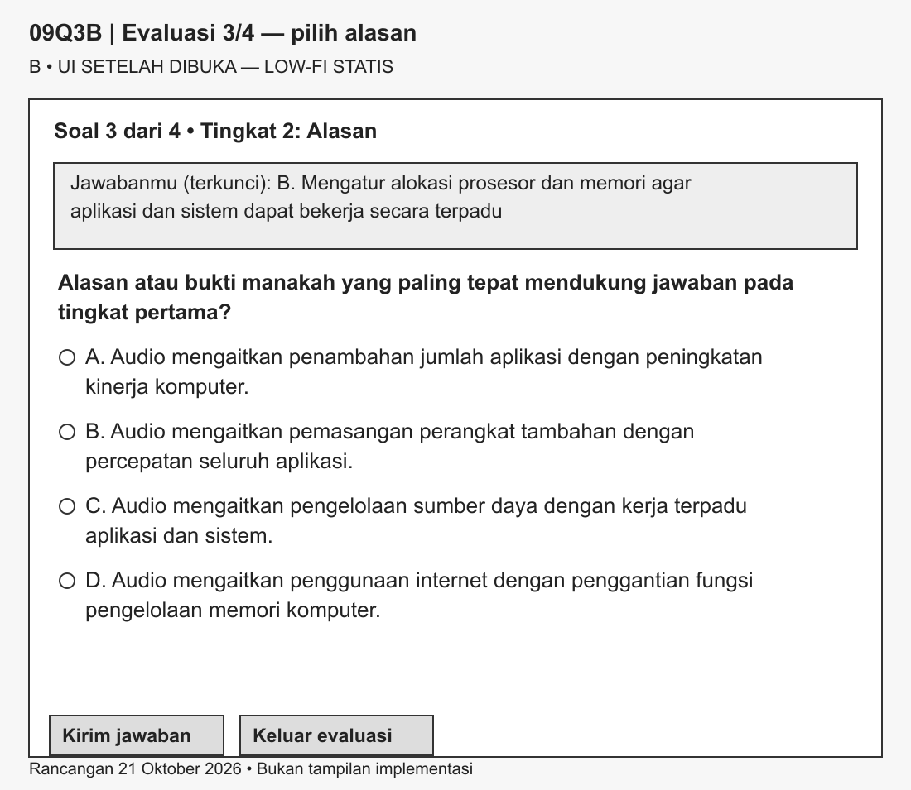

## 09Q4A — Evaluasi 4/4 — pilih jawaban

Dalam narasi audio disebutkan bahwa sistem operasi berperan sebagai penghubung antara pengguna dan aplikasi. Apa yang akan terjadi pada sebuah sistem komputer apabila sistem operasi tidak mampu menjalankan peran tersebut dengan baik! …

A. Aplikasi akan berjalan lebih cepat karena tidak ada perantara

B. Pengguna dapat langsung mengakses perangkat keras tanpa hambatan

C. Perangkat keras akan meningkatkan kinerjanya secara mandiri

D. Sistem operasi akan digantikan secara otomatis oleh aplikasi lain

E. Aplikasi tidak dapat berjalan dengan baik karena komunikasi antara pengguna dan perangkat terganggu

Perilaku: Soal mengikuti tab Peta tujuan pembelajaran tiga level tanpa perubahan isi. Sebelum memilih, Kunci jawaban belum aktif. Pilihan boleh diganti sebelum dikunci. Setelah dikunci, tampilkan tier 2 tanpa warna benar/salah atau penjelasan. Kunci penelaah: Kunci tier 1: E. Batang, opsi, dan kunci mengikuti baseline Sanubari. Kunci tidak ditampilkan pada UI mahasiswa.

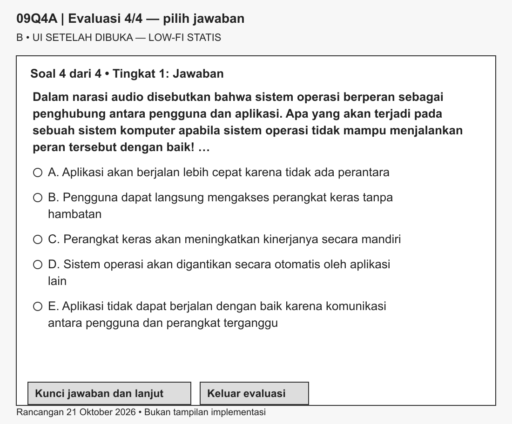

## 09Q4B — Evaluasi 4/4 — pilih alasan

Alasan atau bukti manakah yang paling tepat mendukung jawaban pada tingkat pertama?

A. Audio menyebut aplikasi mengambil alih seluruh tugas OS secara otomatis.

B. Audio menyebut perangkat keras menambah kemampuannya sendiri saat OS terganggu.

C. Audio menyebut kegagalan penghubung membuat aplikasi berjalan semakin cepat.

D. Audio menyebut gangguan peran OS menghambat aplikasi berjalan dengan baik.

Perilaku: Ringkasan jawaban tier 1 yang dipilih terlihat di kotak atas dengan teks pilihan aktual; jawaban sudah terkunci. Pilihan pada low-fi adalah contoh tampilan, bukan penanda kunci bagi pemain. Kirim jawaban aktif setelah satu alasan dipilih. Tidak memberi petunjuk benar/salah sebelum dikirim. Kunci penelaah: Kunci tier 2: D. Bukti penjelas: Audio menghubungkan kegagalan peran OS dengan aplikasi yang tidak berjalan baik. Setelah Kirim, kedua jawaban tidak dapat diganti dan feedback sesuai pilihan tampil.

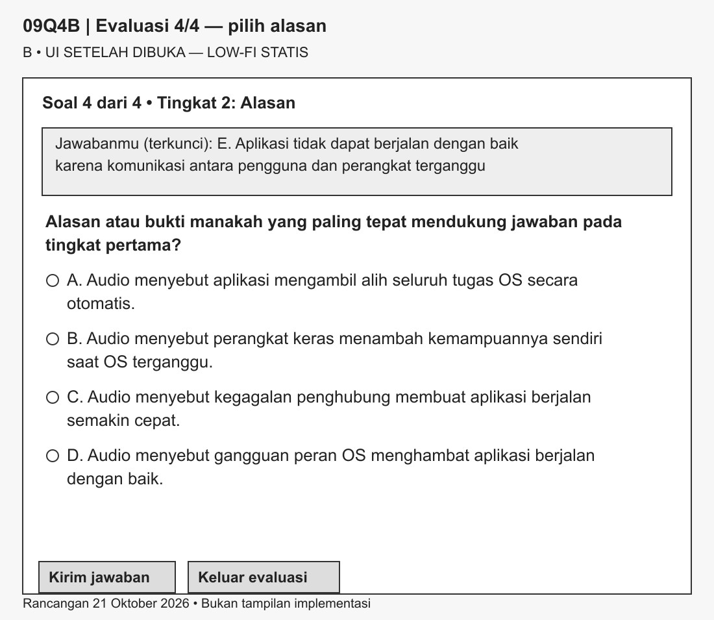

## 10B5 — Evaluasi — konfirmasi keluar

Keluar dari evaluasi?

Percobaan ini belum selesai. Jika keluar, jawaban pada percobaan ini dibatalkan dan belum ada nilai akhir.

Progres materi dan latihan tetap tersimpan selama sesi. Kamu dapat belajar kembali lalu memulai evaluasi baru dari kios.

Perilaku: Muncul setelah Keluar evaluasi dipilih pada tier 1/2. Tetap mengerjakan kembali ke soal yang sama dengan pilihan tetap. Ya, keluar menutup evaluasi dan mengarahkan ke pilihan belajar; bukan hasil gagal bernilai nol. Ini usulan perilaku keluar yang perlu diselaraskan dengan SOP eksperimen.

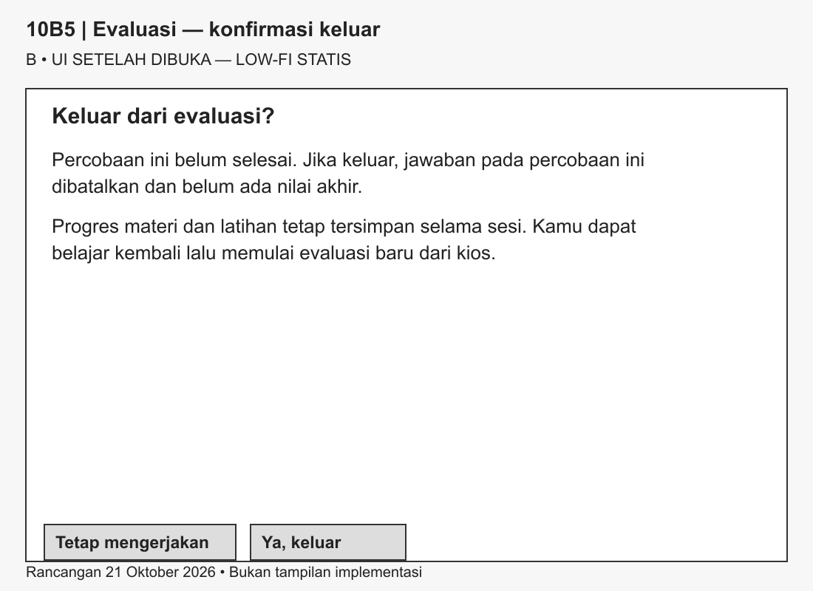

## 10B1 — Umpan balik — jawaban dan alasan tepat

Jawaban tepat • Alasan tepat

Contoh soal 1 • Pilihan jawaban B • Pilihan alasan B

Benar. OS adalah perangkat lunak yang mengelola sumber daya komputer.

Alasan B tepat: narasi merinci sumber daya yang dikelola perangkat lunak.

Bukti audio: narasi menyebut pengelolaan prosesor, memori, penyimpanan, dan input/output oleh perangkat lunak.

Nilai jawaban soal ini: 25 dari 25. Ketepatan alasan dicatat terpisah.

Perilaku: Contoh UI, bukan data peserta. Pesan dirakit dari pilihan yang benar-benar dikirim pada tiap soal; gunakan 36 pesan khusus Level 1 pada sumber. Feedback tampil setelah kedua tier dikirim. Tidak otomatis berganti soal. Tombol Soal berikutnya pada soal 1–3; pada soal 4 menjadi Lihat hasil.

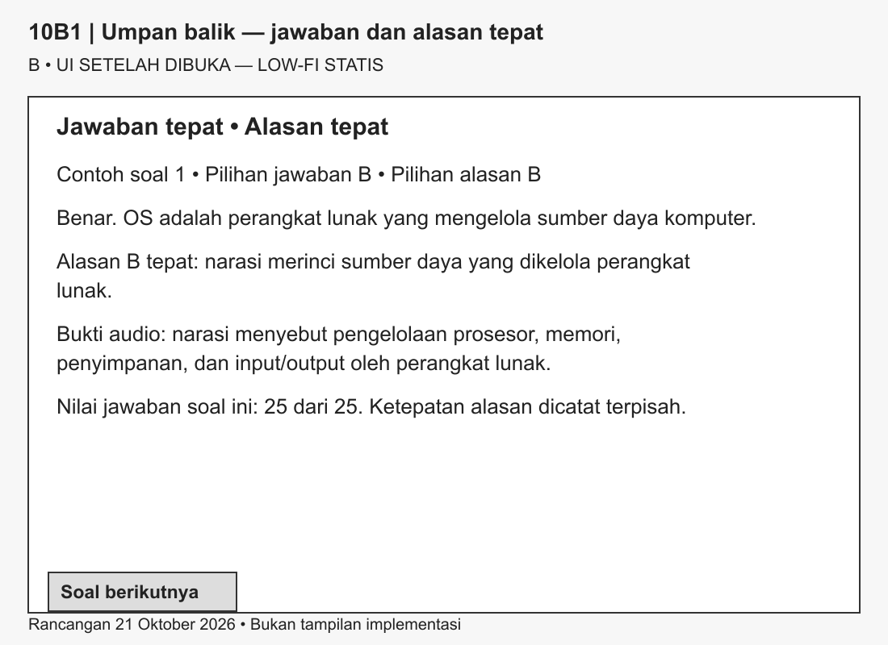

## 10B2 — Umpan balik — jawaban salah, alasan tepat

Jawaban belum tepat • Alasan tepat

Contoh soal 1 • Pilihan jawaban A • Pilihan alasan B

OS disebut perangkat lunak, bukan perangkat keras utama.

Alasan B tepat: narasi merinci sumber daya yang dikelola perangkat lunak.

Bukti audio: narasi menyebut pengelolaan prosesor, memori, penyimpanan, dan input/output oleh perangkat lunak.

Nilai jawaban soal ini: 0 dari 25. Ketepatan alasan dicatat terpisah.

Perilaku: Contoh UI, bukan data peserta. Pesan dirakit dari pilihan yang benar-benar dikirim pada tiap soal; gunakan 36 pesan khusus Level 1 pada sumber. Feedback tampil setelah kedua tier dikirim. Tidak otomatis berganti soal. Tombol Soal berikutnya pada soal 1–3; pada soal 4 menjadi Lihat hasil.

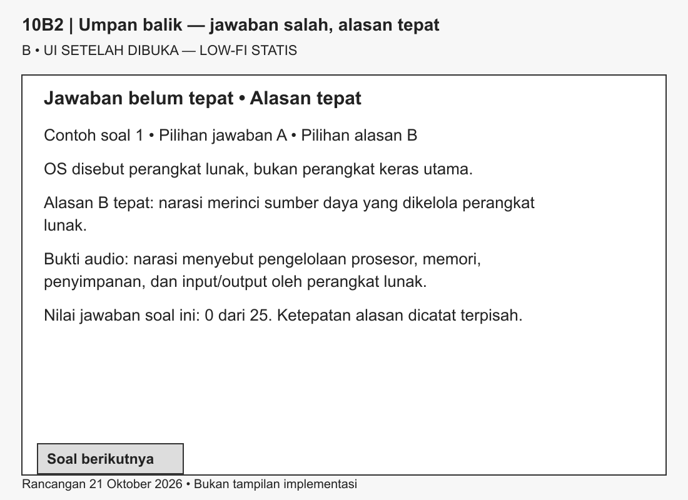

## 10B3 — Umpan balik — jawaban tepat, alasan salah

Jawaban tepat • Alasan belum tepat

Contoh soal 1 • Pilihan jawaban B • Pilihan alasan A

Benar. OS adalah perangkat lunak yang mengelola sumber daya komputer.

Alasan A mengubah OS menjadi perangkat keras; narasi menyebut perangkat lunak.

Bukti audio: narasi menyebut pengelolaan prosesor, memori, penyimpanan, dan input/output oleh perangkat lunak.

Nilai jawaban soal ini: 25 dari 25. Ketepatan alasan dicatat terpisah.

Perilaku: Contoh UI, bukan data peserta. Pesan dirakit dari pilihan yang benar-benar dikirim pada tiap soal; gunakan 36 pesan khusus Level 1 pada sumber. Feedback tampil setelah kedua tier dikirim. Tidak otomatis berganti soal. Tombol Soal berikutnya pada soal 1–3; pada soal 4 menjadi Lihat hasil.

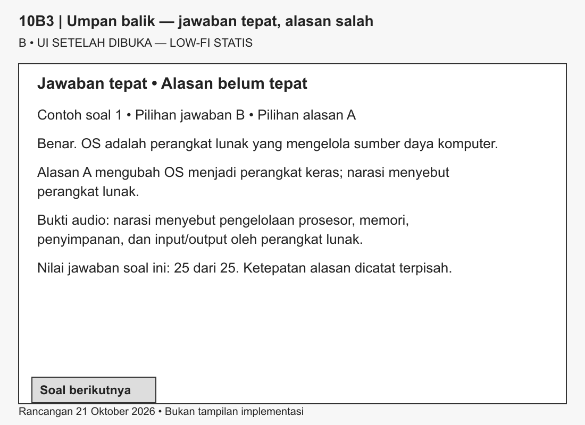

## 10B4 — Umpan balik — keduanya belum tepat

Jawaban belum tepat • Alasan belum tepat

Contoh soal 1 • Pilihan jawaban A • Pilihan alasan A

OS disebut perangkat lunak, bukan perangkat keras utama.

Alasan A mengubah OS menjadi perangkat keras; narasi menyebut perangkat lunak.

Bukti audio: narasi menyebut pengelolaan prosesor, memori, penyimpanan, dan input/output oleh perangkat lunak.

Nilai jawaban soal ini: 0 dari 25. Ketepatan alasan dicatat terpisah.

Perilaku: Contoh UI, bukan data peserta. Pesan dirakit dari pilihan yang benar-benar dikirim pada tiap soal; gunakan 36 pesan khusus Level 1 pada sumber. Feedback tampil setelah kedua tier dikirim. Tidak otomatis berganti soal. Tombol Soal berikutnya pada soal 1–3; pada soal 4 menjadi Lihat hasil.

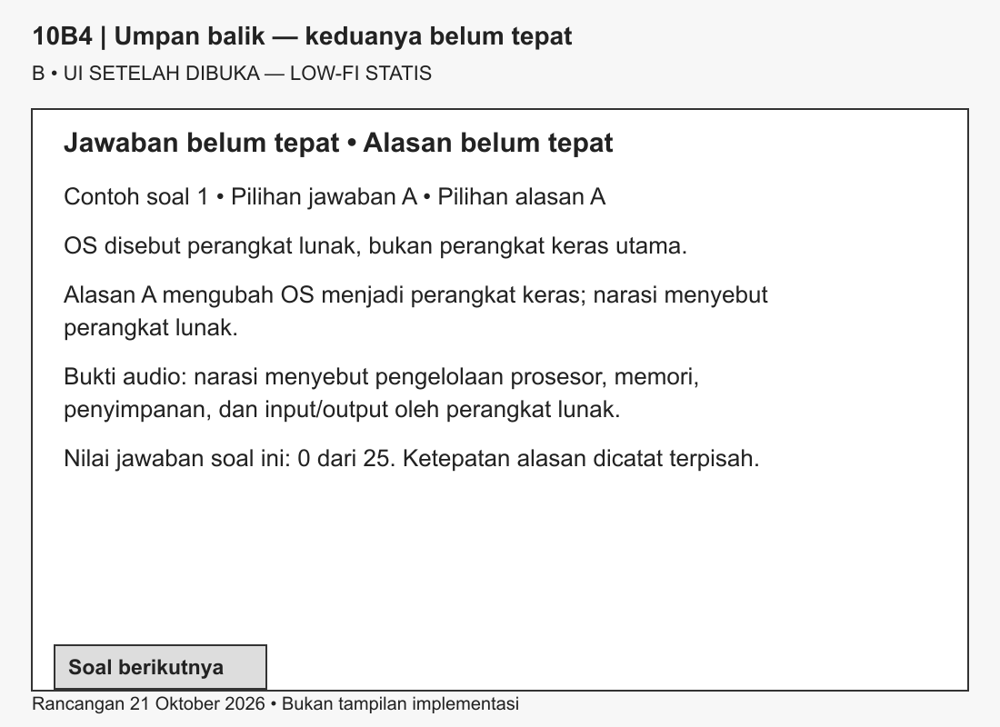

## 11B1 — Hasil Level 1 — lulus

Level 1 selesai

Nilai jawaban: 75 / 100

Jawaban tepat: 3 dari 4 • Alasan tepat: 2 dari 4

Kamu memenuhi nilai minimal 75 untuk melanjutkan.

Selanjutnya, berjalanlah ke gedung Level 2 di sisi kiri dari arah masuk kampus. Ikuti penunjuk menuju pintunya.

Perilaku: Angka merupakan contoh tampilan. Nilai jawaban = jumlah tier 1 tepat ×25; alasan dihitung terpisah 0–4 dan tidak membatalkan kelulusan tier 1. Lanjut ke Level 2 menutup panel, membuka akses belajar Level 2, dan mengaktifkan penunjuk rute. Tidak teleportasi.

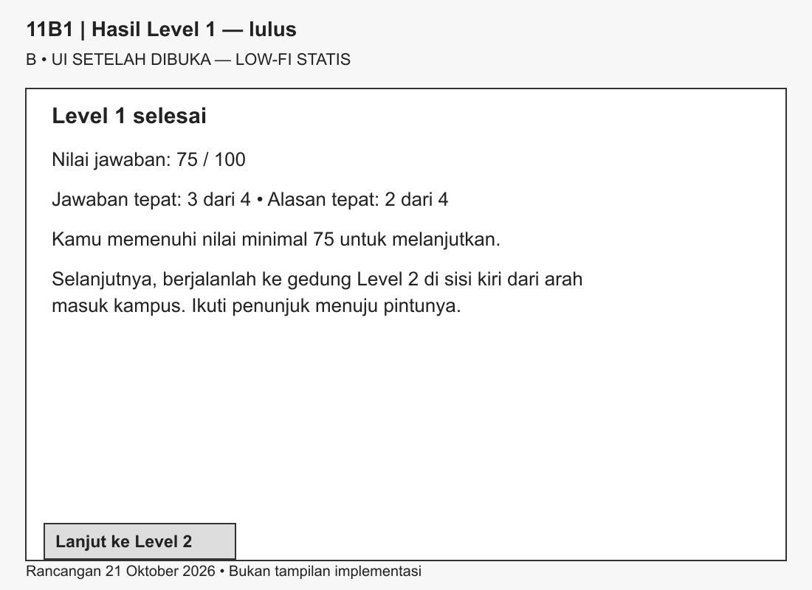

## 11B2 — Hasil Level 1 — belum lulus

Level 1 belum tuntas

Nilai jawaban: 50 / 100

Jawaban tepat: 2 dari 4 • Alasan tepat: 3 dari 4

Nilai minimal untuk melanjutkan adalah 75.

Pelajari kembali bagian yang belum kamu pahami, lalu kembali ke kios untuk mencoba evaluasi lagi.

Perilaku: Angka hanya ilustrasi. Belajar kembali menutup panel dan membuka pilihan lokasi audio/latihan, sehingga pemain tidak terjebak modal. Status belajar tetap, akses Level 2 belum dibuka. Kembali ke kios memungkinkan percobaan baru setelah memilih siap; tidak mewajibkan memutar semua audio dari awal. Batas waktu/jumlah percobaan serta skor percobaan yang dipakai penelitian perlu ditetapkan dalam SOP; bukan diputuskan oleh low-fi.

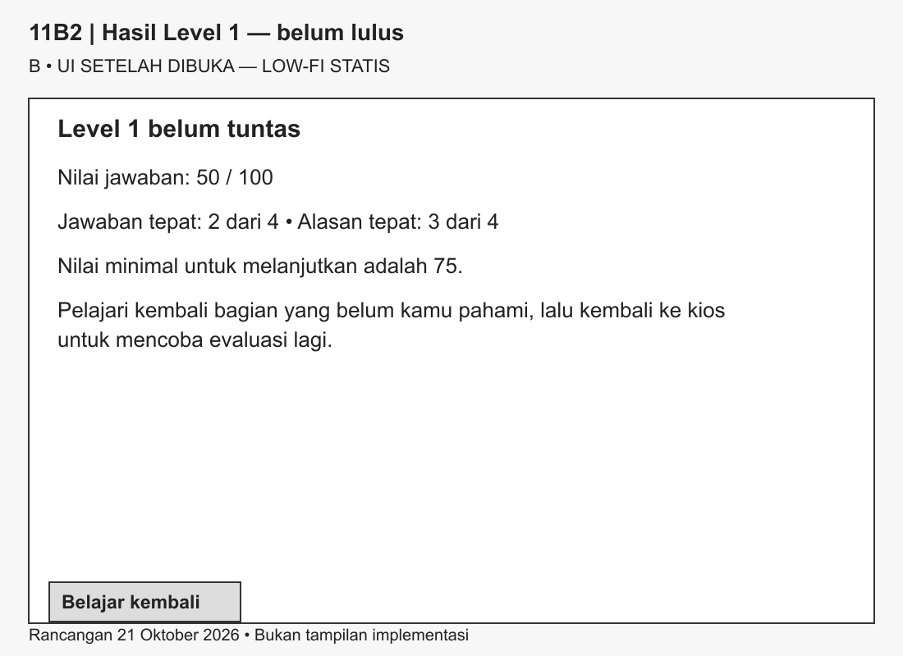

## 12A — Keluar Level 1 — menuju gedung Level 2

Tujuan: Masuk ke gedung Level 2.

LEVEL 2 — MEMBACA BERITA

Ikuti penunjuk menuju pintu masuk gedung.

Perilaku: Setelah Lanjut ke Level 2, pemain melihat lingkungan lagi dan berjalan dari area air mancur menuju gedung kiri. Penunjuk mengarah ke pintu, lalu tujuan berikutnya adalah orientasi di dalam Level 2. Paket ini berhenti di ambang gedung; rincian interaksi Level 2 dibuat pada tahap berikutnya.

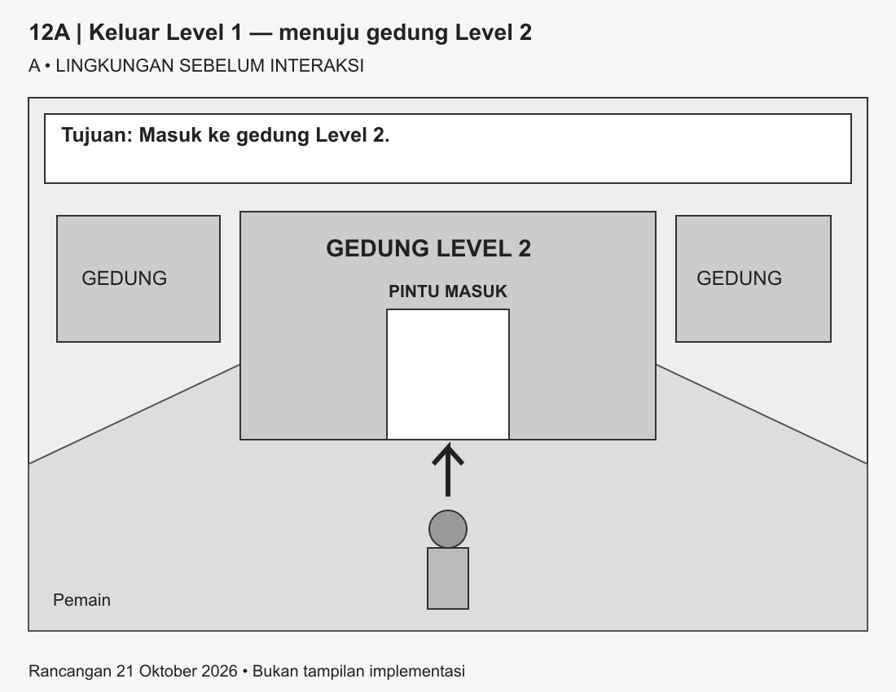
