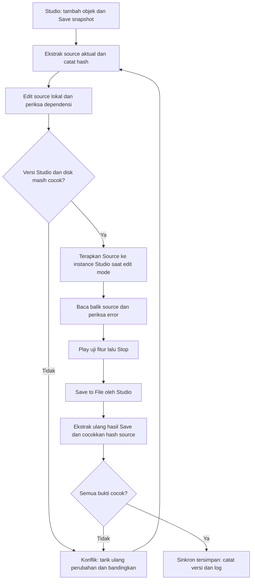

# Skema kerja lokal dan Roblox Studio

Tanggal: 28 Oktober 2026. Status terbaru: bridge v1 sudah dibuat, dipasang dan diuji di Studio untuk script terdaftar dan HoldDuration prompt. Protokol lengkap di bawah tetap rancangan acuan; semua fitur protokol belum diotomatisasi. Panduan aktual: [studio-sync/README.md](../../studio-sync/README.md). WORKING disimpan oleh Studio, bukan server bridge.

## Pembagian kerja

| Bagian | Pemilik perubahan | Cara masuk ke hasil akhir |
| --- | --- | --- |
| Map, posisi, ukuran, Terrain, objek/aset baru | Pengguna di Studio | Studio Save to File ke WORKING |
| Source script yang terdaftar | File lokal yang diekstrak dari snapshot terbaru; AI mengedit | Penghubung menerapkan Source ke instance existing di Studio; Studio menyimpan |
| UI/desain yang dibuat melalui kode | AI menyiapkan source atau operasi edit yang terbatas dan dapat diulang | Penghubung membuat/mengubah hanya path yang disepakati; pratinjau dan uji di Studio |
| Materi, kunci, skor, tujuan | Keputusan penelitian existing | Tetap sesuai storyboard/bank isi; perubahan substansi mengikuti permintaan pengguna |
| WORKING.rbxl | Studio sebagai penulis saat sesi tersambung | Dibaca lokal untuk audit/verifikasi setelah Save; tidak ditimpa penulis kedua |

Default.project.json, src/, src copy/, migration-v2/ tidak otomatis menjadi source aktif. Source baru harus berasal dari WORKING terbaru dan dibandingkan dengan buffer editor yang sedang terbuka. Satu script hanya mempunyai satu penulis selama transaksi. Pengguna tetap dapat menambah objek lain, tetapi perubahan pada dependensi transaksi menghentikan transaksi itu.

## Dua jalur yang tidak boleh berjalan bersamaan

**Jalur harian yang dituju: kode lokal → penghubung → Studio → Save to File.** Penghubung memperbarui instance pada sesi Studio, bukan menimpa biner yang sedang terbuka. Penulis file tetap Studio, sehingga objek yang baru ditambahkan pengguna ikut tersimpan. Otomatis berarti perubahan source yang lolos pemeriksaan dapat diterapkan saat edit mode, bukan kedua sisi saling menimpa bebas. Tidak melakukan patch saat Play/Run aktif.

**Jalur kandidat biner yang tersedia sekarang: snapshot tersimpan → patch lokal → file kandidat baru → buka/uji di Studio.** Ini jalur offline. Sebelum mengambil snapshot, selesaikan Save objek baru. Jangan menimpa file yang sedang terbuka, jangan Save dari tab versi lama ke hasil kandidat. Seluruh output patch tetap kandidat sampai lulus pembukaan dan Play. Penetapan kandidat sebagai WORKING dilakukan saat sesi penulis lama sudah ditutup dan file terbaru sudah dicadangkan. Kandidat yang gagal tidak dipromosikan.

Patch biner tidak membuat sesi Studio di memori berubah otomatis. Ekstraksi dari disk tidak bisa melihat objek atau perubahan editor yang belum disimpan. Schema/manifest sendiri tidak mencegah pengguna menekan Save pada tab lama; penghubung dan disiplin satu penulis tetap diperlukan.

## Siklus transaksi yang dituju

UI ini skema alur, bukan screenshot implementasi. Tahap cek dependensi tidak mengeksekusi script game pada komputer host.

## Pemeriksaan konflik

Untuk setiap target, simpan tiga nilai: B = source snapshot dasar, L = source lokal terbaru, S = source editor Studio terbaru. Bandingkan byte UTF-8 dengan aturan newline yang konsisten.

| Keadaan | Keputusan |
| --- | --- |
| S = B, L berbeda | Terapkan L ke Studio setelah validasi |
| L = B, S berbeda | Impor S ke source lokal; jangan timpa |
| S = L | Sudah sama; tidak perlu mutasi |
| S dan L berbeda satu sama lain serta keduanya berubah dari B | Konflik; simpan kedua versi dan hentikan target |

Hash file snapshot turut diperiksa. File disk berubah di tengah patch berarti basis sudah kedaluwarsa; buat snapshot baru. Pada jalur live, perubahan objek Studio setelah snapshot harus dipertahankan dan diinventaris ulang bila menjadi dependensi source. Path berupa array nama anak, bukan string bertitik; setiap segmen harus tepat satu instance. ClassName, identitas instance sesi, dan hash Source juga harus sesuai. Indeks kelas dari ekstraktor hanya sah untuk file dengan hash yang sama; bukan ID lintas Save.

Penghubung harus membaca source editor, bukan hanya properti Source lama. Untuk script terbuka, gunakan ScriptEditorService:GetEditorSource dan UpdateSourceAsync dengan callback yang memeriksa source dasar lagi. Kalau source berubah antara preflight dan apply, callback membatalkan perubahan. Pembaruan beberapa script tidak boleh dianggap atomik secara otomatis; simpan source sebelum transaksi, hentikan pada kegagalan, dan tandai partial/conflict. Rollback hanya mengembalikan source yang masih sama dengan versi yang baru dipasang penghubung, agar edit pengguna yang lebih baru tidak terhapus.

## Kontrak objek dan UI

- Daftar path, ClassName dan referensi wajib harus lolos sebelum source dipasang. Contoh Level1Handler: Level1Gui, papanInfoFrame, latihanFrame, nama tombol dan atribut; tidak menganggap WaitForChild tanpa batas waktu sebagai validasi.
- Perubahan source tidak dapat dengan sendirinya menciptakan objek permanen dalam edit mode. Script runtime dapat membuat UI di PlayerGui saat Play; itu tidak membuktikan UI edit mode tersimpan.
- Jika perlu UI edit mode, gunakan operasi create/update idempoten pada root pengembangan yang disepakati. Pratinjau mencantumkan path/properti. Jangan menghapus lalu membangun ulang GUI existing atau seluruh Workspace.
- Penambahan instance baru memerlukan pembaruan nama/path, dependensi dan manifest. Rename/reparent harus diperiksa; tidak menebak pengganti berdasarkan nama mirip.
- Isi/kunci/skor mengikuti storyboard. Kecocokan struktur file tidak membuktikan kebenaran pedagogis atau gameplay.

## Save dan bukti keberhasilan

Status bertahap: draft → prepared → applied → tested → saved_verified. Jalur kandidat: draft → candidate_verified → tested → saved_verified. Setiap kegagalan masuk conflict/failed, bukan tetap berlabel sinkron.

1. Prepared: snapshot aktual dan backup byte-identik tersedia, daftar perubahan jelas, identitas/dependensi/lint lolos. Lint Luau belum tersedia sesi ini; harus ditandai belum, tidak diganti klaim parser RBXL sebagai compiler Luau.
2. Applied: source dibaca balik dari editor Studio dan cocok; ini belum bukti Save/Play.
3. Candidate_verified: tepat Source yang diminta berubah, header dan chunk non-target identik, script lain identik; ini belum bukti engine menerima file.
4. Tested: kandidat/sesi yang tepat dapat dibuka, Play berjalan, fitur terdampak dan regresi dasar diperiksa; simpan Output dan hasil aktual. Uji no-op pertama perlu dilakukan sebelum menerapkan perbaikan besar. Ini mengisolasi masalah format dari perubahan logika.
5. Saved_verified: Stop, Save to File, tunggu file stabil lalu ekstrak ulang file tujuan. Cocokkan source target dengan hasil yang diuji dan periksa objek baru pengguna. Jika ada perubahan setelah Play, uji terkait diulang. Terakhir verifikasi hash seluruh file dan catat hasil.

Jika file tidak bisa dibuka atau Play gagal: jangan Save dari kandidat gagal ke WORKING, pertahankan backup dan kandidat untuk diagnosis, lalu kembalikan sumber kerja terakhir yang lolos. Penyebab kegagalan pengguna terdahulu belum diketahui; tidak diasumsikan semuanya karena kompresi atau bug kode.

## Pilihan penghubung

Pilihan yang masuk akal ialah Rojo terbatas pada script yang dipilih atau plugin lokal kecil yang menerapkan kontrak di atas. Rojo sudah dikenal di repo, tetapi konfigurasi migrasi penuh lama tidak boleh langsung dihubungkan ke sesi aktif. Konfigurasi baru harus sempit dan menjaga instance tak dikenal. Pengaman Rojo sendiri tidak otomatis menyediakan seluruh protokol konflik/receipt ini. Terrain dan sejumlah data biner mempunyai keterbatasan live sync, sehingga tidak dimasukkan dalam cakupan sinkron source rutin.

Untuk plugin khusus, layanan lokal hanya di loopback, sesi mempunyai identitas/token sementara, tidak mengeksekusi perintah host dari isi place. Installation/izin koneksi bila diperlukan dilakukan terpisah; sesi ini tidak memasang plugin atau mengubah pengaturan keamanan. Sumber dikirim hanya ke Studio lokal tujuan. Status koneksi harus benar-benar diuji sebelum disebut otomatis aktif.

## Artefak dan status sekarang

Schema mesin: `docs/development/sync-session.schema.json`. Schema mendefinisikan metadata transaksi/evidence; belum ada controller yang menegakkan seluruh aturan semantik atau membaca receipt Studio. Schema valid bukan bukti sinkronisasi.

Sudah tersedia: pembaca/ekstraktor RBXL, patch source kandidat terbatas, bridge plugin+server localhost, source tiga arah terbatas pada script terdaftar, receipt penerapan/readback, pause saat Play melalui StudioTestService.EditModeActive, bootstrap lintas PC CONNECT-STUDIO.cmd dan verifikasi Save terpisah. Uji nyata lokal→editor (komentar sementara dan pemulihan), HoldDuration0→1, Play modal latihan/tutup serta simpan/buka ulang WORKING berhasil. Uji controller konflik memakai fixture, bukan sengaja merusak script pengguna di sesi live. Belum tersedia: compiler/lint Luau, operasi UI generik/create-instance, Save otomatis/receipt Save otomatis, dan pengujian PC kedua. Tidak menjamin bebas error. JSON schema metadata belum menjadi mesin state controller.

Penerapan pertama sudah memakai satu script dan satu properti dengan Save Studio, bukan mempromosikan kandidat biner. Selanjutnya gunakan bridge untuk target terdaftar; perluas daftar bertahap setelah audit dependensi. Kandidat biner tetap jalur terpisah yang belum diuji engine. Pengguna tidak perlu memakai AI Roblox sebagai penulis logika.

## Sumber teknis yang diperiksa

- [Format biner rbx-dom](https://dom.rojo.space/binary.html): framing chunk, kompresi, properti Source; dokumentasi implementor, bukan spesifikasi resmi Roblox.
- [ScriptEditorService Roblox](https://create.roblox.com/docs/reference/engine/classes/ScriptEditorService): GetEditorSource dan UpdateSourceAsync untuk integrasi editor.
- [Detail sinkronisasi Rojo](https://rojo.space/docs/v7/sync-details/): keterbatasan live sync Terrain/data biner.
- [Format project Rojo](https://rojo.space/docs/v7/project-format/): pemetaan terpilih, servePlaceIds dan ignoreUnknownInstances.
